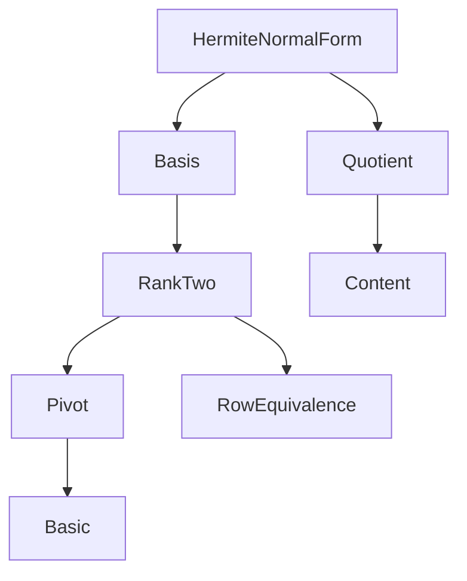

# Project Overview: HermiteNormalForm

Generated: 2026-10-20. **Complete.**


Scope: `XYin/PhD/HermiteNormalForm/` at commit `ff232264c3cb3b455451910cfd24c70ec2c40f68`,
Lean 4.35.0 and mathlib `56a005855ea17e0b0958f73ec801ae140b0a1679`.
The earlier repository-wide report is preserved [here](/Users/dfa25dxu/Projects/Lean/XYin/.mathlib-quality/overview/hnf-2026-10-19/previous-project-overview.md).
This review changes documentation and audit artifacts only; production Lean source is unchanged.

## Executive summary

The folder is a sound foundation for the rank-two integer-lattice arguments used by Cox.
The predicate follows mathlib's echelon conventions, the row transformations are unimodular,
and the basis-change transpose has the correct orientation. The recorded cumulative build passed
all 3,983 jobs, including the HNF tests and `Cox.Theorem11_1.Orders`. All 71 authored
declarations passed a type/axiom audit without `sorryAx`. This is build and logical-dependency
evidence, not a claim of upstream acceptance. The build has module-syntax warnings in HNF and
unrelated existing warnings, including ten existing deferred proofs in `Orders.lean`.

The most useful improvements are structural and mathematical, not line-count reductions.
Thirty-nine declarations concern general echelon, row-equivalence, two-row elimination, coordinates, content or
quotients rather than HNF itself. This is a placement count, including wrappers and existing APIs;
organize the surviving contribution surface in those mathematical areas after the reuse decisions.
Several concrete generalizations have been checked in scratch Lean files.
The main remaining HNF scope gap is arbitrary finite rectangular normalization and uniqueness.
Production existence/uniqueness covers nonsingular `2 × 2` matrices. Checked scratch
extensions now give existence and unique existence for every `2 × 2` integer matrix,
with singular/zero applications and every affected complete caller contract verified.
Triangular normalization remains private under the public multiplier-existence endpoint;
the two uniqueness interfaces share one proof and a private singular-shape certificate.
The determinant-one endpoint also extends to nonnegative determinant, with all three Cox
consumer contracts verified; a local zero-row reflection handles the singular case.

The rank-two reduction overlaps materially with mathlib's `FixedDetMatrices`, but it is not
an identified one-line duplicate: positive/negative determinant conventions and the explicit
multiplier certificate need bridges. A standalone remainder-reduction theorem has a checked
singular extension and reuse that removes repeated arithmetic in the sign-normalizer.
The small predicate-facing lemmas should be
judged by the interface they provide, rather than discarded just because their proofs are short.

## Statistics and verification

| File | Physical lines | Authored declarations | Declaration code lines |
|---|---:|---:|---:|
| [Basic.lean](/Users/dfa25dxu/Projects/Lean/XYin/XYin/PhD/HermiteNormalForm/Basic.lean) | 190 | 15 | 106 |
| [Basis.lean](/Users/dfa25dxu/Projects/Lean/XYin/XYin/PhD/HermiteNormalForm/Basis.lean) | 82 | 3 | 39 |
| [Content.lean](/Users/dfa25dxu/Projects/Lean/XYin/XYin/PhD/HermiteNormalForm/Content.lean) | 115 | 15 | 72 |
| [HermiteNormalForm.lean](/Users/dfa25dxu/Projects/Lean/XYin/XYin/PhD/HermiteNormalForm/HermiteNormalForm.lean) | 26 | 0 | 0 |
| [Pivot.lean](/Users/dfa25dxu/Projects/Lean/XYin/XYin/PhD/HermiteNormalForm/Pivot.lean) | 125 | 11 | 62 |
| [Quotient.lean](/Users/dfa25dxu/Projects/Lean/XYin/XYin/PhD/HermiteNormalForm/Quotient.lean) | 85 | 4 | 39 |
| [RankTwo.lean](/Users/dfa25dxu/Projects/Lean/XYin/XYin/PhD/HermiteNormalForm/RankTwo.lean) | 222 | 10 | 172 |
| [RowEquivalence.lean](/Users/dfa25dxu/Projects/Lean/XYin/XYin/PhD/HermiteNormalForm/RowEquivalence.lean) | 117 | 13 | 54 |
| **Total** | **962** | **71** | **544** |

The declarations comprise 68 theorems, one predicate structure, one content definition and
one decidability instance. Code-line counts exclude comments, blank lines, attributes,
imports and section variables; generated structure projections are not counted twice.
Only the rank-two uniqueness proof exceeds 30 body lines (36).

- [Baseline and version receipt](/Users/dfa25dxu/Projects/Lean/XYin/.mathlib-quality/overview/hnf-2026-10-19/baseline.json)
- [Cumulative build log](/Users/dfa25dxu/Projects/Lean/XYin/.mathlib-quality/overview/hnf-2026-10-19/evidence/build.log)
- [All declaration types and axioms](/Users/dfa25dxu/Projects/Lean/XYin/.mathlib-quality/overview/hnf-2026-10-19/evidence/types-and-axioms.log)
- [Reusable compiled caller index](/Users/dfa25dxu/Projects/Lean/XYin/.mathlib-quality/overview/hnf-2026-10-19/evidence/compiled-callers.json)
  (direct references only; the broad scan includes named tests, classified by source and
  deduplicated against retained test copies)
- [Inventory completeness check: 71/71, no missing fields](/Users/dfa25dxu/Projects/Lean/XYin/.mathlib-quality/overview/hnf-2026-10-19/evidence/inventory-validation.json)
- [Mathematical argument check for all eight longer original proofs](/Users/dfa25dxu/Projects/Lean/XYin/.mathlib-quality/overview/hnf-2026-10-19/evidence/inventory-mathematical-argument-check.json)
- [Infrastructure placement grouping: 39 declarations](/Users/dfa25dxu/Projects/Lean/XYin/.mathlib-quality/overview/hnf-2026-10-19/evidence/infrastructure-placement.json)
- [Independent receipt audit of the first eight assessments](/Users/dfa25dxu/Projects/Lean/XYin/.mathlib-quality/overview/hnf-2026-10-19/evidence/receipt-audit-first8.md)
  (103 local links checked; two reference defects corrected; no remaining defect in that snapshot)
- [Independent receipt audit of assessments nine through eleven](/Users/dfa25dxu/Projects/Lean/XYin/.mathlib-quality/overview/hnf-2026-10-19/evidence/receipt-audit-9-11.md)
  (proofs, weakenings and callers supported; runner provenance supplemented after snapshot)
- [Independent receipt audit of assessments fourteen and fifteen](/Users/dfa25dxu/Projects/Lean/XYin/.mathlib-quality/overview/hnf-2026-10-19/evidence/receipt-audit-14-15.md)
  (proofs, applications, simp consumers and shared caller index checked; one query receipt repaired)
- [Independent receipt audit of assessments sixteen through eighteen](/Users/dfa25dxu/Projects/Lean/XYin/.mathlib-quality/overview/hnf-2026-10-19/evidence/receipt-audit-16-18.md)
  (generic proofs, rank weakening and examples, callers, hashes and upstream version scope checked)
- [Independent receipt audit of assessments nineteen and twenty](/Users/dfa25dxu/Projects/Lean/XYin/.mathlib-quality/overview/hnf-2026-10-19/evidence/receipt-audit-19-20.md)
  (compiled routes, callers, source/result hashes, query bindings and contribution scope checked)
- [Independent receipt audit of assessments twenty-one and twenty-two](/Users/dfa25dxu/Projects/Lean/XYin/.mathlib-quality/overview/hnf-2026-10-19/evidence/receipt-audit-21-22.md)
  (rank weakening, HNF applications, exact consumer substitutions and historical failures checked)
- [Independent receipt audit of assessments twenty-three and twenty-four](/Users/dfa25dxu/Projects/Lean/XYin/.mathlib-quality/overview/hnf-2026-10-19/evidence/receipt-audit-23-24.md)
  (determinant/positivity routes, supervisor edit, reversed Cox indices and compatibility checked)
- [Independent receipt audit of assessments twenty-five and twenty-six](/Users/dfa25dxu/Projects/Lean/XYin/.mathlib-quality/overview/hnf-2026-10-19/evidence/receipt-audit-25-26.md)
  (complete determinant-sign proofs, zero-use scope, query bindings and official source bytes checked)
- [Independent receipt audit of assessments twenty-seven and twenty-eight](/Users/dfa25dxu/Projects/Lean/XYin/.mathlib-quality/overview/hnf-2026-10-19/evidence/receipt-audit-27-28.md)
  (mathlib-only compositions, exact caller contracts, source identities and preserved failures checked)
- [Independent receipt audit of assessments twenty-nine and thirty](/Users/dfa25dxu/Projects/Lean/XYin/.mathlib-quality/overview/hnf-2026-10-19/evidence/receipt-audit-29-30.md)
  (four-fact proofs, companion scope and pinned binaries checked; PDF-access disclosure corrected)
- [Independent receipt audit of assessments thirty-one and thirty-two](/Users/dfa25dxu/Projects/Lean/XYin/.mathlib-quality/overview/hnf-2026-10-19/evidence/receipt-audit-31-32.md)
  (repaired captures, exact solvability and rank contracts, caller alternatives and source snapshots checked)
- [Independent receipt audit of assessments thirty-three and thirty-four](/Users/dfa25dxu/Projects/Lean/XYin/.mathlib-quality/overview/hnf-2026-10-19/evidence/receipt-audit-33-34.md)
  (coefficient maps, zero-divisor determinant scope, caller contracts and official full-file payloads checked)
- [Independent receipt audit of assessments thirty-five and thirty-six](/Users/dfa25dxu/Projects/Lean/XYin/.mathlib-quality/overview/hnf-2026-10-19/evidence/receipt-audit-35-36.md)
  (nonzero and integer witness proofs, exact consumers, full-source hashes and both path clarifications checked)
- [Independent receipt audit of assessments thirty-seven and thirty-eight](/Users/dfa25dxu/Projects/Lean/XYin/.mathlib-quality/overview/hnf-2026-10-19/evidence/receipt-audit-37-38.md)
  (four-fact sign/natAbs proofs, caller identities, full-rank candidate scope and preserved clarification checked)
- [Independent receipt audit of assessments thirty-nine and forty](/Users/dfa25dxu/Projects/Lean/XYin/.mathlib-quality/overview/hnf-2026-10-19/evidence/receipt-audit-39-40.md)
  (absolute-value composition, redundant-input cleanup, all four caller contracts and reference preservation checked)
- [Independent receipt audit of assessments forty-one and forty-two](/Users/dfa25dxu/Projects/Lean/XYin/.mathlib-quality/overview/hnf-2026-10-19/evidence/receipt-audit-41-42.md)
  (recognition and column weakenings, all caller adaptations, historical attempts and 39-declaration grouping checked)
- [Independent receipt audit of assessments forty-three and forty-four](/Users/dfa25dxu/Projects/Lean/XYin/.mathlib-quality/overview/hnf-2026-10-19/evidence/receipt-audit-43-44.md)
  (singular shear and unconditional triangular proofs, implementation dependencies, callers and preserved failures checked)
- [Independent receipt audit of assessments forty-five and forty-six](/Users/dfa25dxu/Projects/Lean/XYin/.mathlib-quality/overview/hnf-2026-10-19/evidence/receipt-audit-45-46.md)
  (all-matrix and determinant-one existence, all caller contracts, source hashes and corrected failure history checked)
- [Independent receipt audit of assessments forty-seven and forty-eight](/Users/dfa25dxu/Projects/Lean/XYin/.mathlib-quality/overview/hnf-2026-10-19/evidence/receipt-audit-47-48.md)
  (singular uniqueness, both witness interfaces, complete callers and preserved source/search histories checked)
- [Independent receipt audit of assessments forty-nine and fifty](/Users/dfa25dxu/Projects/Lean/XYin/.mathlib-quality/overview/hnf-2026-10-19/evidence/receipt-audit-49-50.md)
  (canonical unique existence, determinant-regularity restatement, all callers and exact source histories checked)
- [Independent receipt audit of assessments fifty-one and fifty-two](/Users/dfa25dxu/Projects/Lean/XYin/.mathlib-quality/overview/hnf-2026-10-19/evidence/receipt-audit-51-52.md)
  (index composition, fixed-coordinate basis existence, rank guards and preserved citation correction checked)
- [Independent receipt audit of assessments fifty-three and fifty-four](/Users/dfa25dxu/Projects/Lean/XYin/.mathlib-quality/overview/hnf-2026-10-19/evidence/receipt-audit-53-54.md)
  (executable content, exact finite-gcd specialization, whole callers and preserved reference/query corrections checked)
- [Independent receipt audit of assessments fifty-five and fifty-six](/Users/dfa25dxu/Projects/Lean/XYin/.mathlib-quality/overview/hnf-2026-10-19/evidence/receipt-audit-55-56.md)
  (entry/common-divisor specializations, all whole callers, coherent basic-content migration and native histories checked)
- [Independent receipt audit of assessments fifty-seven and fifty-eight](/Users/dfa25dxu/Projects/Lean/XYin/.mathlib-quality/overview/hnf-2026-10-19/evidence/receipt-audit-57-58.md)
  (zero specialization, three-fact iff chain, exact caller graph, empty shapes and distinct failure histories checked)
- [Independent receipt audit of assessments fifty-nine and sixty](/Users/dfa25dxu/Projects/Lean/XYin/.mathlib-quality/overview/hnf-2026-10-19/evidence/receipt-audit-59-60.md)
  (one shared stronger product law, both caller recoveries, official payloads and preserved search/location repairs checked)
- [Independent receipt audit of assessments sixty-one and sixty-two](/Users/dfa25dxu/Projects/Lean/XYin/.mathlib-quality/overview/hnf-2026-10-19/evidence/receipt-audit-61-62.md)
  (rectangular split-inverse invariance, all whole callers, native histories and owned historical context bindings checked)
- [Independent receipt audit of assessments sixty-three and sixty-four](/Users/dfa25dxu/Projects/Lean/XYin/.mathlib-quality/overview/hnf-2026-10-19/evidence/receipt-audit-63-64.md)
  (finite-gcd compositions, genuine surjective weakening, shared whole caller and preserved native/search histories checked)
- [Independent receipt audit of assessments sixty-five and sixty-six](/Users/dfa25dxu/Projects/Lean/XYin/.mathlib-quality/overview/hnf-2026-10-19/evidence/receipt-audit-65-66.md)
  (exact fold/gcd evaluations, substantive finite diagonal extension, separate whole-caller checks and preserved audit repairs checked)
- [Independent receipt audit of assessments sixty-seven and sixty-eight](/Users/dfa25dxu/Projects/Lean/XYin/.mathlib-quality/overview/hnf-2026-10-19/evidence/receipt-audit-67-68.md)
  (cardinality-two adjugate and four-index basis invariance, exact whole callers, native histories and source/query bindings checked)
- [Independent receipt audit of assessments sixty-nine and seventy](/Users/dfa25dxu/Projects/Lean/XYin/.mathlib-quality/overview/hnf-2026-10-19/evidence/receipt-audit-69-70-note.md)
  (PID coordinate bridge, finite-family cyclicity, exact whole callers, source histories and scoped evidence checked)
- [Independent receipt audit of the final assessment](/Users/dfa25dxu/Projects/Lean/XYin/.mathlib-quality/overview/hnf-2026-10-19/evidence/receipt-audit-71-note.md)
  (all whole callers, exact contracts, recursive dependencies, native histories and rank limits checked)
- [Supporting generalization prototypes](/Users/dfa25dxu/Projects/Lean/XYin/.mathlib-quality/overview/hnf-2026-10-19/evidence/Generalizations.lean),
  [basic/echelon probes](/Users/dfa25dxu/Projects/Lean/XYin/.mathlib-quality/overview/hnf-2026-10-19/evidence/BasicProbes.lean),
  [PID probe](/Users/dfa25dxu/Projects/Lean/XYin/.mathlib-quality/overview/hnf-2026-10-19/evidence/PIDProbe.lean)
  (accepted generalizations have their own source-bound compilation receipts in the detailed reports)
- Per-declaration contribution status: 71 assessed, 0 prefilter
  skips, 0 pending. The skip rule is explained below; it does not assert duplication.

## Part 1: Declaration inventory

Each entry records the type, mathematical content, proof argument, hypotheses, project
dependencies, in-file users, visibility, source lines and notable proof features. The full
elaborated signatures, including inherited instances, are in the type/axiom receipt above.
The inventories describe the original source and preserve proposals from the initial reading
stage. Later proof checks and final recommendations are recorded in the per-declaration
assessments and reconciled action sections; an inventory's early "uncompiled proposal"
annotation does not override those later results.

# Inventory: `XYin/PhD/HermiteNormalForm/Basic.lean`

Source: `/Users/dfa25dxu/Projects/Lean/XYin/XYin/PhD/HermiteNormalForm/Basic.lean` (190 lines), read in full on 2026-10-19. This is a read-only Phase 1 inventory, not a mathlibable verdict. No Lean source edits or full build were performed. Isolated follow-up probes were compiled as recorded below.

All declarations are in namespace `Matrix`. The source-level signatures below retain the surrounding context: `m n : Type*`; in `LT`, `[LT m] [LT n] {A : Matrix m n ℤ}`; in `LinearOrder`, `[LinearOrder m] [LT n] {A : Matrix m n ℤ}`; in `Square`, `[LinearOrder n] {A : Matrix n n ℤ}`. Implicit section binders are described in each Hypotheses field. Proof lengths count physical body lines, excluding the declaration signature and attributes. Structure fields and compiler-generated projections/constructors are included in the structure entry rather than double-counted as authored declarations. `Uses from project` lists body dependencies, including generated HNF constructors/projections when used; occurrence of the HNF predicate only in a signature is recorded separately by its own entry's `Used by`.

Project-internal imports: none. Mathlib imports: `Mathlib.LinearAlgebra.Matrix.Echelon.Basic`, `Mathlib.LinearAlgebra.Matrix.Block`, `Mathlib.Data.Int.Basic`.

### `structure Matrix.IsHermiteNormalForm`
- **Type**: `IsHermiteNormalForm [LT m] [LT n] (A : Matrix m n ℤ) : Prop`, with fields `isRowEchelon : A.IsRowEchelon`, `pos ⦃i : m⦄ ⦃c : n⦄ (hA : A.IsLeadingEntry i c) : 0 < A i c`, and `reduced ⦃i₁ i₂ : m⦄ ⦃c : n⦄ (hlt : i₁ < i₂) (hA : A.IsLeadingEntry i₂ c) : A i₁ c ∈ Set.Ico 0 (A i₂ c)`.
- **What**: Integer row Hermite normal form means row echelon shape, positive leading entries, and entries above each leading entry lying in its canonical nonnegative remainder interval. Rectangular and singular matrices, including zero rows at the bottom, are permitted.
- **How**: Bundles mathlib's existing `IsRowEchelon` and `IsLeadingEntry` predicates with integer positivity and half-open interval membership; it does not introduce a competing pivot representation.
- **Hypotheses**: Integer entries and specified strict relations on the row and column indices. No finiteness, linearity, well-foundedness, nonsingularity, or rank assumption is imposed by this definition.
- **Uses from project**: None. `IsRowEchelon` and `IsLeadingEntry` are imported mathlib declarations.
- **Used by**: All fourteen other authored declarations in this file use the predicate in their signatures or instance target. Constructor/projection body uses are listed below. Generated projection `isRowEchelon` is used in `isHermiteNormalForm_iff`, `eq_zero_of_lt_of_isLeadingEntry`, `isReducedRowEchelon`, and `submatrix_rows`; `pos` in `isHermiteNormalForm_iff`, `nonneg_of_isLeadingEntry`, `mem_Ico_of_ne_of_isLeadingEntry`, and `submatrix_rows`; `reduced` in `isHermiteNormalForm_iff`, `emod_eq`, `isReducedRowEchelon`, `nonneg_of_isLeadingEntry`, `mem_Ico_of_ne_of_isLeadingEntry`, and `submatrix_rows`.
- **Visibility**: Public, including generated constructor `Matrix.IsHermiteNormalForm.mk` and the three named field projections.
- **Lines**: 30–37; 8 declaration lines, no proof body (7 field/doc lines after the header).
- **Notes**: No `sorry`, `set_option`, or TODO. The prose description of increasing leading positions is the usual linear-order interpretation; with bare arbitrary `LT` relations the formal predicate remains the exact three displayed conditions. Generated recursors are implementation artifacts, not additional authored API.

### `theorem Matrix.isHermiteNormalForm_iff`
- **Type**:
  ```lean
  A.IsHermiteNormalForm ↔ A.IsRowEchelon ∧
    (∀ i c, A.IsLeadingEntry i c → 0 < A i c) ∧
    ∀ i₁ i₂ c, i₁ < i₂ → A.IsLeadingEntry i₂ c → A i₁ c ∈ Set.Ico 0 (A i₂ c)
  ```
- **What**: Expresses the HNF structure as a conjunction with explicitly quantified positivity and remainder conditions.
- **How**: Extracts the three structure fields in one direction and reconstructs the structure from the conjunction in the other.
- **Hypotheses**: Integer matrix with arbitrary strict relations on row and column indices.
- **Uses from project**: `IsHermiteNormalForm.isRowEchelon`, `IsHermiteNormalForm.pos`, `IsHermiteNormalForm.reduced`, `IsHermiteNormalForm.mk`.
- **Used by**: Anonymous `Decidable A.IsHermiteNormalForm` instance at line 167.
- **Visibility**: Public.
- **Lines**: 43–48; proof 47–48, 2 lines.
- **Notes**: No `sorry`, `set_option`, or TODO. This representation theorem has a concrete decidability consumer.

### `theorem Matrix.isHermiteNormalForm_zero`
- **Type**: `(0 : Matrix m n ℤ).IsHermiteNormalForm`.
- **What**: Every zero integer matrix is in HNF, in any shape.
- **How**: Every requested lower entry is zero, giving echelon form; a leading entry of the zero matrix would contradict its required nonzero value, so positivity and reduction hold vacuously.
- **Hypotheses**: Arbitrary row and column strict relations; neither index type needs to be inhabited or finite.
- **Uses from project**: `IsHermiteNormalForm.mk`.
- **Used by**: Unused in file.
- **Visibility**: Public; tagged `@[simp]`.
- **Lines**: 51–54; proof 52–54, 3 lines; attribute at line 50.
- **Notes**: No `sorry`, `set_option`, or TODO. Explicitly used by the empty-row and empty-column examples in `XYinTest/HermiteNormalForm.lean:55,60`.

### `theorem Matrix.IsHermiteNormalForm.eq_zero_of_lt_of_isLeadingEntry`
- **Type**:
  ```lean
  {i₁ i₂ : m} → {c : n} → (h : A.IsHermiteNormalForm) →
    (hlt : i₁ < i₂) → (hc : A.IsLeadingEntry i₁ c) → A i₂ c = 0
  ```
- **What**: Every entry below a pivot vanishes.
- **How**: Applies the echelon condition to the pivot row's vanishing entries strictly before that pivot.
- **Hypotheses**: HNF integer matrix, a pivot in a higher row, and a strict comparison placing the target row below it; bare `LT` indices suffice.
- **Uses from project**: `IsHermiteNormalForm.isRowEchelon`.
- **Used by**: `IsHermiteNormalForm.nonneg_of_isLeadingEntry`, `IsHermiteNormalForm.mem_Ico_of_ne_of_isLeadingEntry`.
- **Visibility**: Public.
- **Lines**: 57–60; proof line 60, 1 line.
- **Notes**: No `sorry`, `set_option`, or TODO. The proof uses only echelon shape, not positivity or remainder bounds; a general `IsRowEchelon` lemma over any coefficient type with zero would capture its actual content.

### `theorem Matrix.IsHermiteNormalForm.emod_eq`
- **Type**:
  ```lean
  {i₁ i₂ : m} → {c : n} → (h : A.IsHermiteNormalForm) →
    (hlt : i₁ < i₂) → (hc : A.IsLeadingEntry i₂ c) → A i₁ c % A i₂ c = A i₁ c
  ```
- **What**: An entry above a pivot is already its own integer remainder modulo that pivot.
- **How**: Feeds the lower and upper bounds from the reduction field into `Int.emod_eq_of_lt`.
- **Hypotheses**: HNF integer matrix, an upper row, and a pivot in a strictly lower row; only bare strict relations on indices.
- **Uses from project**: `IsHermiteNormalForm.reduced`.
- **Used by**: Unused in file.
- **Visibility**: Public.
- **Lines**: 63–66; proof line 66, 1 line.
- **Notes**: No `sorry`, `set_option`, or TODO. No explicit references found anywhere else in project Lean sources; useful API-shaped lemma, so lack of current use alone is not a removal verdict.

### `theorem Matrix.IsReducedRowEchelon.isHermiteNormalForm`
- **Type**: `(h : A.IsReducedRowEchelon) → A.IsHermiteNormalForm`.
- **What**: Integer reduced row echelon form implies row HNF.
- **How**: Retains echelon shape, uses pivot value one for positivity, and uses the vanishing of entries above pivots to place them in `[0,1)`.
- **Hypotheses**: Integer matrix in reduced row echelon form and arbitrary strict relations on its index types.
- **Uses from project**: `IsHermiteNormalForm.mk`. All projections from `h` in this proof belong to mathlib's `IsReducedRowEchelon`, not this project.
- **Used by**: `isReducedRowEchelon_iff_isHermiteNormalForm`.
- **Visibility**: Public.
- **Lines**: 69–73; proof 71–73, 3 lines.
- **Notes**: No `sorry`, `set_option`, or TODO. The forward implication uses only the ordered zero/one facts, unlike the converse's integer discreteness.

### `theorem Matrix.IsHermiteNormalForm.isReducedRowEchelon`
- **Type**:
  ```lean
  (h : A.IsHermiteNormalForm) →
    (hp : ∀ i c, A.IsLeadingEntry i c → A i c = 1) → A.IsReducedRowEchelon
  ```
- **What**: An HNF matrix whose leading entries are all one is in reduced row echelon form.
- **How**: Retains echelon shape and the assumed pivot values; an entry above a pivot is an integer in `[0,1)`, hence zero.
- **Hypotheses**: Integer HNF matrix with all leading entries exactly one; arbitrary strict relations on indices. Integer discreteness is essential to the particular interval-to-zero step.
- **Uses from project**: `IsHermiteNormalForm.isRowEchelon`, `IsHermiteNormalForm.reduced`.
- **Used by**: `isReducedRowEchelon_iff_isHermiteNormalForm`.
- **Visibility**: Public.
- **Lines**: 76–85; proof 78–85, 8 lines.
- **Notes**: No `sorry`, `set_option`, or TODO. The docstring says “unit pivots”; the formal hypothesis is exactly pivot value `1`, which is appropriate for positive integer unit pivots. Explicit external consumer: `XYinTest/HermiteNormalForm.lean:65`.

### `theorem Matrix.isReducedRowEchelon_iff_isHermiteNormalForm`
- **Type**:
  ```lean
  A.IsReducedRowEchelon ↔ A.IsHermiteNormalForm ∧
    ∀ i c, A.IsLeadingEntry i c → A i c = 1
  ```
- **What**: Characterizes integer RREF as HNF with every pivot equal to one.
- **How**: Combines the preceding two conversion theorems, extracting the pivot-one field from RREF in the forward direction.
- **Hypotheses**: Integer matrix with arbitrary strict relations on its row and column indices.
- **Uses from project**: `IsReducedRowEchelon.isHermiteNormalForm`, `IsHermiteNormalForm.isReducedRowEchelon`.
- **Used by**: Unused in file.
- **Visibility**: Public.
- **Lines**: 87–91; proof 90–91, 2 lines.
- **Notes**: No `sorry`, `set_option`, or TODO. No explicit external references found. It is an API characterization theorem rather than an independently deep result.

### `theorem Matrix.IsHermiteNormalForm.nonneg_of_isLeadingEntry`
- **Type**:
  ```lean
  {i : m} → {c : n} → (h : A.IsHermiteNormalForm) →
    (hc : A.IsLeadingEntry i c) → (k : m) → 0 ≤ A k c
  ```
- **What**: All entries of a pivot column are nonnegative, including entries below the pivot.
- **How**: Splits the target row into above/equal/below the pivot row: reduction gives nonnegativity above, pivot positivity handles equality, and `eq_zero_of_lt_of_isLeadingEntry` handles below.
- **Hypotheses**: Integer HNF matrix, a selected leading entry, and a linear order on rows so the three positions exhaust all cases; columns require only a strict relation.
- **Uses from project**: `IsHermiteNormalForm.reduced`, `IsHermiteNormalForm.pos`, `IsHermiteNormalForm.eq_zero_of_lt_of_isLeadingEntry`.
- **Used by**: Unused in file.
- **Visibility**: Public.
- **Lines**: 100–105; proof 102–105, 4 lines.
- **Notes**: No `sorry`, `set_option`, or TODO. No explicit external references found. Says nothing about nonpivot columns, which may contain negative entries (tested externally).

### `theorem Matrix.IsHermiteNormalForm.mem_Ico_of_ne_of_isLeadingEntry`
- **Type**:
  ```lean
  {i k : m} → {c : n} → (h : A.IsHermiteNormalForm) →
    (hne : k ≠ i) → (hc : A.IsLeadingEntry i c) → A k c ∈ Set.Ico 0 (A i c)
  ```
- **What**: Every nonpivot entry of a pivot column is in the pivot's canonical remainder interval.
- **How**: A distinct row is either above the pivot, where the reduction field applies, or below it, where `eq_zero_of_lt_of_isLeadingEntry` gives zero and pivot positivity supplies the strict upper bound.
- **Hypotheses**: Integer HNF matrix, a selected leading entry, a distinct target row, and linearly ordered rows; only `LT` columns.
- **Uses from project**: `IsHermiteNormalForm.reduced`, `IsHermiteNormalForm.pos`, `IsHermiteNormalForm.eq_zero_of_lt_of_isLeadingEntry`.
- **Used by**: Unused in file.
- **Visibility**: Public.
- **Lines**: 108–114; proof 111–114, 4 lines.
- **Notes**: No `sorry`, `set_option`, or TODO. No explicit external references found. Its nonnegative component subsumes the nonpivot case of the preceding theorem, but the short proofs do not by themselves justify refactoring.

### `theorem Matrix.IsHermiteNormalForm.submatrix_rows`
- **Type**:
  ```lean
  {m' : Type*} → [LinearOrder m'] → (h : A.IsHermiteNormalForm) →
    (f : m' ↪o m) → (A.submatrix f id).IsHermiteNormalForm
  ```
- **What**: Selecting rows in their original order preserves HNF.
- **How**: A row of the selected matrix is unchanged as a function of columns. The order embedding sends strict comparisons of new rows to strict comparisons of original rows, so all three HNF fields transport directly.
- **Hypotheses**: Integer HNF matrix, linearly ordered source and selected row types, an order embedding between them, and arbitrary strict relation on columns.
- **Uses from project**: `IsHermiteNormalForm.mk`, `IsHermiteNormalForm.isRowEchelon`, `IsHermiteNormalForm.pos`, `IsHermiteNormalForm.reduced`.
- **Used by**: Unused in file.
- **Visibility**: Public.
- **Lines**: 117–122; proof 120–122, 3 lines.
- **Notes**: No `sorry`, `set_option`, or TODO. No explicit external references found. The body only needs preservation of `<`; it never uses reflected order, injectivity, or linear-order case analysis. See the source-backed generalization opportunity below.

### `theorem Matrix.isHermiteNormalForm_of_isUpperTriangular`
- **Type**:
  ```lean
  (ht : A.IsUpperTriangular) → (hp : ∀ i, 0 < A i i) →
    (hr : ∀ i j, i < j → A i j ∈ Set.Ico 0 (A j j)) → A.IsHermiteNormalForm
  ```
- **What**: An upper triangular integer matrix with positive diagonal and the required above-diagonal remainder bounds is in HNF.
- **How**: The positive diagonal identifies each diagonal entry as its row's leading entry. For echelon shape, vanishing before a candidate column forces that column to be at or left of the higher row's diagonal; triangularity then kills the lower-row entry. `Matrix.IsLeadingEntry.unique` identifies every given pivot with the corresponding diagonal entry, allowing the diagonal positivity and remainder hypotheses to supply the remaining fields.
- **Hypotheses**: Square integer matrix indexed by a linear order, upper triangularity, a strictly positive diagonal, and all above-diagonal entries reduced modulo the diagonal entry in their column. No finiteness or well-foundedness needed.
- **Uses from project**: `IsHermiteNormalForm.mk`.
- **Used by**: `isHermiteNormalForm_diagonal`.
- **Visibility**: Public.
- **Lines**: 132–145; proof 135–145, 11 lines.
- **Notes**: No `sorry`, `set_option`, or TODO. Explicit non-test external use: `RankTwo.lean:29`, in `Matrix.isHermiteNormalForm_fin_two`. The named mathlib lemma driving the >10-line proof is `Matrix.IsLeadingEntry.unique` (uses at 141 and 144).

### `theorem Matrix.isHermiteNormalForm_diagonal`
- **Type**: `{d : n → ℤ} → (hd : ∀ i, 0 < d i) → (diagonal d).IsHermiteNormalForm`.
- **What**: A diagonal matrix with positive diagonal entries is in HNF.
- **How**: Applies `isHermiteNormalForm_of_isUpperTriangular`; off-diagonal entries vanish, while the specified positive diagonal makes zero a valid remainder above each pivot.
- **Hypotheses**: Linearly ordered square index type and a strictly positive integer at every diagonal position.
- **Uses from project**: `isHermiteNormalForm_of_isUpperTriangular`.
- **Used by**: `isHermiteNormalForm_one`.
- **Visibility**: Public.
- **Lines**: 148–155; proof 150–155, 6 lines.
- **Notes**: No `sorry`, `set_option`, or TODO. No explicit external references found.

### `theorem Matrix.isHermiteNormalForm_one`
- **Type**: `(1 : Matrix n n ℤ).IsHermiteNormalForm`.
- **What**: The identity integer matrix is in HNF.
- **How**: Specializes the positive-diagonal theorem to the constant-one diagonal and identifies that diagonal matrix with the identity via mathlib's `diagonal_one`.
- **Hypotheses**: Linearly ordered square index type; no finiteness or nonemptiness.
- **Uses from project**: `isHermiteNormalForm_diagonal`.
- **Used by**: Unused in file.
- **Visibility**: Public; tagged `@[simp]`.
- **Lines**: 158–159; proof line 159, 1 line; attribute at line 157.
- **Notes**: No `sorry`, `set_option`, or TODO. No explicit external references found; simp-tagged usage may occur without textual naming.

### `instance Matrix: Decidable A.IsHermiteNormalForm` (anonymous source instance)
- **Type**: `(A : Matrix m n ℤ) → Decidable A.IsHermiteNormalForm`, under `[Fintype m] [Fintype n] [LT m] [DecidableLT m] [LT n] [DecidableLT n]`.
- **What**: HNF is algorithmically decidable for a finite integer matrix with decidable row and column comparisons.
- **How**: Constructs decisions for the nested finite quantifiers in echelon shape, pivot positivity, and remainder bounds. `decidable_of_iff` transports the decision for their conjunction across `isHermiteNormalForm_iff.symm`; mathlib already supplies decidability of `IsLeadingEntry`.
- **Hypotheses**: Explicit finite enumerations of both index types, decidable strict relations on both, and integer coefficients (whose equality and order tests are decidable). Linearity and well-foundedness are unnecessary.
- **Uses from project**: `isHermiteNormalForm_iff`.
- **Used by**: Unused by earlier declarations in this file (the instance is last). Used implicitly by downstream `decide` proofs, including the positive/negative rectangular cases and sample normal forms in `XYinTest/HermiteNormalForm.lean:23,37,40,43,46,49,66,73,75`.
- **Visibility**: Public global instance. Its compiler-generated constant name has not been queried; this inventory identifies it unambiguously by target and source line rather than guessing that name.
- **Lines**: 167–186; proof 168–186, 19 lines.
- **Notes**: No `sorry`, `set_option`, or TODO. Longest body in this file, but below 30 lines. The mathematical/transport lemma in the >10-line proof is `decidable_of_iff`; the project equivalence is `isHermiteNormalForm_iff`. Much of the length is explicit local decidability scaffolding.

## File Summary

- Total authored declarations: **15** (**0 defs/abbrevs**, **1 structure**, **13 theorems**, **1 instance**). Generated structure fields/constructor/recursors are not counted twice.
- Visibility: all 15 public; none private or scoped. Two simp lemmas: `isHermiteNormalForm_zero`, `isHermiteNormalForm_one`.
- Key API used by 3+ other authored declarations in this file: the `IsHermiteNormalForm` predicate (all 14 others through signatures/instance target). Its generated field projections are also central: `isRowEchelon` in 4 proof bodies, `pos` in 4, and `reduced` in 6. The generated constructor is used in 5 bodies. No authored theorem is explicitly used by 3+ other bodies here.
- Unused declarations in this file: `isHermiteNormalForm_zero`, `IsHermiteNormalForm.emod_eq`, `isReducedRowEchelon_iff_isHermiteNormalForm`, `IsHermiteNormalForm.nonneg_of_isLeadingEntry`, `IsHermiteNormalForm.mem_Ico_of_ne_of_isLeadingEntry`, `IsHermiteNormalForm.submatrix_rows`, `isHermiteNormalForm_one`, the final anonymous decidability instance. This is not a claim that they are unused downstream or ought to be removed.
- Declarations with `sorry`: none.
- Declarations with `set_option`: none.
- TODO comments: none.
- Proofs >30 lines: none. Proofs >10 lines: `isHermiteNormalForm_of_isUpperTriangular` (11), anonymous decidability instance (19).
- Direct importing project file: `XYin/PhD/HermiteNormalForm/Pivot.lean:6`; other uses arrive transitively.

## Cross-file usage evidence

Searches covered all project `*.lean` files, explicitly excluding `.lake/**` and `.mathlib-quality/**`, and included dotted short-name references. Ambiguous `.isHermiteNormalForm` occurrences in the Cox wrapper were inspected and are a different structure's field, not calls to `IsReducedRowEchelon.isHermiteNormalForm`.

- `IsHermiteNormalForm`: used throughout `Pivot.lean`, `RankTwo.lean`, `Basis.lean`, `Cox/HermiteNormalForm.lean`, `Cox/CoxMatrices/Basic.lean`, `Cox/CyclicSublattice/Classification.lean`, and `XYinTest/HermiteNormalForm.lean`. The Cox classification occurrence accesses a wrapper field returning this predicate. These are predicate consumers, not references to the unused helper theorems.
- `IsHermiteNormalForm.isRowEchelon`: `Pivot.lean:82,87,96,107`; `RankTwo.lean:47`; `XYinTest/HermiteNormalForm.lean:32`. `Pivot` uses it to obtain pivot certificates, rank, triangularity, and diagonal leading entries.
- `IsHermiteNormalForm.pos`: `Pivot.lean:107`, proving positive diagonal under a nonzero determinant.
- `IsHermiteNormalForm.reduced`: `RankTwo.lean:47`, extracting the upper-right remainder bound in the rank-two characterization.
- `isHermiteNormalForm_of_isUpperTriangular`: `RankTwo.lean:29`, establishing the two-by-two canonical shape.
- `isHermiteNormalForm_zero`: test cases at `XYinTest/HermiteNormalForm.lean:55,60`.
- `IsHermiteNormalForm.isReducedRowEchelon`: test at `XYinTest/HermiteNormalForm.lean:65`.
- Anonymous decidability instance: implicit consumers in the test cases listed in its entry. These cannot be detected by searching its generated name.
- No explicit external uses found for the other authored theorem names. Attribute-driven simp use is not ruled out by a textual search.

## Source-backed review findings

No mathematical defect was established by this inventory. The following are concrete generality/API observations, with implementation changes left to later review.

1. **The below-pivot zero lemma is attached more narrowly than its proof needs.** At 57–60, `IsHermiteNormalForm.eq_zero_of_lt_of_isLeadingEntry` only calls the echelon field with `hc.1`. Its argument works for `IsRowEchelon` with any coefficient type carrying zero, under the same bare row/column strict relations. The checked pinned mathlib `Matrix/Echelon/Basic.lean` contains `IsRowEchelon.row_eq_zero_of_lt`, `IsLeadingEntry.row_ne_zero`, and `IsLeadingEntry.unique`, but no named lemma with this below-pivot statement. An echelon-level API lemma could serve both HNF and RREF; the local HNF wrapper currently has two consumers (105,113). This is a source-proved generalization opportunity, not an assertion of literature novelty.
2. **Row restriction requires less order structure than its signature requests.** At 120 and 122, the only property of `f : m' ↪o m` used is `f.strictMono`; line 121 merely transports an unchanged row. The same construction works with arbitrary `LT` row types and a hypothesis `∀ ⦃i j⦄, i < j → f i < f j`, or with preorder row types and `StrictMono f`. Pinned mathlib's `StrictMono` is declared in a section with `[Preorder α] [Preorder β]`, so the bare-`LT` version should use the explicit relation-preservation hypothesis rather than claim the current `StrictMono` spelling needs no preorder. No use of injectivity or order reflection occurs in the proof. The bare-`LT` generalization was subsequently compiled successfully in the isolated probe recorded below.
3. **Generic echelon decidability is re-established locally.** Lines 168–174 explicitly decide `A.IsRowEchelon` by its defining quantifiers. The imported pinned mathlib echelon file supplies decidability of `IsLeadingEntry` at lines 78–80, but no `IsRowEchelon` decidability instance was found in `Mathlib/LinearAlgebra/Matrix`. Providing that generic finite-matrix instance upstream would remove HNF-specific duplication of the echelon definition and reduce the local instance's maintenance burden. The generic claim would require finite decidable index comparisons and decidable equality on the coefficient type; it is not integer-specific.
4. **The intended abstraction is already well integrated.** The definition reuses mathlib's echelon and leading-entry notions, and `Pivot.lean` transfers this shape into mathlib pivot/rank API. There is no evidence here for replacing the HNF structure with a separately hand-rolled pivot list. The predicate does not assert existence or uniqueness; those are supplied separately and currently only in nonsingular rank two.

## Candidates requiring further investigation

- Generalizing the coefficient type of HNF itself requires choosing a normalization and residue convention. The current positivity and `[0,pivot)` convention is natural for integers; the RREF converse specifically uses integer discreteness, so a blanket replacement by an ordered ring would be mathematically wrong without additional hypotheses.
- `emod_eq`, the RREF equivalence, the two pivot-column bounds, and `submatrix_rows` currently have no textual consumers. They are small conventional API facts; removal should depend on the public API/contribution goal, not solely on local usage count.
- The repeated above/equal/below column arguments suggest optional shared API, but each proof is only four lines and a refactor has not been demonstrated to improve the file.
- Bare `LT` generality makes the predicate meaningful beyond ordinary finite ordered matrices, but conventional prose about unique leading positions requires additional order hypotheses. This is a documentation qualification to consider, not evidence of an incorrect theorem.

## Verification boundary

The entire 190-line source was inspected along with the relevant pinned mathlib definitions, the downstream rank-two/pivot consumers, and the regression-test source. No project source changes, full build, web/literature research, or declaration-level mathlibable assessment were performed. Isolated probes establish only the specific improvements recorded below; they are not a cumulative build or exhaustive duplication verdict.

## Isolated probe receipt

`lake env lean /tmp/hnf-overview-basic-probes.lean` completed with **exit code 0 and no diagnostics** on 2026-10-19, importing the current `Pivot` module. The final 54-line scratch file contains no `sorry`, axiom, or option override and checks:

- Lines 6–12: row selection preserves HNF with only `[LT m] [LT n] [LT m']` and explicit strict-relation preservation by `f`.
- Lines 14–16: the HNF triangularity wrapper works with `[LT n] [WellFoundedLT n]`, without `LinearOrder`.
- Lines 18–21: the below-pivot zero statement works for any `[Zero R]` and merely `IsRowEchelon`.
- Lines 23–44: a verbatim computational copy of the existing HNF decision procedure.
- Lines 46–52: positive and negative concrete `by decide` examples with that copied procedure supplied locally.

The earlier obvious shortening attempt (keeping only `inferInstanceAs` for expanded echelon shape and `decidable_of_iff` for the conjunction) **failed** to synthesize the nested finite universal decisions. The imported pinned mathlib `Echelon/Pivot.lean:173` explicitly documents that instance resolution cannot nest `Fintype.decidableForallFintype` under another binder. The final successful scratch file retains the existing scaffolding; no shorter computational instance has been established or recommended. The failed experiment was replaced rather than left as a sorry-containing artifact.


---

# Inventory: `XYin/PhD/HermiteNormalForm/Pivot.lean`

Source: `/Users/dfa25dxu/Projects/Lean/XYin/XYin/PhD/HermiteNormalForm/Pivot.lean` (125 lines), read in full on 2026-10-19. Read-only Phase 1 inventory; no Lean source edits or full build. All declarations are public theorems in namespace `Matrix`; the last seven are in `Matrix.IsHermiteNormalForm`. The source-level type signatures below retain implicit section variables `m n R : Type*`; the final five inherit `[LinearOrder n]`, and the final four also inherit `[Fintype n]`.

Project-internal imports: `XYin.PhD.HermiteNormalForm.Basic`. Mathlib import: `Mathlib.LinearAlgebra.Matrix.Echelon.Pivot`. Proof lengths count physical body lines after the declaration signature; project dependencies list body references, not the occurrence of a type in a signature. Generated HNF projections are named explicitly.

### `theorem Matrix.IsRowEchelon.exists_isPivotedBy`
- **Type**:
  ```lean
  [Zero R] → [LT m] → [LT n] → [WellFoundedLT n] →
    {A : Matrix m n R} → (hA : A.IsRowEchelon) → ∃ l : m → WithTop n, A.IsPivotedBy l
  ```
- **What**: Every row echelon matrix over a coefficient type with zero admits a mathlib pivot certificate when the column relation is well founded. The pivot map takes value `⊤` exactly for zero rows, as the imported certificate API subsequently proves.
- **How**: For each row, choose `⊤` if it is zero and otherwise use `Matrix.row_ne_zero_iff_exists_isLeadingEntry` to choose a leading column. Lift these rowwise choices to one pivot map and pair its entry certificates with the given echelon condition. The named mathematical existence lemma in this >10-line proof is `row_ne_zero_iff_exists_isLeadingEntry`, which obtains a minimal nonzero position from well-foundedness.
- **Hypotheses**: A coefficient type with zero; arbitrary strict relation on rows; a well-founded strict relation on columns; and row echelon shape. No linear order, finiteness, addition, multiplication, or HNF positivity/remainder assumptions are needed.
- **Uses from project**: None. `IsRowEchelon`, `IsLeadingEntry`, `row_ne_zero_iff_exists_isLeadingEntry`, `IsPivotedBy`, and its constructor are imported from mathlib.
- **Used by**: `IsRowEchelon.rank_eq_card_nonzero_rows`; `IsHermiteNormalForm.exists_isPivotedBy`.
- **Visibility**: Public.
- **Lines**: 25–42; proof 27–42, 16 lines.
- **Notes**: Uses `classical` for row equality decisions and simultaneous choice; no `sorry`, `set_option`, or TODO. This is an existence theorem, not a computational pivot-finding algorithm. It constructs mathlib certificates rather than defining a duplicate certificate structure.

### `theorem Matrix.IsRowEchelon.isUpperTriangular`
- **Type**:
  ```lean
  [Zero R] → [LT n] → [WellFoundedLT n] →
    {A : Matrix n n R} → (hA : A.IsRowEchelon) → A.IsUpperTriangular
  ```
- **What**: A square row echelon matrix is upper triangular when its shared index relation is well founded.
- **How**: Uses well-founded induction on the column `j`. To kill `A i j` for `j < i`, apply echelon shape using row `j`; each entry `A j k` with `k < j` already vanishes by the induction hypothesis for column `k`.
- **Hypotheses**: Square matrix over a type with zero, one shared strict relation on rows and columns, well-foundedness of that relation, and echelon shape. Neither totality nor transitivity nor finiteness is assumed separately.
- **Uses from project**: None. It applies only the mathlib echelon predicate and well-founded induction.
- **Used by**: `IsRowEchelon.isLeadingEntry_diag`; `IsHermiteNormalForm.isUpperTriangular`.
- **Visibility**: Public.
- **Lines**: 45–53; proof 47–53, 7 lines.
- **Notes**: No `sorry`, `set_option`, or TODO. Its bare-`LT` formulation is strictly more general than the HNF wrapper's current inherited `LinearOrder` assumption.

### `theorem Matrix.IsRowEchelon.rank_eq_card_nonzero_rows`
- **Type**:
  ```lean
  [Finite m] → [Fintype n] → [LinearOrder m] → [LinearOrder n] →
    [CommRing R] → [IsDomain R] → {A : Matrix m n R} →
    (hA : A.IsRowEchelon) → A.rank = Nat.card {i // A i ≠ 0}
  ```
- **What**: The rank of a finite row echelon matrix over an integral domain equals its number of nonzero rows.
- **How**: Selects a finite enumeration of rows, constructs a pivot certificate via `IsRowEchelon.exists_isPivotedBy`, and applies mathlib's `IsPivotedBy.rank_eq`. The certificate equivalence `eq_top_iff` identifies non-top pivots with nonzero rows, converting the finset cardinality into `Nat.card` of the row subtype.
- **Hypotheses**: Finite row type, explicitly enumerable finite column type, linear orders on both indices, coefficients in a commutative domain, and row echelon shape. The finite linear column order supplies the required well-foundedness.
- **Uses from project**: `IsRowEchelon.exists_isPivotedBy`.
- **Used by**: `IsHermiteNormalForm.rank_eq_card_nonzero_rows`.
- **Visibility**: Public.
- **Lines**: 56–63; proof 59–63, 5 lines.
- **Notes**: Uses `classical`; no `sorry`, `set_option`, or TODO. The `[Fintype n]` assumption is present in mathlib's definition of `Matrix.rank`, so it is not automatically removable just because the conclusion uses `Nat.card` for rows.

### `theorem Matrix.IsRowEchelon.isLeadingEntry_diag`
- **Type**:
  ```lean
  [Fintype n] → [LinearOrder n] → [CommRing R] → {A : Matrix n n R} →
    (hA : A.IsRowEchelon) → (hdet : A.det ≠ 0) → (i : n) → A.IsLeadingEntry i i
  ```
- **What**: Every diagonal entry of a nonsingular finite square row echelon matrix is its row's leading entry.
- **How**: The echelon-to-triangular theorem kills entries strictly left of the diagonal. The determinant is the product of the diagonal entries; if the selected diagonal entry were zero, `Finset.prod_eq_zero` would contradict the nonzero determinant.
- **Hypotheses**: Finite linearly ordered square index type, coefficients in a commutative ring, echelon shape, and nonzero determinant. No integral-domain hypothesis is required because only “one zero factor implies zero product” is used.
- **Uses from project**: `IsRowEchelon.isUpperTriangular` (twice).
- **Used by**: `IsHermiteNormalForm.diagonal_pos`.
- **Visibility**: Public.
- **Lines**: 67–72; proof 70–72, 3 lines.
- **Notes**: No `sorry`, `set_option`, or TODO. Cross-file consumers: `RankTwo.lean:47` and `Cox/HermiteNormalForm.lean:81`.

### `theorem Matrix.IsHermiteNormalForm.exists_isPivotedBy`
- **Type**:
  ```lean
  [LT m] → [LT n] → [WellFoundedLT n] → (hA : A.IsHermiteNormalForm) →
    ∃ l : m → WithTop n, A.IsPivotedBy l
  ```
  Here `A : Matrix m n ℤ`.
- **What**: An integer HNF matrix inherits a pivot certificate under well-founded column order.
- **How**: Projects the echelon field and applies the generic existence theorem.
- **Hypotheses**: Integer HNF matrix, arbitrary row strict relation, and well-founded column strict relation.
- **Uses from project**: `IsHermiteNormalForm.isRowEchelon` (from `Basic`); `IsRowEchelon.exists_isPivotedBy`.
- **Used by**: Unused in file.
- **Visibility**: Public.
- **Lines**: 80–82; proof line 82, 1 line.
- **Notes**: No `sorry`, `set_option`, or TODO. No explicit downstream project reference found. It is a convenience wrapper exposing the pivot API directly through HNF.

### `theorem Matrix.IsHermiteNormalForm.rank_eq_card_nonzero_rows`
- **Type**:
  ```lean
  [Finite m] → [Fintype n] → [LinearOrder m] → [LinearOrder n] →
    (hA : A.IsHermiteNormalForm) → A.rank = Nat.card {i // A i ≠ 0}
  ```
  Here `A : Matrix m n ℤ`.
- **What**: The rank of a finite integer HNF matrix is the number of its nonzero rows.
- **How**: Projects echelon shape and specializes the generic domain-valued rank theorem to integers.
- **Hypotheses**: Integer HNF matrix, finite rows, explicitly enumerable finite columns, and linear orders on both index types.
- **Uses from project**: `IsHermiteNormalForm.isRowEchelon` (from `Basic`); `IsRowEchelon.rank_eq_card_nonzero_rows`.
- **Used by**: Unused in file.
- **Visibility**: Public.
- **Lines**: 85–87; proof line 87, 1 line.
- **Notes**: No `sorry`, `set_option`, or TODO. Used by the rectangular and sample-square rank regression examples at `XYinTest/HermiteNormalForm.lean:26,97`.

### `theorem Matrix.IsHermiteNormalForm.isUpperTriangular`
- **Type**: `[WellFoundedLT n] → (hA : A.IsHermiteNormalForm) → A.IsUpperTriangular`, under inherited `[LinearOrder n] {A : Matrix n n ℤ}`.
- **What**: A square integer HNF matrix with well-founded index order is upper triangular.
- **How**: Projects echelon shape and applies `IsRowEchelon.isUpperTriangular`.
- **Hypotheses**: Integer square HNF matrix and a well-founded linear order on the shared row/column index type. The proof only needs the weaker bare strict relation plus well-foundedness used by the generic theorem.
- **Uses from project**: `IsHermiteNormalForm.isRowEchelon` (from `Basic`); `IsRowEchelon.isUpperTriangular`.
- **Used by**: `IsHermiteNormalForm.det_eq_prod_diagonal`.
- **Visibility**: Public.
- **Lines**: 94–96; proof line 96, 1 line.
- **Notes**: No `sorry`, `set_option`, or TODO. The extra linear order comes from section line 91, rather than any body requirement. Used in `RankTwo.lean:45`, `Cox/HermiteNormalForm.lean:65`, and `Cox/CoxMatrices/Basic.lean:130,139`.

### `theorem Matrix.IsHermiteNormalForm.det_eq_prod_diagonal`
- **Type**: `(hA : A.IsHermiteNormalForm) → A.det = ∏ i, A i i`, under `[Fintype n] [LinearOrder n] {A : Matrix n n ℤ}`.
- **What**: The determinant of a finite square integer HNF matrix equals the product of its diagonal entries.
- **How**: Applies mathlib's `det_of_isUpperTriangular` to the HNF triangularity theorem.
- **Hypotheses**: Finite linearly ordered square index set and integer HNF; singular matrices are allowed.
- **Uses from project**: `IsHermiteNormalForm.isUpperTriangular`.
- **Used by**: `IsHermiteNormalForm.det_pos`.
- **Visibility**: Public.
- **Lines**: 101–102; proof line 102, 1 line.
- **Notes**: No `sorry`, `set_option`, or TODO. No explicit external project references found. It is a convenient specialization of an existing generic triangular determinant theorem.

### `theorem Matrix.IsHermiteNormalForm.diagonal_pos`
- **Type**: `(hA : A.IsHermiteNormalForm) → (hdet : A.det ≠ 0) → (i : n) → 0 < A i i`, under `[Fintype n] [LinearOrder n] {A : Matrix n n ℤ}`.
- **What**: Every diagonal entry of a nonsingular finite square integer HNF matrix is positive.
- **How**: Uses `IsRowEchelon.isLeadingEntry_diag` to identify the diagonal entry as a pivot, then applies the HNF positivity field.
- **Hypotheses**: Integer square HNF matrix, finite linearly ordered indices, and nonzero determinant.
- **Uses from project**: `IsHermiteNormalForm.pos`, `IsHermiteNormalForm.isRowEchelon` (both from `Basic`); `IsRowEchelon.isLeadingEntry_diag`.
- **Used by**: `IsHermiteNormalForm.det_pos`.
- **Visibility**: Public.
- **Lines**: 105–107; proof line 107, 1 line.
- **Notes**: No `sorry`, `set_option`, or TODO. Widely used downstream: `RankTwo.lean:45,46`, `Cox/HermiteNormalForm.lean:71,75`, `Cox/CoxMatrices/Basic.lean:127`.

### `theorem Matrix.IsHermiteNormalForm.det_pos`
- **Type**: `(hA : A.IsHermiteNormalForm) → (hdet : A.det ≠ 0) → 0 < A.det`, under `[Fintype n] [LinearOrder n] {A : Matrix n n ℤ}`.
- **What**: A nonsingular finite square integer HNF matrix has strictly positive determinant.
- **How**: Rewrites the determinant as the diagonal product and applies `Finset.prod_pos` to the positive diagonal entries supplied by `diagonal_pos`.
- **Hypotheses**: Integer square HNF matrix, finite linearly ordered indices, and nonzero determinant.
- **Uses from project**: `IsHermiteNormalForm.det_eq_prod_diagonal`; `IsHermiteNormalForm.diagonal_pos`.
- **Used by**: `IsHermiteNormalForm.det_nonneg`.
- **Visibility**: Public.
- **Lines**: 110–112; proof 111–112, 2 lines.
- **Notes**: No `sorry`, `set_option`, or TODO. Used in `RankTwo.lean:147` to determine the determinant sign of a normalizing row operation and in `Cox/HermiteNormalForm.lean:61` to prove positivity of the normalized inclusion determinant.

### `theorem Matrix.IsHermiteNormalForm.det_nonneg`
- **Type**: `(hA : A.IsHermiteNormalForm) → 0 ≤ A.det`, under `[Fintype n] [LinearOrder n] {A : Matrix n n ℤ}`.
- **What**: Every finite square integer HNF matrix has nonnegative determinant, including the singular case.
- **How**: If the determinant is zero, nonnegativity is immediate; otherwise apply `det_pos` and weaken the strict inequality.
- **Hypotheses**: Integer square HNF matrix and finite linearly ordered indices; no nonsingularity requirement.
- **Uses from project**: `IsHermiteNormalForm.det_pos`.
- **Used by**: Unused in file.
- **Visibility**: Public.
- **Lines**: 116–119; proof 117–119, 3 lines.
- **Notes**: No `sorry`, `set_option`, or TODO. No explicit external reference found. It completes the expected determinant-sign API.

## File Summary

- Total authored declarations: **11**, all public theorems; **0 defs**, **0 structures**, **0 instances**, **0 private/scoped declarations**.
- Key API used by 3+ other declarations in this file: no authored theorem meets this threshold. The imported project projection `IsHermiteNormalForm.isRowEchelon` occurs in four proof bodies. The generic existence and triangularity theorems each have two direct in-file consumers.
- Unused declarations in this file: `IsHermiteNormalForm.exists_isPivotedBy`, `IsHermiteNormalForm.rank_eq_card_nonzero_rows`, `IsHermiteNormalForm.det_nonneg`. The rank wrapper has downstream test consumers.
- Declarations with `sorry`: none.
- Declarations with `set_option`: none.
- TODO comments: none.
- Proofs >30 lines: none. Only proof >10 lines: `IsRowEchelon.exists_isPivotedBy` (16 lines).
- Classical choice/decidability used explicitly in generic pivot existence and generic rank theorem; their statements are propositions, not promised executable algorithms.
- Direct downstream import: `XYin/PhD/HermiteNormalForm/RankTwo.lean:6`.

## Cross-file dependencies and actual uses

Searches covered project `*.lean` files, excluding `.lake/**` and `.mathlib-quality/**`, and inspected both fully qualified and dotted short-name results. Where `det_pos` occurs on a Cox wrapper, it was distinguished from this HNF theorem.

- The only `Basic` declaration bodies used directly are generated fields `IsHermiteNormalForm.isRowEchelon` and `IsHermiteNormalForm.pos`; HNF itself occurs in the seven wrapper/consequence signatures.
- `IsRowEchelon.exists_isPivotedBy`, `IsRowEchelon.isUpperTriangular`, and `IsRowEchelon.rank_eq_card_nonzero_rows`: no explicit external references beyond the wrappers in this file.
- `IsRowEchelon.isLeadingEntry_diag`: `RankTwo.isHermiteNormalForm_fin_two_iff` at `RankTwo.lean:47`; `Cox.InclusionNormalForm.zero_one_mem` at `Cox/HermiteNormalForm.lean:81`.
- `IsHermiteNormalForm.exists_isPivotedBy`: no explicit external reference found.
- `IsHermiteNormalForm.rank_eq_card_nonzero_rows`: `XYinTest/HermiteNormalForm.lean:26,97`.
- `IsHermiteNormalForm.isUpperTriangular`: `RankTwo.lean:45`; `Cox/HermiteNormalForm.lean:65`; `Cox/CoxMatrices/Basic.lean:130,139`.
- `IsHermiteNormalForm.det_eq_prod_diagonal`: no explicit external reference found.
- `IsHermiteNormalForm.diagonal_pos`: `RankTwo.lean:45,46`; `Cox/HermiteNormalForm.lean:71,75`; `Cox/CoxMatrices/Basic.lean:127`.
- `IsHermiteNormalForm.det_pos`: `RankTwo.lean:147`; `Cox/HermiteNormalForm.lean:61`. Subsequent `h.det_pos` at Cox lines 133 and `CyclicSublattice.lean:87` refers to the Cox inclusion-normal-form theorem, not directly to this theorem.
- `IsHermiteNormalForm.det_nonneg`: no explicit external reference found.

## Source-backed review findings

1. **The HNF triangularity wrapper has an unnecessary linear-order hypothesis.** `IsRowEchelon.isUpperTriangular` at 45–53 is already proved with `[LT n] [WellFoundedLT n]`, whereas the wrapper at 94–96 inherits `[LinearOrder n]` from line 91. Its body only projects `isRowEchelon` and applies that generic theorem. The direct proof under bare `LT` is included in `/tmp/hnf-overview-basic-probes.lean`; the probe compiled successfully (receipt below). Moving the wrapper before the linear-order square section, or giving it explicitly weaker binders, is a concrete generalization opportunity.
2. **Generic echelon statements are already separated from HNF-specific positivity.** The four `IsRowEchelon` theorems work over zero-equipped types, commutative domains, or commutative rings as their proofs require. In particular, `isLeadingEntry_diag` correctly avoids a domain hypothesis. No blanket integer specialization problem applies to these four declarations.
3. **The existing mathlib pivot API is used rather than duplicated.** The generic existence bridge uses `IsPivotedBy`; its rank consequence invokes mathlib `IsPivotedBy.rank_eq` and `eq_top_iff`. The checked pinned `Mathlib/LinearAlgebra/Matrix/Echelon/Pivot.lean` has certificate uniqueness and rank but no echelon-to-certificate existence theorem. This is local source evidence of an API bridge, not an exhaustive novelty claim.
4. **Convenience wrappers are shallow, with differing practical use.** HNF pivot existence and determinant nonnegativity have no textual consumers; HNF rank has two tests; triangularity, diagonal positivity, and determinant positivity have concrete downstream users. Their shared proof shape does not alone make them harmful duplication; a contribution review should decide how much dot-notation convenience belongs in the public API.

## Candidates requiring further investigation

- With linearly ordered columns, generic pivot existence can be strengthened to unique existence by combining it with mathlib `IsPivotedBy.unique` (pinned source lines 79–91). No current caller requires a unique-existence statement, so this is optional API completeness rather than a demonstrated defect.
- Generalization of the rank theorem beyond commutative domains would require an alternative rank theorem or hypotheses controlling nonzero minors; its current domain restriction is inherited from mathlib's actual `IsPivotedBy.rank_eq`, not redundant syntax.
- The module comment's unqualified “square echelon matrices are upper triangular” should be read with the well-foundedness hypothesis stated by the theorem. Removing well-foundedness is not established and is false for suitable non-well-founded index orders (for example, an integer-indexed shift matrix); this inventory does not formalize that counterexample.

## Verification boundary

The full file, pinned mathlib pivot/echelon definitions, and all found external project references were inspected. No Lean source was edited and no project build was run by this worker. The isolated probe checks only the proposed weakening and the existing computational decision procedure; it is not a new whole-file or cumulative project verification receipt. Full per-declaration mathlibable assessment remains with the orchestrator.

## Isolated probe receipt

`lake env lean /tmp/hnf-overview-basic-probes.lean` completed with **exit code 0 and no diagnostics** on 2026-10-19. Lines 14–16 prove the HNF triangularity wrapper with `[LT n] [WellFoundedLT n]` by the unchanged one-line argument `hA.isRowEchelon.isUpperTriangular`. Thus the wrapper hypothesis weakening is compiler verified. The same scratch file verifies the Basic-file row-restriction and below-pivot generalizations and preserves concrete `by decide` evaluation with the existing decision procedure. This was an isolated file check, not a full build.


---

# Inventory: `XYin/PhD/HermiteNormalForm/RowEquivalence.lean`

Read the entire 117-line file, relevant definitions and relation API in mathlib's `LinearAlgebra/Matrix/ElementaryRowOperations.lean`, the `vecMulLinear`/row-span API, rank multiplication theorem, and the general-linear-group definitions. No project source edits or full builds were performed. This is a Phase 1 inventory, not a completed mathlibable assessment.

All imports are mathlib: `Mathlib.Data.Int.Order.Units`, `Mathlib.LinearAlgebra.Matrix.ElementaryRowOperations`, and `Mathlib.LinearAlgebra.Matrix.Rank`. There are no project-internal imports.

Common implicit parameters for the first nine declarations are `{R m n : Type*} [CommRing R] [Fintype m] [DecidableEq m]`, retaining only used types and instances. The final four declarations specialize coefficients to ℤ. **Uses from project** lists explicit project constants in proof bodies, including dot notation, and excludes imported mathlib definitions such as `Matrix.RowEquivalent`. **Used by** counts direct named proof consumers in this file. Proof length counts nonblank body lines after `:=`/`:= by`.

## Declaration inventory

### `theorem Matrix.rowEquivalent_iff_exists_isUnit_det`
- **Type**: `{A B : Matrix m n R} : RowEquivalent A B ↔ ∃ U : Matrix m m R, IsUnit U.det ∧ U * A = B`.
- **What**: Two matrices are row-equivalent exactly when an invertible-determinant square matrix left-multiplies the first to the second.
- **How**: A witness in the general linear group has unit determinant by `Matrix.isUnits_det_units`. Conversely, `Matrix.isUnit_iff_isUnit_det` promotes a matrix with unit determinant to a unit matrix, which supplies the orbit witness.
- **Hypotheses**: Matrices over any commutative ring, finitely many rows, and decidable equality of row indices. Column indices need not be finite.
- **Uses from project**: `[]`.
- **Used by**: `RowEquivalent.rank_eq`, `RowEquivalent.det_eq_zero_iff`, `rowEquivalent_iff_exists_det_eq_one_or_neg_one`.
- **Visibility**: public.
- **Lines**: 26–33; proof 6 lines.
- **Notes**: No `sorry`, `set_option`, or TODO. A direct bridge between two existing mathlib descriptions of matrix invertibility. It has production consumers in rank-two HNF uniqueness/existence.

### `theorem Matrix.RowEquivalent.range_vecMulLinear_eq`
- **Type**: `{A B : Matrix m n R} (h : RowEquivalent A B) : LinearMap.range A.vecMulLinear = LinearMap.range B.vecMulLinear`.
- **What**: Row-equivalent matrices have the same image under the map sending row coefficients to a linear combination of rows.
- **How**: If `D = U * C`, each row combination `w ᵥ* D` is `(w ᵥ* U) ᵥ* C` by `Matrix.vecMul_vecMul`, proving one range inclusion. Apply this argument also to `h.symm` and use antisymmetry of submodule inclusion.
- **Hypotheses**: Row-equivalent matrices over a commutative ring, with finite row index type and decidable equality; arbitrary column type.
- **Uses from project**: `[]`; `Matrix.RowEquivalent.symm` and `Matrix.vecMul_vecMul` are mathlib declarations.
- **Used by**: `span_row_eq`, `exists_vecMul_eq_iff`.
- **Visibility**: public.
- **Lines**: 40–47; proof 6 lines, including the local helper `range_le` (not a top-level declaration).
- **Notes**: No `sorry`, `set_option`, or TODO. The linear-combination argument only needs semiring algebra, but the checked-out upstream `RowEquivalent` relation itself requires `CommRing`; see the verified signature evidence below. Do not report a direct semiring weakening as completed.

### `theorem Matrix.RowEquivalent.span_row_eq`
- **Type**: `{A B : Matrix m n R} (h : RowEquivalent A B) : Submodule.span R (Set.range A.row) = Submodule.span R (Set.range B.row)`.
- **What**: Row-equivalent matrices generate the same row submodule over their original coefficient ring.
- **How**: Reexpresses both ranges in `range_vecMulLinear_eq` as row spans using mathlib's `Matrix.range_vecMulLinear`.
- **Hypotheses**: Row-equivalent commutative-ring matrices with finite row indexing; no field or full-rank assumption.
- **Uses from project**: `[Matrix.RowEquivalent.range_vecMulLinear_eq]`.
- **Used by**: `mem_span_row_iff`.
- **Visibility**: public.
- **Lines**: 50–52; proof 1 line.
- **Notes**: No `sorry`, `set_option`, or TODO. This expresses the same invariant as the range theorem in a natural user-facing form; it is tested in `XYinTest/HermiteNormalForm.lean`.

### `theorem Matrix.RowEquivalent.mem_span_row_iff`
- **Type**: `{A B : Matrix m n R} (h : RowEquivalent A B) (v : n → R) : v ∈ Submodule.span R (Set.range A.row) ↔ v ∈ Submodule.span R (Set.range B.row)`.
- **What**: A vector lies in the row span of one matrix exactly when it lies in the row span of a row-equivalent matrix.
- **How**: Transports membership across the equality of row submodules `span_row_eq`.
- **Hypotheses**: Row-equivalent matrices over a commutative ring with finite row indexing, and any vector indexed by the columns.
- **Uses from project**: `[Matrix.RowEquivalent.span_row_eq]`.
- **Used by**: unused in file.
- **Visibility**: public.
- **Lines**: 55–57; proof 1 line.
- **Notes**: No `sorry`, `set_option`, or TODO. No explicit external use was found. A convenience wrapper around an equality rewrite; central API review can decide whether this orientation adds enough value to keep.

### `theorem Matrix.RowEquivalent.exists_vecMul_eq_iff`
- **Type**: `{A B : Matrix m n R} (h : RowEquivalent A B) (v : n → R) : (∃ w, w ᵥ* A = v) ↔ ∃ w, w ᵥ* B = v`.
- **What**: Solvability of a row-combination equation for a fixed target vector is invariant under row equivalence.
- **How**: Identifies each existential with membership in the corresponding `vecMulLinear` range, then rewrites by `range_vecMulLinear_eq`.
- **Hypotheses**: Row-equivalent finite-row commutative-ring matrices and an arbitrary target vector; columns need not be finite.
- **Uses from project**: `[Matrix.RowEquivalent.range_vecMulLinear_eq]`.
- **Used by**: unused in file.
- **Visibility**: public.
- **Lines**: 60–63; proof 2 lines.
- **Notes**: No `sorry`, `set_option`, or TODO. Closely related to `mem_span_row_iff`, with a concrete witness-oriented conclusion; the test file uses it to transport a solution.

### `theorem Matrix.RowEquivalent.rank_eq`
- **Type**: `{A B : Matrix m n R} [Fintype n] (h : RowEquivalent A B) : A.rank = B.rank`.
- **What**: Row-equivalent finite matrices have equal matrix rank over their coefficient ring.
- **How**: Obtains a left multiplier with unit determinant using `rowEquivalent_iff_exists_isUnit_det`, then applies `Matrix.rank_mul_eq_right_of_isUnit_det` and reverses the resulting equality.
- **Hypotheses**: Row-equivalent matrices over a commutative ring; both index types finite; decidable equality of row indices. No integral-domain or field assumption is imposed.
- **Uses from project**: `[Matrix.rowEquivalent_iff_exists_isUnit_det]`.
- **Used by**: unused in file.
- **Visibility**: public.
- **Lines**: 66–68; proof 2 lines.
- **Notes**: No `sorry`, `set_option`, or TODO. Thin relation-facing wrapper around an exact rank-invariance result in mathlib; used in tests. `hl.rank_eq` in `Pivot.lean:63` is `Matrix.IsPivotedBy.rank_eq`, applied to a pivot certificate, and is not a consumer of this declaration.

### `theorem Matrix.RowEquivalent.map`
- **Type**: `{A B : Matrix m n R} {S : Type*} [CommRing S] (h : RowEquivalent A B) (f : R →+* S) : RowEquivalent (A.map f) (B.map f)`.
- **What**: Applying a ring homomorphism entrywise preserves row equivalence.
- **How**: Maps the general-linear-group witness through `Matrix.GeneralLinearGroup.map`, then uses `Matrix.map_mul` to identify the mapped product with the product of the mapped matrices.
- **Hypotheses**: A unital ring homomorphism between commutative rings; row-equivalent matrices with finite row indexing. The ring map need not be injective or surjective.
- **Uses from project**: `[]`; `U.map` is mathlib's `Matrix.GeneralLinearGroup.map`, not this project theorem recursively.
- **Used by**: unused in file.
- **Visibility**: public.
- **Lines**: 71–75; proof 3 lines.
- **Notes**: No `sorry`, `set_option`, or TODO. No explicit external use found. The current upstream relation and GL map both have `CommRing` assumptions; semiring-level mapping would require upstream changes or a different formulation before this declaration can weaken them.

### `theorem Matrix.RowEquivalent.det_eq_zero_iff`
- **Type**: `{A B : Matrix m m R} (h : RowEquivalent A B) : A.det = 0 ↔ B.det = 0`.
- **What**: Row equivalence of square matrices preserves whether their determinant vanishes, even when the coefficient ring has zero divisors.
- **How**: Writes one matrix as `U * A` with unit determinant by `rowEquivalent_iff_exists_isUnit_det`. Multiplicativity of determinant and `IsUnit.mul_right_eq_zero` show multiplication by `U.det` preserves zero.
- **Hypotheses**: Row-equivalent square matrices over a commutative ring, with finite decidable indexing. No domain hypothesis is needed because the scalar factor is a unit.
- **Uses from project**: `[Matrix.rowEquivalent_iff_exists_isUnit_det]`.
- **Used by**: `det_ne_zero_iff`.
- **Visibility**: public.
- **Lines**: 78–81; proof 2 lines.
- **Notes**: No `sorry`, `set_option`, or TODO. A general associated-determinants theorem could supply this invariant as a consequence.

### `theorem Matrix.RowEquivalent.det_ne_zero_iff`
- **Type**: `{A B : Matrix m m R} (h : RowEquivalent A B) : A.det ≠ 0 ↔ B.det ≠ 0`.
- **What**: Row equivalence preserves the condition that a square matrix has nonzero determinant.
- **How**: Negates both sides of `det_eq_zero_iff` using `not_congr`.
- **Hypotheses**: Row-equivalent square matrices over a commutative ring with finite decidable indexing. The conclusion is determinant nonvanishing, not necessarily invertibility over the ring.
- **Uses from project**: `[Matrix.RowEquivalent.det_eq_zero_iff]`.
- **Used by**: unused in file.
- **Visibility**: public.
- **Lines**: 84–86; proof 1 line.
- **Notes**: No `sorry`, `set_option`, or TODO. Used to transport a nonzero-determinant premise in a test. Over a general commutative ring, the docstring's word “nonsingularity” should be understood as this precise nonvanishing condition.

### `theorem Matrix.rowEquivalent_iff_exists_det_eq_one_or_neg_one`
- **Type**: `{A B : Matrix m n ℤ} : RowEquivalent A B ↔ ∃ U : Matrix m m ℤ, (U.det = 1 ∨ U.det = -1) ∧ U * A = B`.
- **What**: Integer row equivalence is precisely left multiplication by a matrix of determinant 1 or −1.
- **How**: Specializes `rowEquivalent_iff_exists_isUnit_det` and rewrites integer units using mathlib's `Int.isUnit_iff`.
- **Hypotheses**: Integer matrices with finite decidable row indexing; arbitrary column indexing.
- **Uses from project**: `[Matrix.rowEquivalent_iff_exists_isUnit_det]`.
- **Used by**: `RowEquivalent.det_eq_or_eq_neg_det`.
- **Visibility**: public.
- **Lines**: 91–93; proof 1 line.
- **Notes**: No `sorry`, `set_option`, or TODO. A direct integer spelling of the general determinant-unit characterization.

### `theorem Matrix.RowEquivalent.det_eq_or_eq_neg_det`
- **Type**: `{A B : Matrix m m ℤ} (h : RowEquivalent A B) : B.det = A.det ∨ B.det = -A.det`.
- **What**: Determinants of row-equivalent square integer matrices agree up to sign.
- **How**: The preceding integer characterization supplies a left multiplier with determinant ±1. `Matrix.det_mul` then gives the claimed sign alternatives.
- **Hypotheses**: Row-equivalent square integer matrices, finite decidable index type; singular matrices are allowed.
- **Uses from project**: `[Matrix.rowEquivalent_iff_exists_det_eq_one_or_neg_one]`.
- **Used by**: `natAbs_det_eq`, `abs_det_eq`.
- **Visibility**: public.
- **Lines**: 100–105; proof 4 lines.
- **Notes**: No `sorry`, `set_option`, or TODO. A general association-of-determinants statement would subsume the algebraic content, with this as an integer corollary.

### `theorem Matrix.RowEquivalent.natAbs_det_eq`
- **Type**: `{A B : Matrix m m ℤ} (h : RowEquivalent A B) : A.det.natAbs = B.det.natAbs`.
- **What**: The natural absolute value of the determinant is invariant under integer row equivalence.
- **How**: Splits on `det_eq_or_eq_neg_det`; absolute value is unchanged by the possible sign change.
- **Hypotheses**: Row-equivalent square integer matrices with finite decidable indexing.
- **Uses from project**: `[Matrix.RowEquivalent.det_eq_or_eq_neg_det]`.
- **Used by**: unused in file.
- **Visibility**: public.
- **Lines**: 108–109; proof 1 line.
- **Notes**: No `sorry`, `set_option`, or TODO. Used in tests and natural for lattice indices. `Int.associated_iff_natAbs` provides an exact mathlib bridge from a future generic determinant association theorem.

### `theorem Matrix.RowEquivalent.abs_det_eq`
- **Type**: `{A B : Matrix m m ℤ} (h : RowEquivalent A B) : |A.det| = |B.det|`.
- **What**: The integer absolute value of the determinant is invariant under integer row equivalence.
- **How**: Uses the same sign alternatives `det_eq_or_eq_neg_det` and the invariance of integer absolute value under negation.
- **Hypotheses**: Row-equivalent square integer matrices with finite decidable indexing.
- **Uses from project**: `[Matrix.RowEquivalent.det_eq_or_eq_neg_det]`.
- **Used by**: unused in file.
- **Visibility**: public.
- **Lines**: 112–113; proof 1 line.
- **Notes**: No `sorry`, `set_option`, or TODO. No explicit external reference found. It duplicates the invariant of `natAbs_det_eq` in a different codomain; a cast bridge could derive one from the other.

## File Summary

- Total declarations: **13 (0 definitions, 13 theorems, 0 instances)**; all public.
- Key API used by at least three others in this file: `Matrix.rowEquivalent_iff_exists_isUnit_det` (3 direct proof consumers).
- Other shared helpers: `range_vecMulLinear_eq` (2 consumers), `det_eq_or_eq_neg_det` (2 consumers).
- Unused in file: `mem_span_row_iff`, `exists_vecMul_eq_iff`, `rank_eq`, `map`, `det_ne_zero_iff`, `natAbs_det_eq`, `abs_det_eq`.
- No explicit consumers anywhere in project source found for `mem_span_row_iff`, `map`, and `abs_det_eq`. This is a textual observation, not a compiled reachability claim.
- Declarations with `sorry`: none.
- Declarations with `set_option`: none.
- TODO comments: none.
- Proofs >30 lines: none; longest bodies are 6 lines.
- Mathematical role: a relation-facing layer over mathlib's matrix units, row-combination maps, and determinant/rank APIs. The file uses the upstream RowEquivalent abstraction and does not define its own equivalence or elementary operations.

## Cross-file usage evidence

Project searches exclude `.lake/`, `.mathlib-quality/`, and build artifacts. The only direct importer is `XYin/PhD/HermiteNormalForm/RankTwo.lean:9`.

| Declaration | External explicit references |
|---|---|
| `rowEquivalent_iff_exists_isUnit_det` | `RankTwo.lean:204`, in `Matrix.IsHermiteNormalForm.eq_of_rowEquivalent_fin_two`; `RankTwo.lean:213`, in `Matrix.existsUnique_rowEquivalent_isHermiteNormalForm_fin_two`; `XYinTest/HermiteNormalForm.lean:84,115`, a private test helper and an example. |
| `range_vecMulLinear_eq` | None. |
| `span_row_eq` | `XYinTest/HermiteNormalForm.lean:90`. |
| `mem_span_row_iff` | None. |
| `exists_vecMul_eq_iff` | `XYinTest/HermiteNormalForm.lean:93`. |
| `rank_eq` | `XYinTest/HermiteNormalForm.lean:97`. The `Matrix.IsPivotedBy.rank_eq` result applied to a pivot certificate in `Pivot.lean` is unrelated. |
| `map` | None identified; full `RowEquivalent`-context search found no external use of this method. |
| `det_eq_zero_iff` | None identified; `LinearMap.det_eq_zero_iff_ker_ne_bot` in Basis is a different mathlib theorem. |
| `det_ne_zero_iff` | `XYinTest/HermiteNormalForm.lean:119`. |
| `rowEquivalent_iff_exists_det_eq_one_or_neg_one` | None. |
| `det_eq_or_eq_neg_det` | None. |
| `natAbs_det_eq` | `XYinTest/HermiteNormalForm.lean:102`. |
| `abs_det_eq` | None. |

`RankTwo.lean` above is relative to `XYin/PhD/HermiteNormalForm/`.

## Verified assumptions and exact mathlib alternatives

1. **Semiring weakening requires upstream work in this checkout.** The source `Mathlib/LinearAlgebra/Matrix/ElementaryRowOperations.lean:57` introduces `[CommRing R]` before `RowEquivalent` at line 112. `/tmp/hnf_overview_signatures.lean`, run by `lake env lean`, printed the actual elaborated type:
   ```lean
   Matrix.RowEquivalent : {R : Type*} → {m n : Type*} →
     [DecidableEq m] → [CommRing R] → [Fintype m] →
     Matrix m n R → Matrix m n R → Prop
   ```
   It also printed `Matrix.GeneralLinearGroup.map` with commutative-ring assumptions on both rings. `Matrix.vecMulLinear` is semiring-general and `Matrix.rank` is commutative-semiring-general, but this does **not** make the existing relation-facing statements semiring-general. A new orbit formulation or a coordinated upstream generalization of the relation/map API is needed first. No such weakening is claimed proved here. The signature probe's overall exit was 1 only because its final exploratory `#check Int.finsetGcd_nonneg` tested an absent unqualified name; the preceding signature commands succeeded and the correct `Finset.Int.finsetGcd_nonneg` was printed.

2. **Existing row-span abstraction.** `Matrix.vecMulLinear` and `Matrix.range_vecMulLinear` are at `Mathlib/LinearAlgebra/Matrix/ToLin.lean:163,175`. They already identify row combinations and row span over a semiring. The file correctly reuses those rather than introducing an integer-row-lattice definition. Its range equality is the only substantive new invariant proof in that cluster; the span/membership/solvability statements are useful interface translations.

3. **Existing determinant-unit bridge.** `Matrix.isUnit_iff_isUnit_det` (`NonsingularInverse.lean:125`) and `Matrix.isUnits_det_units` supply the exact underlying equivalence used by `rowEquivalent_iff_exists_isUnit_det`. This wrapper is not an independent invertibility theorem.

4. **Existing rank invariance.** `Matrix.rank_mul_eq_right_of_isUnit_det` (`Rank.lean:284–286`) is an exact mathlib theorem over arbitrary commutative rings, with no domain hypothesis. The project theorem is its two-step relation-facing corollary. Do not strengthen its coefficient assumptions to a field merely because many elementary presentations define rank there.

5. **Determinant association is a plausible generic missing companion.** A generic theorem `Associated A.det B.det` would follow from the same unit multiplier, and could feed zero/nonzero equivalence and integer sign/absolute-value results. Exact source-backed bridges include `Int.associated_iff_natAbs` at `Mathlib/Algebra/GCDMonoid/Nat.lean:166` and `Int.natAbs_eq_iff_associated` at `Mathlib/Data/Int/Associated.lean:23`. The association theorem and alternative proofs are **uncompiled proposals**, not established replacements. Mathlib also has `Matrix.rowEquivalent_iff_associated_op_op` (`ElementaryRowOperations.lean:115`) for square matrices; its association is in the opposite matrix monoid and is not itself a determinant theorem.

6. **Preserve meaningful variants; prune only with usage judgment.** `mem_span_row_iff`, `det_ne_zero_iff`, and the integer ±1 characterization are short corollaries, not mathematical gaps. `mem_span_row_iff`, `map`, and `abs_det_eq` currently have no explicit project consumer. The central review should decide whether to keep these convenience APIs; low line count or lack of current consumers is not by itself a proof of uselessness.

## Pairwise comparison observations

| Decl A | Decl B | Same statement? | Same proof? | Inventory conclusion |
|---|---|---|---|---|
| `range_vecMulLinear_eq` | `span_row_eq` | Same invariant under mathlib's range/span equality. | Second is a one-step translation of first. | One core proof and both natural statement forms are defensible. |
| `mem_span_row_iff` | `exists_vecMul_eq_iff` | Equivalent membership/solvability statements after range/span identification. | Both rewrite the corresponding invariant. | The explicit-solvability form has a test consumer; the membership form has none. |
| `det_eq_zero_iff` | `det_ne_zero_iff` | Logically equivalent by negation. | Second is `not_congr` of first. | Convenience duplication; current test uses the nonzero form. |
| `natAbs_det_eq` | `abs_det_eq` | Same integer invariant in ℕ versus ℤ codomain. | Identical sign case split. | Derive by a cast bridge if retained; only natural absolute value has an explicit consumer. |
| `rowEquivalent_iff_exists_isUnit_det` | `rowEquivalent_iff_exists_det_eq_one_or_neg_one` | Second is the ℤ specialization plus the unit classification. | Second directly rewrites first. | Retain generic core; integer form is optional convenience. |
| `rank_eq` | mathlib `rank_mul_eq_right_of_isUnit_det` | Same invariance after unpacking row equivalence. | Two-step wrapper. | Relation-facing API, not a new rank theorem. |


---

# Inventory: `XYin/PhD/HermiteNormalForm/RankTwo.lean`

Read on 2026-10-19. Entire 222-line file read, together with its local imports `Pivot.lean` and `RowEquivalence.lean`, and `Basic.lean` (which supplies the HNF predicate). No source edits, elaboration checks, or builds were performed. All declaration names below are fully qualified. Proof lengths count physical body lines after the outer `:= by` line; the source ranges include signatures but exclude documentation comments. `Uses from project` records explicit direct body references, including structure projections; it does not count the HNF predicate occurring only in a signature, nor list transitive dependencies.

## Mathematical scope and imports

This file proves existence and uniqueness of **row** HNF for nonsingular 2×2 integer matrices. Its HNF is `!![a, b; 0, d]` with `a > 0`, `d > 0`, and `0 ≤ b < d`. It first eliminates the lower-left entry by a Bézout matrix of determinant one, then corrects the sign of the second pivot and takes the canonical remainder. Uniqueness uses positivity to force the diagonal of a unimodular transition matrix to be one, followed by equality of reduced residue representatives.

Direct project imports:

- `XYin.PhD.HermiteNormalForm.Pivot` at line 6, transitively importing `Basic`.
- `XYin.PhD.HermiteNormalForm.RowEquivalence` at line 9.

Direct mathlib imports are `Mathlib.Data.Int.GCD` and `Mathlib.LinearAlgebra.Matrix.SpecialLinearGroup`. The project predicate `Matrix.IsHermiteNormalForm` in `Basic.lean:30–37` stores echelon shape, positive leading entries, and nonnegative remainder bounds above each pivot. `Matrix.RowEquivalent` and special linear matrices themselves are mathlib abstractions, not custom definitions in this project.

## Declaration inventory

### `theorem Matrix.isHermiteNormalForm_fin_two`

- **Type**: `{a b d : ℤ} (ha : 0 < a) (hd : 0 < d) (hb0 : 0 ≤ b) (hbd : b < d) : IsHermiteNormalForm !![a, b; 0, d]`.
- **What**: A positive upper-triangular 2×2 integer matrix is in row HNF if its upper-right entry is the canonical nonnegative remainder modulo its lower-right pivot.
- **How**: Applies `Matrix.isHermiteNormalForm_of_isUpperTriangular`, then checks upper triangularity, diagonal positivity, and the one possible above-diagonal remainder condition by enumerating the two row and column indices.
- **Hypotheses**: Both diagonal entries are strictly positive, and the upper-right entry is between zero inclusive and the second diagonal entry exclusive. No determinant assumption is needed because these conditions already imply nonsingularity.
- **Uses from project**: [`Matrix.isHermiteNormalForm_of_isUpperTriangular`].
- **Used by**: `Matrix.isHermiteNormalForm_fin_two_iff`, `Matrix.isHermiteNormalForm_reduce_fin_two`, `Matrix.exists_isUnit_det_mul_isHermiteNormalForm_upperTriangular_fin_two` (3 declarations).
- **Visibility**: Public.
- **Lines**: 26–35; proof body 29–35, 7 lines.
- **Notes**: No `sorry`, `set_option`, TODO, or proof-length warning. Used externally by `Cox.CoxMatrix.mobiusMatrix_isHermiteNormalForm`.

### `theorem Matrix.isHermiteNormalForm_fin_two_iff`

- **Type**: `{A : Matrix (Fin 2) (Fin 2) ℤ} (hdet : A.det ≠ 0) : A.IsHermiteNormalForm ↔ A 1 0 = 0 ∧ 0 < A 0 0 ∧ 0 < A 1 1 ∧ A 0 1 ∈ Set.Ico 0 (A 1 1)`.
- **What**: Characterizes nonsingular 2×2 row HNFs by their four familiar scalar conditions: zero lower-left entry, positive diagonal, and reduced upper-right entry.
- **How**: The forward implication uses `IsHermiteNormalForm.isUpperTriangular` and `diagonal_pos`; `IsRowEchelon.isLeadingEntry_diag` identifies the second pivot so that the `reduced` field applies. Conversely, `Matrix.eta_fin_two` reconstructs the matrix from its entries and `isHermiteNormalForm_fin_two` supplies the HNF certificate.
- **Hypotheses**: The integer 2×2 matrix has nonzero determinant. This is essential for the stated iff: singular HNFs such as the zero matrix do not have positive diagonal.
- **Uses from project**: [`Matrix.IsHermiteNormalForm.isUpperTriangular`, `Matrix.IsHermiteNormalForm.diagonal_pos`, `Matrix.IsHermiteNormalForm.reduced` (structure projection), `Matrix.IsHermiteNormalForm.isRowEchelon` (structure projection), `Matrix.IsRowEchelon.isLeadingEntry_diag`, `Matrix.isHermiteNormalForm_fin_two`].
- **Used by**: `Matrix.IsHermiteNormalForm.eq_of_isUnit_det_mul_fin_two` (two calls in that proof).
- **Visibility**: Public.
- **Lines**: 39–52; proof body 43–52, 10 lines.
- **Notes**: No `sorry`, `set_option`, TODO, or proof-length warning. External uses occur in the Cox representative conversion and cusp-normalization code.

### `theorem Matrix.exists_det_one_mul_upperTriangular_fin_two`

- **Type**: `(A : Matrix (Fin 2) (Fin 2) ℤ) (hdet : A.det ≠ 0) : ∃ U : Matrix (Fin 2) (Fin 2) ℤ, U.det = 1 ∧ (U * A) 1 0 = 0 ∧ 0 < (U * A) 0 0`.
- **What**: Every nonsingular 2×2 integer matrix can have its first column transformed to a positive leading entry followed by zero by a determinant-one row transformation.
- **How**: Sets `g = gcd(A 0 0, A 1 0)`, uses `Int.gcd_eq_zero_iff` and nonsingularity to show `g > 0`, and writes the first-column entries as `g*a` and `g*c`. Bézout coefficients `p,q` from `Int.gcd_eq_gcd_ab` satisfy `p*a + q*c = 1`; the explicit matrix `!![p, q; -c, a]` therefore has determinant one and sends the first column to `(g,0)`.
- **Hypotheses**: The input is an integer 2×2 matrix with nonzero determinant. The proof uses this only to rule out an entirely zero first column; it does not use the second column after that step.
- **Uses from project**: [].
- **Used by**: `Matrix.exists_isUnit_det_mul_isHermiteNormalForm_fin_two`.
- **Visibility**: Public.
- **Lines**: 56–88; proof body 60–88, 29 lines (30 including the outer `by` line).
- **Notes**: No `sorry`, `set_option`, or TODO. Verified generalization opportunity: replace nonsingularity in this helper by nonvanishing of the first column (equivalently, not both entries zero); the only use of `hdet` is at line 65. This is a proof-design observation, not a tested restatement.

### `theorem Matrix.isHermiteNormalForm_reduce_fin_two`

- **Type**: `{a b d : ℤ} (ha : 0 < a) (hd : 0 < d) : (!![1, -(b / d); 0, 1] * !![a, b; 0, d]).IsHermiteNormalForm`.
- **What**: Subtracting the quotient `b / d` times the second row from the first puts a positive upper-triangular 2×2 integer matrix in row HNF.
- **How**: Computes the product as `!![a, b % d; 0, d]` using the Euclidean-division identity `Int.emod_def`; `Int.emod_nonneg` and `Int.emod_lt_of_pos` provide the remainder bounds needed by `isHermiteNormalForm_fin_two`.
- **Hypotheses**: Both diagonal entries are strictly positive; the upper-right integer is unrestricted.
- **Uses from project**: [`Matrix.isHermiteNormalForm_fin_two`].
- **Used by**: Unused in file.
- **Visibility**: Public.
- **Lines**: 92–100; proof body 94–100, 7 lines.
- **Notes**: No `sorry`, `set_option`, TODO, or proof-length warning. No explicit references were found anywhere else in project Lean files. The following sign-normalizing theorem repeats this product/remainder argument instead of using this lemma; see the proof-design findings below.

### `theorem Matrix.exists_isUnit_det_mul_isHermiteNormalForm_upperTriangular_fin_two`

- **Type**: `{a b d : ℤ} (ha : 0 < a) (hd : d ≠ 0) : ∃ U : Matrix (Fin 2) (Fin 2) ℤ, IsUnit U.det ∧ (U * !![a, b; 0, d]).IsHermiteNormalForm`.
- **What**: A 2×2 upper-triangular integer matrix with positive first pivot and nonzero second pivot admits a unimodular row transformation into HNF, even when the second pivot is negative.
- **How**: Chooses a unit sign `s ∈ {−1,1}` making `s*d > 0`, then uses the explicit matrix `!![1, -(b / (s*d))*s; 0, s]`. Its determinant is the unit `s`, and the product is `!![a, b % (s*d); 0, s*d]`; `Int.emod_nonneg`, `Int.emod_lt_of_pos`, and `isHermiteNormalForm_fin_two` finish.
- **Hypotheses**: The first diagonal entry is positive, and the second diagonal entry is nonzero; the off-diagonal integer is unrestricted.
- **Uses from project**: [`Matrix.isHermiteNormalForm_fin_two`].
- **Used by**: `Matrix.exists_isUnit_det_mul_isHermiteNormalForm_fin_two`.
- **Visibility**: Public.
- **Lines**: 104–122; proof body 108–122, 15 lines.
- **Notes**: No `sorry`, `set_option`, or TODO. The product computation at 113–117 and remainder-bound application at 121–122 parallel the corresponding parts of `isHermiteNormalForm_reduce_fin_two` at 94–100.

### `theorem Matrix.exists_isUnit_det_mul_isHermiteNormalForm_fin_two`

- **Type**: `(A : Matrix (Fin 2) (Fin 2) ℤ) (hdet : A.det ≠ 0) : ∃ U : Matrix (Fin 2) (Fin 2) ℤ, IsUnit U.det ∧ (U * A).IsHermiteNormalForm`.
- **What**: Every nonsingular 2×2 integer matrix has row HNF after a unimodular left multiplication.
- **How**: Applies `exists_det_one_mul_upperTriangular_fin_two`, then uses determinant multiplicativity to show the second diagonal entry of the resulting triangular matrix is nonzero. After recovering its explicit triangular shape by `Matrix.eta_fin_two`, applies `exists_isUnit_det_mul_isHermiteNormalForm_upperTriangular_fin_two` and composes the two left multipliers.
- **Hypotheses**: The integer 2×2 input has nonzero determinant; either determinant sign is allowed.
- **Uses from project**: [`Matrix.exists_det_one_mul_upperTriangular_fin_two`, `Matrix.exists_isUnit_det_mul_isHermiteNormalForm_upperTriangular_fin_two`].
- **Used by**: `Matrix.exists_SL2_mul_isHermiteNormalForm`, `Matrix.existsUnique_rowEquivalent_isHermiteNormalForm_fin_two`.
- **Visibility**: Public.
- **Lines**: 125–140; proof body 128–140, 13 lines.
- **Notes**: No `sorry`, `set_option`, or TODO. This is the main existence theorem; external use includes normalizing a rank-two submodule basis and a test with a zero upper-left input entry.

### `theorem Matrix.exists_SL2_mul_isHermiteNormalForm`

- **Type**: `(A : Matrix (Fin 2) (Fin 2) ℤ) (hdet : 0 < A.det) : ∃ U : SL(2, ℤ), (U.1 * A).IsHermiteNormalForm`.
- **What**: A positive-determinant 2×2 integer matrix can be put into row HNF using a determinant-one, rather than merely unimodular, row transformation.
- **How**: Obtains a unimodular multiplier from `exists_isUnit_det_mul_isHermiteNormalForm_fin_two`. The output determinant is positive by `IsHermiteNormalForm.det_pos`; since `Int.isUnit_iff` restricts the multiplier determinant to ±1, determinant multiplicativity and input positivity rule out −1.
- **Hypotheses**: The integer 2×2 input has strictly positive determinant. The stronger sign assumption is necessary for a determinant-one transformation to reach this positive-pivot HNF convention.
- **Uses from project**: [`Matrix.exists_isUnit_det_mul_isHermiteNormalForm_fin_two`, `Matrix.IsHermiteNormalForm.det_pos`].
- **Used by**: Unused in file.
- **Visibility**: Public.
- **Lines**: 143–155; proof body 146–155, 10 lines.
- **Notes**: No `sorry`, `set_option`, TODO, or proof-length warning. This is an externally used endpoint, with three named callers in Cox/modular-function code; unused-in-file is not project dead code.

### `theorem Matrix.IsHermiteNormalForm.eq_of_isUnit_det_mul_fin_two`

- **Type**: `{A B U : Matrix (Fin 2) (Fin 2) ℤ} (hA : A.IsHermiteNormalForm) (hB : B.IsHermiteNormalForm) (hdet : A.det ≠ 0) (hU : IsUnit U.det) (hmul : U * A = B) : A = B`.
- **What**: Two nonsingular 2×2 integer HNFs related by a unimodular row transformation are equal.
- **How**: Uses `isHermiteNormalForm_fin_two_iff` for both matrices. The lower-left product equation forces `U 1 0 = 0`, so the unit determinant forces both diagonal entries of `U` to be integer units; their positive action on the HNF diagonals excludes −1 using `Int.isUnit_iff`. Thus the HNF diagonals agree, and the upper-right product equation makes the two upper-right entries congruent modulo the common second pivot; `Int.emod_eq_of_lt` and their remainder bounds force equality, after which all four entries agree.
- **Hypotheses**: Both integer 2×2 matrices are in row HNF, the first is nonsingular, and the second equals a left product by an integer matrix with unit determinant. Nonsingularity of the second matrix follows from these assumptions rather than being separately required.
- **Uses from project**: [`Matrix.isHermiteNormalForm_fin_two_iff`].
- **Used by**: `Matrix.IsHermiteNormalForm.eq_of_rowEquivalent_fin_two`.
- **Visibility**: Public.
- **Lines**: 159–198; proof body 163–198, 36 lines (37 including the outer `by` line).
- **Notes**: The only proof body over 30 lines in this file. No `sorry`, `set_option`, or TODO. Lines 178–187 repeat the same “positive entries exclude the negative integer unit” argument for the two diagonal positions. The proof deliberately obtains actual matrix equality rather than uniqueness of the multiplier, though its argument also forces the transition matrix to be the identity.

### `theorem Matrix.IsHermiteNormalForm.eq_of_rowEquivalent_fin_two`

- **Type**: `{A B : Matrix (Fin 2) (Fin 2) ℤ} (hA : A.IsHermiteNormalForm) (hB : B.IsHermiteNormalForm) (hdet : A.det ≠ 0) (hAB : RowEquivalent A B) : A = B`.
- **What**: Nonsingular 2×2 integer HNFs in the same row-equivalence class are equal.
- **How**: Uses `rowEquivalent_iff_exists_isUnit_det` to extract a unimodular left multiplier and applies `IsHermiteNormalForm.eq_of_isUnit_det_mul_fin_two`. This is the row-equivalence interface to the preceding matrix-equation uniqueness theorem.
- **Hypotheses**: Both integer 2×2 matrices are HNFs, the first is nonsingular, and they are row equivalent.
- **Uses from project**: [`Matrix.rowEquivalent_iff_exists_isUnit_det`, `Matrix.IsHermiteNormalForm.eq_of_isUnit_det_mul_fin_two`].
- **Used by**: `Matrix.existsUnique_rowEquivalent_isHermiteNormalForm_fin_two`.
- **Visibility**: Public.
- **Lines**: 201–205; proof body 204–205, 2 lines.
- **Notes**: No `sorry`, `set_option`, TODO, or proof-length warning. A short semantic interface wrapper with both an in-file caller and a test caller, rather than an unreferenced helper.

### `theorem Matrix.existsUnique_rowEquivalent_isHermiteNormalForm_fin_two`

- **Type**: `(A : Matrix (Fin 2) (Fin 2) ℤ) (hdet : A.det ≠ 0) : ∃! H : Matrix (Fin 2) (Fin 2) ℤ, H.IsHermiteNormalForm ∧ RowEquivalent A H`.
- **What**: Every nonsingular 2×2 integer matrix has exactly one row HNF in its row-equivalence class.
- **How**: Takes the HNF supplied by `exists_isUnit_det_mul_isHermiteNormalForm_fin_two`, and expresses its unimodular construction as row equivalence using `rowEquivalent_iff_exists_isUnit_det`. For another candidate, symmetry and transitivity of row equivalence place the two HNFs in the same class; `IsHermiteNormalForm.eq_of_rowEquivalent_fin_two` proves uniqueness, with nonsingularity transported by determinant multiplicativity.
- **Hypotheses**: The integer 2×2 input has nonzero determinant. No sign condition is required.
- **Uses from project**: [`Matrix.exists_isUnit_det_mul_isHermiteNormalForm_fin_two`, `Matrix.rowEquivalent_iff_exists_isUnit_det`, `Matrix.IsHermiteNormalForm.eq_of_rowEquivalent_fin_two`]. (`Matrix.RowEquivalent.symm` and `.trans` are mathlib declarations, not project declarations.)
- **Used by**: Unused in file.
- **Visibility**: Public.
- **Lines**: 208–220; proof body 211–220, 10 lines.
- **Notes**: No `sorry`, `set_option`, TODO, or proof-length warning. The principal combined existence-and-uniqueness endpoint is explicitly exercised by a project test.

## Cross-file usage evidence

Searched all project `.lean` files using all ten declaration names, excluding `.lake/**` and `.mathlib-quality/**`. Names were searched by their unqualified suffixes as well, so method notation such as `hA.eq_of_isUnit_det_mul_fin_two` was included. The table lists all matches outside `RankTwo.lean`; line numbers refer to the inspected snapshot. Anonymous test examples are identified by use location.

| Declaration suffix | External caller | Use location |
|---|---|---|
| `isHermiteNormalForm_fin_two` | `Cox.CoxMatrix.mobiusMatrix_isHermiteNormalForm` | `XYin/PhD/Cox/CoxMatrices/Basic.lean:102` |
| `isHermiteNormalForm_fin_two_iff` | `Cox.CoxMatrix.ofRowHNF` (`b_lt` field) | `XYin/PhD/Cox/CoxMatrices/Basic.lean:134` |
| `isHermiteNormalForm_fin_two_iff` | `Cox.CoxMatrix.mobiusMatrix_ofRowHNF` | `XYin/PhD/Cox/CoxMatrices/Basic.lean:155` |
| `isHermiteNormalForm_fin_two_iff` | private `Cox.exists_levelJ_cusp_normalization` | `XYin/PhD/Cox/ModularFunction/LevelJ.lean:149` |
| `exists_isUnit_det_mul_isHermiteNormalForm_fin_two` | `Submodule.exists_basis_isHermiteNormalForm` | `XYin/PhD/HermiteNormalForm/Basis.lean:73` |
| `exists_isUnit_det_mul_isHermiteNormalForm_fin_two` | anonymous zero-first-entry example | `XYinTest/HermiteNormalForm.lean:124` |
| `exists_SL2_mul_isHermiteNormalForm` | private `Cox.exists_levelJ_cusp_normalization` | `XYin/PhD/Cox/ModularFunction/LevelJ.lean:146` |
| `exists_SL2_mul_isHermiteNormalForm` | private `Cox.exists_coxMatrix_reduction` | `XYin/PhD/Cox/CoxMatrices/Basic.lean:370` |
| `exists_SL2_mul_isHermiteNormalForm` | `Cox.exists_sl2_mul_eq_coxMatrix` | `XYin/PhD/Cox/CoxMatrices/Basic.lean:673` |
| `IsHermiteNormalForm.eq_of_isUnit_det_mul_fin_two` | `Cox.InclusionNormalForm.matrix_eq` | `XYin/PhD/Cox/HermiteNormalForm.lean:147` |
| `IsHermiteNormalForm.eq_of_isUnit_det_mul_fin_two` | private `Cox.coxMatrix_reduction_unique` | `XYin/PhD/Cox/CoxMatrices/Basic.lean:392` |
| `IsHermiteNormalForm.eq_of_rowEquivalent_fin_two` | anonymous negative-determinant example | `XYinTest/HermiteNormalForm.lean:118` |
| `existsUnique_rowEquivalent_isHermiteNormalForm_fin_two` | anonymous uniqueness example | `XYinTest/HermiteNormalForm.lean:107` |

No external name references were found for `exists_det_one_mul_upperTriangular_fin_two`, `isHermiteNormalForm_reduce_fin_two`, or `exists_isUnit_det_mul_isHermiteNormalForm_upperTriangular_fin_two`. The first and third are nevertheless used internally. No direct project name references at all were found for `isHermiteNormalForm_reduce_fin_two`.

The only direct imports of `RankTwo` found in project Lean files are `XYin/PhD/HermiteNormalForm/Basis.lean:6` and `XYin/PhD/Cox/ModularFunction/LevelJ.lean:6`; other listed clients receive it transitively.

## Concrete proof-design findings

1. **The triangularization helper uses a stronger input condition than its argument needs.** At lines 62–65, `hdet` is used solely to reject both first-column entries being zero; the remainder of lines 68–88 involves only those entries. A first-column-nonzero version would also cover nonzero rank-one matrices and specialize immediately to the current theorem. This observation does not establish full singular-HNF existence, which remains outside the file's implemented theorem scope.
2. **The standalone positive-pivot reduction lemma is unused and its argument is repeated.** Compare lines 94–100 with 113–122: each explicitly computes the transformed upper-right entry as a remainder and applies the same remainder bounds. A concrete cleanup choice is to route sign-normalization through a diagonal sign change followed by `isHermiteNormalForm_reduce_fin_two`, or remove the standalone lemma if the explicit combined matrix is preferred. No claim that either refactor has been Lean-verified is made.
3. **The long uniqueness proof has a repeated unit/sign argument.** Lines 178–182 and 183–187 each prove that an integer unit taking a positive pivot to another positive pivot equals one. A scalar helper expressing that fact could shorten this proof and the analogous determinant-sign step at 150–154. Its usefulness should be weighed against adding a lemma for only three local uses; no mathlib-duplication verdict is asserted in this inventory.
4. **The API is deliberately narrower than the predicate.** `Basic.IsHermiteNormalForm` admits rectangular and singular matrices, but the existence/uniqueness endpoints here require nonsingular 2×2 matrices. There is no executable normalized-matrix definition or singular/rectangular existence theorem in this file. This is an explicit mathematical scope boundary, not an alleged error.
5. **Unused-in-file endpoints have verified consumers.** `exists_SL2_mul_isHermiteNormalForm` supports three named Cox/modular-function results; `existsUnique_rowEquivalent_isHermiteNormalForm_fin_two` supports a test. Those declarations should not be marked dead merely from the local dependency graph.

## File Summary

- **Total declarations**: 10 (0 definitions, 10 theorems, 0 lemmas declared with `lemma`, 0 instances, 0 structures/classes/abbreviations). All 10 are public and documented.
- **Key API (used by 3+ other declarations in this file)**: `Matrix.isHermiteNormalForm_fin_two` (3).
- **Additional key API across the project**: `Matrix.isHermiteNormalForm_fin_two_iff` (4 named dependents: 1 internal + 3 external); `Matrix.exists_isUnit_det_mul_isHermiteNormalForm_fin_two` (3 named dependents + 1 test); `Matrix.exists_SL2_mul_isHermiteNormalForm` (3 external named dependents); `Matrix.IsHermiteNormalForm.eq_of_isUnit_det_mul_fin_two` (3 named dependents: 1 internal + 2 external). `Matrix.isHermiteNormalForm_fin_two` has 4 named dependents total.
- **Unused declarations in this file**: `Matrix.isHermiteNormalForm_reduce_fin_two`, `Matrix.exists_SL2_mul_isHermiteNormalForm`, `Matrix.existsUnique_rowEquivalent_isHermiteNormalForm_fin_two`.
- **No explicit reference elsewhere in the project**: only `Matrix.isHermiteNormalForm_reduce_fin_two` after combining internal and external searches.
- **Declarations with `sorry`**: [].
- **Declarations with `set_option`**: [].
- **TODO/FIXME comments**: [].
- **Proofs >30 lines**: `Matrix.IsHermiteNormalForm.eq_of_isUnit_det_mul_fin_two` (36 body lines; 37 with outer `by`).
- **Total proof body lines under the stated convention**: 139.
- **Verification status**: Read-only source inventory and reference searches completed; no build or Lean diagnostic success is claimed. Per-declaration mathlibable assessment is intentionally left to the central workflow.

## Additional source-backed mathlib overlap: `FixedDetMatrices`

The entire pinned mathlib file `.lake/packages/mathlib/Mathlib/LinearAlgebra/Matrix/FixedDetMatrices.lean` (286 lines) was read. This is existing **row** reduction under left `SL₂(ℤ)` action, so reusing it is compatible with avoiding the old project column-normalization implementation. The observations below are source-backed overlap findings; no theorem below is labeled an exact duplicate, and no compiled short derivation was attempted.

| Mathlib declaration | Exact source behavior | Relationship to this file |
|---|---|---|
| `FixedDetMatrix` (28) and `FixedDetMatrices.smul_def` (50–52) | Matrices with determinant fixed to `m`; an `SL₂` matrix acts by left multiplication. | A matrix `A` can be packaged at determinant `A.det`. This is the same row-action orientation as this file. |
| `FixedDetMatrices.reps` (70–71) | Requires `A 1 0 = 0`, `A 0 0 > 0`, `A 0 1 ≥ 0`, and `|A 0 1| < |A 1 1|`; it does **not** require a positive second diagonal entry. | For `m > 0`, the fixed determinant and positive first pivot force the second pivot positive, and these conditions coincide mathematically with `isHermiteNormalForm_fin_two_iff`. For `m < 0`, they force a negative second pivot and differ from this project's HNF. |
| `FixedDetMatrices.reduceStep` (74) and `reduce_rec` (86–96) | One Euclidean row step uses `S • (T ^ (−(a/c))) • A`, decreasing the absolute lower-left entry; `reduce_rec` supplies induction/recursion down to the upper-triangular case. | An existing general-purpose Euclidean mechanism overlaps with the elimination performed here in one Bézout transformation. The algorithm and proof design differ. |
| `FixedDetMatrices.reduce` (100–110) | Recursively clears the lower-left entry; in the triangular base case it applies a power of `T` to reduce the upper-right entry, and applies `S² = −I` if the first pivot is not positive. | Already constructs a fixed-determinant reduced representative. This substantially overlaps with the existence pipeline, but always preserves determinant sign. |
| `FixedDetMatrices.reduce_of_pos` (112–116) | On an upper-triangular matrix with positive first pivot, reduction is exactly the action of `T ^ (−(b/d))`. | The same row subtraction as `isHermiteNormalForm_reduce_fin_two`, packaged through modular-group generators and a fixed-determinant subtype. The project theorem additionally certifies the custom HNF predicate. |
| `FixedDetMatrices.reduce_mem_reps` (178–212) | For `m ≠ 0`, the reduced matrix lies in `reps m`. | Supplies representative-shape existence, including positive-determinant HNF shape after a small mathematical bridge. Its result contains the reduced matrix and its shape but **does not expose an existential multiplier** `U` with `U*A = reduce A`. |
| `FixedDetMatrices.induction_on` (241–255) | Proves a property at fixed nonzero determinant from the representative case and closure under left multiplication by `S` and `T`. | Can be used with the property “there exists an `SL₂`/unimodular multiplier into HNF” to recover an existence theorem; this requires representative-shape/sign handling and proof of the two action-closure cases. This is reusable infrastructure, not a direct ≤3-call replacement demonstrated here. |
| `FixedDetMatrices.reps_one_id` (257–261) | A representative at determinant **one** is the identity. | A special determinant-one rigidity statement, not the general uniqueness of row HNF at arbitrary nonzero determinant proved at `RankTwo.lean:159–220`. |

### Limitations and precise reuse route

- **Negative determinant is a real convention difference.** `reduce` is built from determinant-one transformations, and hence its second pivot is negative when `m < 0`. Multiplying its second row by −1 would produce the project's positive-pivot HNF while preserving the already nonnegative upper-right entry and the bound modulo `|d|`; this final transformation has determinant −1. Thus replacing the all-sign unimodular theorem requires explicit sign normalization.
- **A multiplier witness needs additional API/proof.** The public `reduce_mem_reps` statement supplies membership, not a matrix witnessing row equivalence. Inspection of the complete file found no public theorem stating `∃ U : SL(2,ℤ), U • A = reduce A`. One route is to prove this by `reduce_rec`, composing the known `S`/`T` steps. A second route is `induction_on` with an existential-normalization property: if `U` normalizes `B`, then `U*g⁻¹` normalizes `g•B` for `g = S,T`, with group-action associativity and inverse cancellation. Both routes require more than citing the representative-membership theorem.
- **Positive determinant offers the closest reuse.** For `A.det > 0`, `reduce_mem_reps` plus the positive-second-pivot argument proves the output is HNF; a multiplier-witness lemma would then yield the current `exists_SL2_mul_isHermiteNormalForm`. Such a bridge would allow the existing mathlib reduction to replace the local Bézout-existence path while preserving the public project API.
- **General uniqueness is not supplied by this inspected file.** The only representative-rigidity theorem is `reps_one_id`; no theorem in the file proves two arbitrary representatives in one `SL₂` orbit are equal. The current general uniqueness proof therefore has no identified replacement in this module. This statement is limited to the inspected API and recorded searches, not a claim of global mathlib absence.
- **Search coverage**: searched the pinned mathlib tree for qualified uses of `FixedDetMatrices.reduce`, `.reps`, `.induction_on`, `.reduce_rec`, and for `reduce_mem_reps`/`reduce_eq`/`exists.*reps` patterns. The matrix-reduction hits were confined to the inspected file; unrelated free-group reduction matches were discarded. No compiled ≤3-call derivation was produced, so the correct inventory label is **substantial mathematical/API overlap with bridge work**, not “exact duplicate” or a verified deletion recommendation.


---

# Inventory: `XYin/PhD/HermiteNormalForm/Basis.lean`

Read on 2026-10-19. Entire 82-line file and the entire 26-line umbrella `HermiteNormalForm.lean` were read. The local `RankTwo` dependency and its `Pivot`, `RowEquivalence`, and `Basic` dependencies were already read in full for the companion RankTwo inventory. No source edits or builds were performed by this inventory worker. Proof lengths count physical lines after the outer `:= by` line. Direct project body references are listed separately from project types appearing only in signatures.

## Mathematical scope and imports

`Basis.lean` transports matrix facts into coordinate-free lattice statements. Two general coordinate lemmas precede the HNF application: injectivity versus nonzero determinant over any integral domain, and the lattice index versus absolute determinant over the integers. The final theorem normalizes the transpose of a rank-two submodule inclusion matrix; its rows are the ambient coordinates of the submodule's basis vectors.

- Direct project import: `XYin.PhD.HermiteNormalForm.RankTwo` at line 6.
- Direct mathlib imports: `Mathlib.LinearAlgebra.FreeModule.Finite.CardQuotient` at line 7 and `Mathlib.LinearAlgebra.Matrix.ToLinearEquiv` at line 8.
- Transitive project dependencies: `RankTwo → Pivot → Basic` and `RankTwo → RowEquivalence`.
- All three declarations are public theorems with documentation comments. There are no custom definitions, structures, classes, or instances in this file.

## Declaration inventory

### `theorem Matrix.toLin_injective_iff_det_ne_zero`

- **Type** (full, including implicit ambient variables):

  ```lean
  {R M₁ M₂ n : Type*} [Fintype n] [DecidableEq n]
  [CommRing R] [IsDomain R] [AddCommGroup M₁] [AddCommGroup M₂]
  [Module R M₁] [Module R M₂]
  (b₁ : Basis n R M₁) (b₂ : Basis n R M₂) {A : Matrix n n R} :
  Function.Injective (Matrix.toLin b₁ b₂ A) ↔ A.det ≠ 0
  ```

- **What**: For two based modules of the same finite rank over an integral domain, the linear map represented by a square matrix is injective exactly when the matrix determinant is nonzero.
- **How**: `Matrix.repr_toLin` identifies the represented linear map, after applying the codomain coordinate equivalence, with multiplication by the matrix after applying the domain coordinate equivalence. Bijectivity of those coordinate maps transfers injectivity to `Matrix.toLin' A`; `LinearMap.ker_eq_bot`, `LinearMap.det_eq_zero_iff_ker_ne_bot`, and `LinearMap.det_toMatrix'` then identify this with nonvanishing of `A.det`.
- **Hypotheses**: The coefficient ring is a commutative integral domain, and both modules have specified bases indexed by the same finite set. No HNF, integrality, positivity, rank-two, or surjectivity assumption is used. The integral-domain condition is material to the stated nonzero-determinant criterion; over general rings, mere nonzero determinant does not imply injectivity.
- **Uses from project**: [].
- **Used by**: `Submodule.exists_basis_isHermiteNormalForm`.
- **Visibility**: Public.
- **Lines**: 24–36; proof body 28–36, 9 lines.
- **Notes**: No `sorry`, `set_option`, TODO, or proof-length warning. The proof passes through the common coordinate module so it handles two different based modules, whereas the core mathlib kernel/determinant theorem is phrased for an endomorphism. External callers use both directions of the iff.

### `theorem Module.Basis.index_eq_natAbs_det_toMatrix`

- **Type** (full, including inherited variables):

  ```lean
  {M : Type*} [AddCommGroup M] {ι : Type*} [Fintype ι] [DecidableEq ι]
  (bM : Basis ι ℤ M) (N : Submodule ℤ M) (bN : Basis ι ℤ N) :
  N.toAddSubgroup.index = (LinearMap.toMatrix bN bM N.subtype).det.natAbs
  ```

- **What**: The additive-group index of a submodule of a finite-rank free abelian group is the absolute determinant of its inclusion matrix, when ambient and submodule bases have the same finite index type.
- **How**: Starts from mathlib's `AddSubgroup.index_eq_natAbs_det`, which expresses the index using the ambient basis determinant applied to the included submodule basis. `Basis.det_apply` turns that determinant into a coordinate matrix determinant; `Basis.toMatrix_apply`, `LinearMap.toMatrix_apply`, and `Submodule.subtype_apply` identify the entries with those of the inclusion matrix.
- **Hypotheses**: The ambient additive abelian group and its integer submodule both have specified bases with the same finite index set, expressing equal finite rank. No HNF property, rank-two restriction, or separately asserted finite-index hypothesis is needed.
- **Uses from project**: [].
- **Used by**: Unused in file.
- **Visibility**: Public.
- **Lines**: 46–52; proof body 49–52, 4 lines.
- **Notes**: No `sorry`, `set_option`, TODO, or proof-length warning. It is a coordinate reformulation of an existing mathlib index theorem, with one verified external caller. This inventory does not claim an exact duplicate or present a compiled ≤3-call replacement.

### `theorem Submodule.exists_basis_isHermiteNormalForm`

- **Type** (full, including inherited variables):

  ```lean
  {M : Type*} [AddCommGroup M] (bM : Basis (Fin 2) ℤ M)
  (N : Submodule ℤ M) (hN : Module.finrank ℤ N = 2) :
  ∃ bN : Basis (Fin 2) ℤ N,
    (LinearMap.toMatrix bN bM N.subtype)ᵀ.IsHermiteNormalForm
  ```

- **What**: A rank-two integer submodule inside a based rank-two free abelian group has a basis whose ambient coordinate vectors, arranged as rows, form a Hermite normal form.
- **How**: Uses `Module.finBasis` reindexed by the rank hypothesis to choose an initial submodule basis, and `Matrix.toLin_injective_iff_det_ne_zero` to show the inclusion matrix has nonzero determinant. Applies `Matrix.exists_isUnit_det_mul_isHermiteNormalForm_fin_two` to its transpose, converts the transpose of the unimodular multiplier into a submodule automorphism with `Matrix.toLinearEquiv`, and maps the initial basis by that automorphism. `LinearMap.toMatrix_map_left`, `LinearMap.toMatrix_comp`, and `Matrix.transpose_mul` show that the new transposed inclusion matrix is exactly the HNF matrix already constructed.
- **Hypotheses**: The ambient additive abelian group has a specified integer basis of length two, and the integer submodule has rank two. Freeness and finite generation of the ambient module come from its basis, and the initial submodule basis is obtained using mathlib's integer-submodule/free-module machinery. No chosen initial basis for the submodule is required as an input.
- **Uses from project**: [`Matrix.toLin_injective_iff_det_ne_zero`, `Matrix.exists_isUnit_det_mul_isHermiteNormalForm_fin_two`].
- **Used by**: Unused in file.
- **Visibility**: Public.
- **Lines**: 62–80; proof body 66–80, 15 lines.
- **Notes**: No `sorry`, `set_option`, or TODO. The transpose is mathematically necessary for the selected row-HNF convention: inclusion matrices store generator coordinates in columns, and changing the domain basis multiplies the inclusion matrix on the right. The theorem asserts existence, not uniqueness of the normalized basis.

## Cross-file usage evidence

Searched all project `.lean` files for all three unqualified declaration names and the Basis/umbrella import paths, excluding `.lake/**` and `.mathlib-quality/**`. All external named references are listed below; method notation is covered by searching the declaration suffix.

| Declaration | External caller | Use location |
|---|---|---|
| `Matrix.toLin_injective_iff_det_ne_zero` | `Cox.InclusionNormalForm.det_ne_zero` | `XYin/PhD/Cox/HermiteNormalForm.lean:55` |
| `Matrix.toLin_injective_iff_det_ne_zero` | private `Cox.CoxMatrix.inclusionHermiteNormalForm` | `XYin/PhD/Cox/CyclicSublattice/Classification.lean:80` |
| `Module.Basis.index_eq_natAbs_det_toMatrix` | `Cox.InclusionNormalForm.index_eq_natAbs_det` | `XYin/PhD/Cox/HermiteNormalForm.lean:128` |
| `Submodule.exists_basis_isHermiteNormalForm` | `Cox.exists_inclusionNormalForm` | `XYin/PhD/Cox/HermiteNormalForm.lean:169` |

Direct importers of `Basis.lean` are `XYin/PhD/HermiteNormalForm/HermiteNormalForm.lean:6` and `XYin/PhD/Cox/HermiteNormalForm.lean:6`.

## Concrete scope and proof-design observations

1. **The first two lemmas are already general in dimension and independent of HNF.** Their mathematical statements do not require importing the rank-two normal-form result. The file currently combines these coordinate facts with the HNF-specific existence theorem; separating the coordinate facts into a lower-level module is a possible import-structure improvement, not a necessary mathematical correction.
2. **The index result is a short compatibility bridge to mathlib.** Inspected `Mathlib/LinearAlgebra/FreeModule/Finite/CardQuotient.lean:98–103`: `AddSubgroup.index_eq_natAbs_det` already proves the same mathematical index formula in terms of `Basis.det`. The four-line project proof converts to `LinearMap.toMatrix`; this is verified overlap at the mathematical level, not a claim that the two Lean statements are syntactically identical.
3. **The injectivity statement is stronger than a field-only isomorphism criterion.** The proof uses a domain determinant/kernel theorem rather than asserting that nonzero determinant is a unit. This distinction is necessary over integers: multiplication by two is injective but not surjective. No inappropriate field assumption or inverse construction was found in that theorem.
4. **The basis change has the correct orientation.** With old inclusion matrix `A` and row multiplier `U` for `Aᵀ`, the new inclusion matrix is `A * Uᵀ`, hence its transpose is `U * Aᵀ`. This identity is the content of lines 74–80 and avoids confusing row reduction with changing ambient coordinates.
5. **The endpoint is existential and rank-two.** The existence theorem depends directly on the rank-two matrix normalizer, so arbitrary-rank basis normalization is not supplied by this file. No dead declarations were found: both results unused locally have named external callers.

## File Summary

- **Total declarations**: 3 (0 definitions, 3 theorems, 0 lemmas declared with `lemma`, 0 instances, 0 structures/classes/abbreviations). All 3 are public and documented.
- **Key API (used by 3+ other declarations in this file)**: [].
- **Key API across the project**: `Matrix.toLin_injective_iff_det_ne_zero` has 3 named dependents (1 internal + 2 external).
- **Unused declarations in this file**: `Module.Basis.index_eq_natAbs_det_toMatrix`, `Submodule.exists_basis_isHermiteNormalForm`.
- **Unused declarations project-wide by explicit-name search**: [].
- **Declarations with `sorry`**: [].
- **Declarations with `set_option`**: [].
- **TODO/FIXME comments**: [].
- **Proofs >30 lines**: [].
- **Total proof body lines**: 28.
- **Verification status**: Complete source reading, direct-usage search, and local mathlib-source checks; no fresh build or elaboration result is claimed by this worker. Per-declaration mathlibable assessment remains with the central workflow.

# Umbrella inventory: `XYin/PhD/HermiteNormalForm/HermiteNormalForm.lean`

## Imports and documentation

The entire 26-line file contains the license header, two imports, and an HNF API overview. It declares no definitions, lemmas, theorems, structures, classes, instances, or abbreviations.

- Direct local imports: `XYin.PhD.HermiteNormalForm.Basis` at line 6 and `XYin.PhD.HermiteNormalForm.Quotient` at line 7.
- The `Basis` branch exposes `RankTwo`, `Pivot`, `Basic`, and `RowEquivalence`; the `Quotient` branch imports `Content` (`Quotient.lean:6`). Consequently the umbrella reaches all seven substantive HNF modules listed in its documentation.
- Documentation at lines 14–21 accurately divides the API into the row predicate, pivot/rank consequences, row-equivalence invariants, rank-two normalization, basis/index statements, content, and cyclic quotient criterion.
- Lines 23–25 explicitly limit current existence/uniqueness to nonsingular rank two. The mention of arbitrary finite rectangular shapes concerns the predicate and pivot/rank API, not an unimplemented general normalization theorem.
- The opening “direct Bézout row reduction” description at lines 17–18 matches the inspected `RankTwo.lean` implementation. If that implementation later switches to mathlib `FixedDetMatrices.reduce`, this description should change to match the new proof route.

## Importers

The umbrella is directly imported by `XYin.lean:2` and `XYinTest/HermiteNormalForm.lean:6`. These imports make the umbrella active even though it introduces no declarations of its own.

## File Summary

- **Total declarations**: 0 (0 definitions, 0 lemmas/theorems, 0 instances).
- **Key API**: The import surface itself; all seven substantive HNF modules are reachable.
- **Unused declarations**: [].
- **Declarations with `sorry`**: [].
- **Declarations with `set_option`**: [].
- **TODO/FIXME comments**: [].
- **Proofs >30 lines**: [].
- **Verification status**: Entire source and transitive local import paths inspected. No build is claimed by this worker.


---

# Inventory: `XYin/PhD/HermiteNormalForm/Content.lean`

Read the entire 115-line file and the overview Phase 1 workflow and shared runtime contract. This is a read-only source inventory, not a completed mathlibable assessment. No project Lean source edits or full builds were performed; this file was inventoried from source, with subsequent bounded probe evidence identified explicitly below. All proposed replacement proofs and generalized signatures below are **uncompiled proposals**, except the surjective-submatrix generalization subsequently compiled by the supervising agent and documented below.

The file has no project-internal imports. Its three imports are `Mathlib.Algebra.GCDMonoid.Finset`, `Mathlib.LinearAlgebra.Matrix.Adjugate`, and `Mathlib.LinearAlgebra.Matrix.NonsingularInverse`.

Conventions: all names below are in namespace `Matrix`; common implicit parameters are `{l m n : Type*} [Fintype l] [Fintype m] [Fintype n]`, with only parameters actually used retained by Lean. **Uses from project** lists explicit project declarations in the proof/definition body, including dot notation; implicit reduction is described separately where relevant. **Used by** counts named declarations in this file with a direct body reference, except that the defining `content` also records type references. It does not claim that textual search finds hidden elaborator or simplifier dependencies. Proof length counts nonblank body lines after `:=`/`:= by`; attributes and docstrings are outside declaration ranges.

## Declaration inventory

### `def Matrix.content`
- **Type**: `(A : Matrix m n ℤ) : ℕ`.
- **What**: Defines the content of a finite integer matrix to be the nonnegative gcd of the absolute values of all its entries. Empty index sets give content zero.
- **How**: Applies `Finset.gcd` to the universal finite set of index pairs, mapping each pair to the natural absolute value of its entry.
- **Hypotheses**: Integer-valued matrix; finite row and column index types. Neither nonempty dimensions nor an invertibility assumption is required.
- **Uses from project**: `[]`.
- **Used by**: All 14 theorems below mention `content` in their types. `dvd_content_iff` and `content_zero` explicitly unfold it in their bodies; `content_eq_zero_iff` also relies on its definitional reduction.
- **Visibility**: public.
- **Lines**: 21–22; definition body 1 line.
- **Notes**: No `sorry`, `set_option`, or TODO. This already wraps mathlib's generic finite gcd abstraction. A coefficient-valued content over a normalized gcd monoid is a possible generalized core; the current ℕ output deliberately removes sign choices for ℤ.

### `theorem Matrix.dvd_content_iff`
- **Type**: `{A : Matrix m n ℤ} {d : ℕ} : d ∣ A.content ↔ ∀ i j, d ∣ (A i j).natAbs`.
- **What**: A natural number divides the matrix content exactly when it divides the absolute value of every matrix entry.
- **How**: Uses `Finset.dvd_gcd_iff` on the universal set of pairs and removes universal-set membership conditions.
- **Hypotheses**: Finite integer matrix and an arbitrary natural divisor, including zero.
- **Uses from project**: `[Matrix.content]`.
- **Used by**: `content_dvd_entry`, `dvd_content`.
- **Visibility**: public.
- **Lines**: 24–26; proof 1 line.
- **Notes**: No `sorry`, `set_option`, or TODO. Thin matrix-facing specialization of `Finset.dvd_gcd_iff`; useful as the abstraction boundary for the new definition.

### `theorem Matrix.content_dvd_entry`
- **Type**: `(A : Matrix m n ℤ) (i : m) (j : n) : A.content ∣ (A i j).natAbs`.
- **What**: The content divides the absolute value of any specified entry.
- **How**: Specializes the forward direction of `dvd_content_iff` to the reflexive divisibility of the content by itself.
- **Hypotheses**: Finite integer matrix and a chosen row and column.
- **Uses from project**: `[Matrix.dvd_content_iff]`.
- **Used by**: `content_dvd_mul_right`, `content_dvd_mul_left`, `content_transpose`, `content_submatrix_equiv`, `content_fin_two`.
- **Visibility**: public.
- **Lines**: 28–30; proof 1 line.
- **Notes**: No `sorry`, `set_option`, or TODO. The direct finite-gcd alternative is `Finset.gcd_dvd` at membership `(i,j) ∈ Finset.univ`; retaining a named matrix accessor avoids unfolding at downstream sites.

### `theorem Matrix.dvd_content`
- **Type**: `{A : Matrix m n ℤ} {d : ℕ} (h : ∀ i j, d ∣ (A i j).natAbs) : d ∣ A.content`.
- **What**: Any common natural divisor of all entries divides the matrix content.
- **How**: Takes the reverse direction of the universal divisibility characterization `dvd_content_iff`.
- **Hypotheses**: Finite integer matrix and a natural number dividing every entry's absolute value.
- **Uses from project**: `[Matrix.dvd_content_iff]`.
- **Used by**: `content_dvd_mul_right`, `content_dvd_mul_left`, `content_transpose`, `content_submatrix_equiv`, `content_fin_two`.
- **Visibility**: public.
- **Lines**: 32–34; proof 1 line.
- **Notes**: No `sorry`, `set_option`, or TODO. Matrix-facing specialization of `Finset.dvd_gcd`.

### `theorem Matrix.content_zero`
- **Type**: `(0 : Matrix m n ℤ).content = 0`.
- **What**: The zero matrix has content zero.
- **How**: Uses `Finset.gcd_eq_zero_iff`: every value being folded is the absolute value of zero and hence zero.
- **Hypotheses**: Finite row and column index types; includes the empty case.
- **Uses from project**: `[Matrix.content]`.
- **Used by**: `content_eq_zero_iff`.
- **Visibility**: public, `@[simp]`.
- **Lines**: 37–38; proof 1 line.
- **Notes**: No `sorry`, `set_option`, or TODO. Same unqualified name as `Polynomial.content_zero` in mathlib, but a different qualified name and different object; do not interpret that lexical collision as an exact matrix duplicate.

### `theorem Matrix.content_eq_zero_iff`
- **Type**: `{A : Matrix m n ℤ} : A.content = 0 ↔ A = 0`.
- **What**: An integer matrix has content zero exactly when all its entries vanish.
- **How**: In the forward direction, `Finset.gcd_eq_zero_iff` forces each absolute value to vanish, and `Int.natAbs_eq_zero` plus matrix extensionality gives the zero matrix. The reverse direction substitutes zero and applies `content_zero`.
- **Hypotheses**: Finite integer matrix, with no nonempty or nonsingularity assumption.
- **Uses from project**: `[Matrix.content_zero]`; `Matrix.content` is also unfolded implicitly when applying `Finset.gcd_eq_zero_iff` to the hypothesis.
- **Used by**: unused in file.
- **Visibility**: public, `@[simp]`.
- **Lines**: 41–47; proof 6 lines.
- **Notes**: No `sorry`, `set_option`, or TODO. No explicit named use found elsewhere in project source, but it is a public simp theorem; absence of a textual reference is not proof that it is unused by simplification. Same unqualified name as `Polynomial.content_eq_zero_iff`, not the same qualified declaration.

### `theorem Matrix.content_dvd_mul_right`
- **Type**: `(A : Matrix l m ℤ) (B : Matrix m n ℤ) : A.content ∣ (A * B).content`.
- **What**: Right-multiplying an integer matrix cannot remove any common divisor of its entries.
- **How**: Each entry of `A * B` is a finite sum of products. `content_dvd_entry`, `Int.natCast_dvd`, and `dvd_mul_of_dvd_left` show that the integer cast of the content divides each summand; `Finset.dvd_sum` and `dvd_content` finish.
- **Hypotheses**: Compatible finite integer matrices; no invertibility, rank, or nonzero hypotheses.
- **Uses from project**: `[Matrix.dvd_content, Matrix.content_dvd_entry]`.
- **Used by**: `content_mul_of_isUnit_det`.
- **Visibility**: public.
- **Lines**: 49–53; proof 3 lines.
- **Notes**: No `sorry`, `set_option`, or TODO. The additive step is semiring-level: `Finset.dvd_sum` is stated for `NonUnitalSemiring`. A normalized-gcd semiring formulation should remove the integer/natural cast conversion.

### `theorem Matrix.content_dvd_mul_left`
- **Type**: `(A : Matrix l m ℤ) (B : Matrix m n ℤ) : B.content ∣ (A * B).content`.
- **What**: Left-multiplying an integer matrix preserves every common divisor of the right factor's entries.
- **How**: Applies `content_dvd_entry` to the right-hand entries of each product, uses `dvd_mul_of_dvd_right`, and sums the resulting divisibility statements with `Finset.dvd_sum`; `Int.natCast_dvd` and `dvd_content` translate back to natural content.
- **Hypotheses**: Compatible finite integer matrices, without rank or invertibility assumptions.
- **Uses from project**: `[Matrix.dvd_content, Matrix.content_dvd_entry]`.
- **Used by**: `content_isUnit_det_mul`.
- **Visibility**: public.
- **Lines**: 55–59; proof 3 lines.
- **Notes**: No `sorry`, `set_option`, or TODO. Dual proof structure to `content_dvd_mul_right`; both useful statements can be retained, with one potentially derived using transpose after arranging dependency order.

### `theorem Matrix.content_mul_of_isUnit_det`
- **Type**: `[DecidableEq n] (A : Matrix m n ℤ) {U : Matrix n n ℤ} (hU : IsUnit U.det) : (A * U).content = A.content`.
- **What**: Right multiplication by a unimodular integer matrix preserves content.
- **How**: `content_dvd_mul_right` gives one divisibility direction. Apply it again to `(A * U) * U⁻¹`; `Matrix.mul_nonsing_inv U hU` cancels the unimodular factor, and `Nat.dvd_antisymm` gives equality.
- **Hypotheses**: Finite compatible integer matrices, decidable equality for the square factor's index type, and determinant a unit (equivalently ±1 over ℤ).
- **Uses from project**: `[Matrix.content_dvd_mul_right]`.
- **Used by**: unused in file.
- **Visibility**: public.
- **Lines**: 61–66; proof 4 lines.
- **Notes**: No `sorry`, `set_option`, or TODO. Used externally by the change-of-basis theorem. The proof fundamentally needs an inverse for the factor; mathlib's `Matrix.isUnit_iff_isUnit_det` connects a potentially more general matrix-unit statement to this determinant presentation.

### `theorem Matrix.content_isUnit_det_mul`
- **Type**: `[DecidableEq m] {U : Matrix m m ℤ} (hU : IsUnit U.det) (A : Matrix m n ℤ) : (U * A).content = A.content`.
- **What**: Left multiplication by a unimodular integer matrix preserves content.
- **How**: Uses `content_dvd_mul_left` in each direction, multiplying by `U⁻¹` to obtain the reverse divisibility; `Matrix.nonsing_inv_mul U hU` cancels the factor and `Nat.dvd_antisymm` concludes.
- **Hypotheses**: Finite compatible integer matrices, decidable equality for the square factor's index type, and determinant a unit.
- **Uses from project**: `[Matrix.content_dvd_mul_left]`.
- **Used by**: unused in file.
- **Visibility**: public.
- **Lines**: 68–73; proof 4 lines.
- **Notes**: No `sorry`, `set_option`, or TODO. Several external uses justify this convenience orientation. Can share a more general inverse-invariance argument with the preceding theorem.

### `theorem Matrix.content_transpose`
- **Type**: `(A : Matrix m n ℤ) : A.transpose.content = A.content`.
- **What**: Transposing a finite integer matrix leaves its content unchanged.
- **How**: Swapping the row and column indices shows that the content of each matrix divides every entry of the other, by `content_dvd_entry` and `dvd_content`; apply `Nat.dvd_antisymm`.
- **Hypotheses**: Any finite integer matrix, rectangular or square.
- **Uses from project**: `[Matrix.dvd_content, Matrix.content_dvd_entry]`.
- **Used by**: unused in file.
- **Visibility**: public, `@[simp]`.
- **Lines**: 76–79; proof 3 lines.
- **Notes**: No `sorry`, `set_option`, or TODO. Generalizable to normalized gcds of entries; this is invariance under swapping the pair of indices, not the same as independently reindexing rows and columns.

### `theorem Matrix.content_submatrix_equiv`
- **Type**: `{m' n' : Type*} [Fintype m'] [Fintype n'] (A : Matrix m n ℤ) (e : m' ≃ m) (f : n' ≃ n) : (A.submatrix e f).content = A.content`.
- **What**: Reindexing rows and columns by equivalences leaves content unchanged.
- **How**: For one divisibility, choose the inverse-image row and column under `e` and `f` and apply `content_dvd_entry`; for the other, use their forward images. `dvd_content` and `Nat.dvd_antisymm` assemble equality.
- **Hypotheses**: Finite old and new index types and bijective row and column reindexing maps.
- **Uses from project**: `[Matrix.dvd_content, Matrix.content_dvd_entry]`.
- **Used by**: unused in file.
- **Visibility**: public, `@[simp]`.
- **Lines**: 82–88; proof 4 lines.
- **Notes**: No `sorry`, `set_option`, or TODO. Equivalences are stronger than necessary: surjective row and column maps preserve the set of entry values, including duplicates, and suffice mathematically. `Finset.gcd_image` supplies relevant generic reindexing machinery.

### `theorem Matrix.content_fin_two`
- **Type**: `(A : Matrix (Fin 2) (Fin 2) ℤ) : A.content = Nat.gcd (Nat.gcd (Nat.gcd (A 0 0).natAbs (A 0 1).natAbs) (A 1 0).natAbs) (A 1 1).natAbs`.
- **What**: Expresses the content of a two-by-two integer matrix as the nested gcd of its four entries' absolute values.
- **How**: Proves mutual divisibility. `content_dvd_entry` gives the four components required by `Nat.dvd_gcd_iff`; conversely, `Fin.forall_fin_two` reduces the universal entry condition to four cases, each handled by transitivity of `Nat.gcd_dvd_left` and `Nat.gcd_dvd_right`.
- **Hypotheses**: Exactly two rows and two columns, integer entries; no determinant restriction.
- **Uses from project**: `[Matrix.content_dvd_entry, Matrix.dvd_content]`.
- **Used by**: `content_diagonal_fin_two`, `content_adjugate`.
- **Visibility**: public.
- **Lines**: 91–103; proof 10 lines (11 if the signature's `:= by` line is included).
- **Notes**: No `sorry`, `set_option`, or TODO. Longest proof in the file, still well below 30 lines. `Finset.gcd_insert`, `Finset.gcd_empty`, and explicit enumeration offer an alternative evaluation proof, but no simplification replacement was compiled. The nested association is a convention, not a mathematical restriction.

### `theorem Matrix.content_diagonal_fin_two`
- **Type**: `(a : Fin 2 → ℤ) : (Matrix.diagonal a).content = Nat.gcd (a 0).natAbs (a 1).natAbs`.
- **What**: The content of a diagonal two-by-two integer matrix is the gcd of its two diagonal entries' absolute values.
- **How**: Uses `content_fin_two`, evaluates the diagonal and off-diagonal entries, and removes the zero entries from the gcd.
- **Hypotheses**: An arbitrary pair of integer diagonal entries.
- **Uses from project**: `[Matrix.content_fin_two]`.
- **Used by**: unused in file.
- **Visibility**: public, `@[simp]`.
- **Lines**: 106–108; proof 1 line.
- **Notes**: No `sorry`, `set_option`, or TODO. Used by the quotient cyclicity theorem. A finite-dimensional `content_diagonal` theorem returning the gcd of the diagonal entries would be the natural general API.

### `theorem Matrix.content_adjugate`
- **Type**: `(A : Matrix (Fin 2) (Fin 2) ℤ) : A.adjugate.content = A.content`.
- **What**: Adjugation preserves the content of a two-by-two integer matrix.
- **How**: `Matrix.adjugate_fin_two` identifies the adjugate entries as the diagonal entries exchanged and off-diagonal entries negated. `content_fin_two`, invariance of absolute value under negation, and `Nat.gcd_comm`/`Nat.gcd_left_comm` show their gcd is unchanged.
- **Hypotheses**: Two-by-two integer matrix; nonsingularity is not required.
- **Uses from project**: `[Matrix.content_fin_two]`.
- **Used by**: unused in file.
- **Visibility**: public, `@[simp]`.
- **Lines**: 111–113; proof 1 line.
- **Notes**: No `sorry`, `set_option`, or TODO. The dimension-two restriction is essential for equality: for the mathematical example `2 • I₃`, content is 2 while adjugate content is 4. Coefficient generality to normalized gcd domains remains plausible; arbitrary-dimensional equality does not.

## File Summary

- Total declarations: **15 (1 definition, 14 theorems, 0 instances)**; all public.
- Key API (used by at least three other declarations in this file): `content` (all 14 theorem types), `content_dvd_entry` (5 proof consumers), `dvd_content` (5 proof consumers).
- Other direct body consumers: `dvd_content_iff` (2), `content_zero` (1), `content_dvd_mul_right` (1), `content_dvd_mul_left` (1), `content_fin_two` (2).
- Unused declarations in this file: `content_eq_zero_iff`, `content_mul_of_isUnit_det`, `content_isUnit_det_mul`, `content_transpose`, `content_submatrix_equiv`, `content_diagonal_fin_two`, `content_adjugate`. Six of these have explicit external consumers; `content_eq_zero_iff` has no explicit external name reference found but is a simp theorem.
- Declarations with `sorry`: none.
- Declarations with `set_option`: none.
- TODO comments: none.
- Proofs >30 lines: none. Longest: `content_fin_two`, 10 body lines.
- Simp API: `content_zero`, `content_eq_zero_iff`, `content_transpose`, `content_submatrix_equiv`, `content_diagonal_fin_two`, `content_adjugate`.
- Mathematical role: the file supplies the first determinantal divisor of a finite integer matrix, proves invariance under changes of integer bases, and gives the two-dimensional evaluations used to characterize cyclic lattice quotients. The universal gcd divisibility characterization is consistently used as the main interface.

## Cross-file usage evidence

A project-wide `rg` search of Lean files excluded `.lake/`, `.mathlib-quality/`, and build artifacts. Direct imports of this file occur in `XYin/PhD/HermiteNormalForm/Quotient.lean:6` and `XYin/PhD/Cox/MatrixCoordinates.lean:6`.

| Declaration | Explicit external references found |
|---|---|
| `Matrix.content` | Statements and/or bodies in `XYinTest/HermiteNormalForm.lean:127,130`; `Cox/HermiteNormalForm.lean:137`; `Cox/MatrixCoordinates.lean:52–53`; `Cox/CyclicSublattice.lean:67`; `Cox/SingularModuli.lean:90`; `Cox/CoxMatrices/Basic.lean:111,123,144,310,375,671`; `HermiteNormalForm/Quotient.lean:29,78`; `Cox/Theorem11_1/Orders.lean:2197–2227`. Paths in this table without the initial `XYin/PhD/` are relative to that directory. |
| `dvd_content_iff` | None outside this file. |
| `content_dvd_entry` | `Cox/CoxMatrices/Basic.lean:315–316` (`Cox.coxInput_content_eq_one`, private); `Cox/Theorem11_1/Orders.lean:2203,2220` (`not_isAddCyclic_iff_exists_scalar`). |
| `dvd_content` | `Cox/Theorem11_1/Orders.lean:2227` (`not_isAddCyclic_iff_exists_scalar`). |
| `content_zero` | No explicit external reference. |
| `content_eq_zero_iff` | No explicit external reference. |
| `content_dvd_mul_right` | No explicit external reference. |
| `content_dvd_mul_left` | No explicit external reference. |
| `content_mul_of_isUnit_det` | `HermiteNormalForm/Quotient.lean:32` (`LinearMap.content_toMatrix_eq`). |
| `content_isUnit_det_mul` | `HermiteNormalForm/Quotient.lean:34` (`LinearMap.content_toMatrix_eq`); `Cox/CoxMatrices/Basic.lean:376` (`Cox.exists_coxMatrix_reduction`, private), `:675` (`Cox.exists_sl2_mul_eq_coxMatrix`); `XYinTest/HermiteNormalForm.lean:132` (example). |
| `content_transpose` | `Cox/MatrixCoordinates.lean:54` (`Matrix.content_antiTranspose`). |
| `content_submatrix_equiv` | `Cox/MatrixCoordinates.lean:54` (`Matrix.content_antiTranspose`). |
| `content_fin_two` | `Cox/SingularModuli.lean:91` (`Cox.PrimitiveQuadraticEquation.fixingMatrix_content_eq_one`); `Cox/CoxMatrices/Basic.lean:112` (`Cox.CoxMatrix.inclusionMatrix_content_eq_one`), `:138` (`Cox.CoxMatrix.ofRowHNF`); `XYinTest/HermiteNormalForm.lean:140,146` (examples). |
| `content_diagonal_fin_two` | `HermiteNormalForm/Quotient.lean:84` (`Module.Basis.quotient_isAddCyclic_iff_content_toMatrix_eq_one`). |
| `content_adjugate` | `Cox/CyclicSublattice.lean:304` (`PeriodPair.CyclicSublattice.dual_cyclic`, private). |

## Source-backed mathlib alternatives and generality observations

These are inventory findings from the checked-out mathlib sources, not full five-method API searches or contribution verdicts. No Matrix content definition was found in the checked-out `Mathlib/LinearAlgebra/Matrix` subtree. A broad declaration-name search found polynomial declarations named `content`, `content_zero`, and `content_eq_zero_iff`; those concern polynomials and must not be misreported as exact Matrix duplicates. If the central Step 9 prefilter follows the workflow's literal unqualified-name rule, these three lexical collisions need an explicit record.

1. **Existing generic abstraction.** `Mathlib/Algebra/GCDMonoid/Finset.lean:40,124–144` defines `Finset.gcd` under `[CommMonoidWithZero R] [NormalizedGCDMonoid R]` and provides `Finset.dvd_gcd_iff`, `Finset.gcd_dvd`, and `Finset.dvd_gcd`. Thus the first four declarations are a small coherent Matrix API over an existing abstraction; there is no need for a separate gcd algorithm. `Finset.gcd_eq_zero_iff` at line 188 covers both zero statements. A generalized coefficient-valued definition `Finset.univ.gcd (fun ij => A ij.1 ij.2)` should need no additive structure for its basic divisibility, zero, transpose, and reindexing theory. **Uncompiled proposal**: make that the generic core and keep the present ℕ-valued integer function as an adapter if natural content is important to users.

2. **Equality after mutual divisibility needs normalization, not `Nat.dvd_antisymm`.** `Mathlib/Algebra/GCDMonoid/Basic.lean:185–214` has `Associated.eq_of_normalized`, `normalize_eq_normalize`, and `dvd_antisymm_of_normalize_eq`. `Finset.normalize_gcd` at `Finset.lean:164` proves the requisite normalization property. These are exact source-verified alternatives for generalized proofs currently ending in `Nat.dvd_antisymm`. The sources expose the necessary cancellation hypotheses; a generalization must account for those rather than asserting that arbitrary associates are equal.

3. **Semiring-level multiplication.** `Mathlib/Algebra/BigOperators/Ring/Finset.lean:88–92` gives `Finset.dvd_sum` under `NonUnitalSemiring`. The two matrix-product proofs use no subtraction, order, integer Euclidean division, or integer-specific property beyond the conversion between ℕ content and ℤ entries. **Uncompiled proposal**: coefficient-valued normalized content over a commutative semiring with normalized gcd structure, retaining both left and right product divisibility lemmas. A more general noncommutative formulation would need careful treatment of sided divisibility; the current GCDMonoid API is commutative.

4. **Use matrix units for the algebraic core of invariance.** `Matrix.isUnit_iff_isUnit_det` (`NonsingularInverse.lean:125`), `Matrix.mul_nonsing_inv` (`:209`), and `Matrix.nonsing_inv_mul` (`:215`) are the existing exact APIs. **Uncompiled proposal**: first prove invariance for an explicit invertible/unit square factor over the generalized semiring coefficient type, then recover determinant-unit statements in the commutative-ring specialization. The present determinant formulation is useful for existing call sites and need not disappear.

5. **Reindexing generality.** `Finset.gcd_image` (`Finset.lean:181`) is a generic gcd-under-reindexing theorem. **Verified generalization (supervisor compile receipt)**: `.mathlib-quality/overview/hnf-2026-10-19/evidence/Generalizations.lean` contains `HNFOverviewProbe.content_submatrix_surjective`, with arbitrary functions `f : m' → m`, `g : n' → n` and hypotheses `Function.Surjective f`, `Function.Surjective g`. I inspected the actual proof; it obtains preimages and uses the same mutual-divisibility argument. The supervisor reports exit 0, with output in `evidence/generalizations.log`. Derive `content_submatrix_equiv` from this general statement. A separately named one-way submatrix-divisibility convenience lemma remains an uncompiled proposal.

6. **Natural missing companion API.** **Uncompiled proposals**: finite-dimensional `content_diagonal`, `content_neg`, and scalar multiplication. `Finset.gcd_mul_left`/`gcd_mul_right` (`Finset.lean:211–224`) already give scalar-factor formulas with `normalize`, under the source's stronger `StrongNormalizedGCDMonoid` assumption; the primed associated-value versions at `:227–233` need less. Do not silently assert an exact coefficient equality without the appropriate normalization assumption. Over ℤ, a natural-valued scalar formula should use the scalar's `natAbs`.

7. **Integer adapter source.** `Mathlib/Algebra/GCDMonoid/Nat.lean:125,131,150` provides `Int.coe_gcd`, `Int.natAbs_gcd`, and `Int.gcd_eq_natAbs`; `Finset.Int.finsetGcd_nonneg` is declared in namespace `Finset` at `Finset.lean:297` (the source spells it `theorem Int.finsetGcd_nonneg`). These supply relevant bridges between integer normalized gcds and natural gcds. An entire finite-gcd adapter equivalence was not proved here.

8. **Broader ideal-valued perspective, not an existing replacement.** An ideal generated by the matrix entries makes sense over commutative semirings even when no gcd element exists. `Mathlib/LinearAlgebra/Matrix/Ideal.lean:38–48` defines `Ideal.matrix` and `Ideal.mem_matrix` for square matrices over a semiring; this is the ideal of matrices whose entries lie in a fixed ideal, not itself a scalar content ideal of a matrix. `Polynomial.contentIdeal` (`Mathlib/RingTheory/Polynomial/ContentIdeal.lean:54`) is an analogous construction for polynomials, not a matrix theorem. **Uncompiled proposal**: only introduce a Matrix content ideal if downstream mathematics needs such generality; connect to the existing scalar content in Bézout/PID settings rather than replacing a small computational API without need.

9. **Dimension boundary.** `Matrix.adjugate_fin_two` (`Adjugate.lean:372`) is valid over a general commutative ring. The current `content_adjugate` proof uses only the signed permutation of the four entries, so a normalized-gcd-ring coefficient generalization is plausible. Its two-dimensional hypothesis should remain: higher adjugates have minors of larger degree and need a different theorem.

## Local comparison observations for central analysis

| Decl A | Decl B | Same statement? | Same proof? | Inventory conclusion |
|---|---|---|---|---|
| `content_dvd_mul_right` | `content_dvd_mul_left` | No; left versus right factor. | Same finite-sum divisibility pattern with the product side exchanged. | Keep useful orientations; central cleanup can consider transpose-based derivation after reordering. |
| `content_mul_of_isUnit_det` | `content_isUnit_det_mul` | No; right versus left multiplication. | Same inverse-cancellation and mutual-divisibility argument. | Share a generalized units/inverse argument if the generic API is adopted. |
| `content_transpose` | `content_submatrix_equiv` | No; swapping index factors versus independent reindexing. | Both express invariance of a gcd under index transport. | Generic pair-index invariance can explain both; neither is automatically redundant. |
| `content_fin_two` | `content_diagonal_fin_two` | No; the latter is a diagonal special case. | The latter directly specializes the former. | Retain the useful simp lemma; consider deriving it from an arbitrary-dimension diagonal API. |
| `dvd_content_iff` | `Finset.dvd_gcd_iff` | Same universal property after expanding Matrix content and indexing by pairs. | Direct specialization. | Wrapper is the intended abstraction boundary, not evidence of an unnecessary new gcd abstraction. |


---

# Inventory: `XYin/PhD/HermiteNormalForm/Quotient.lean`

Read the entire 85-line file, the relevant full-rank Smith-basis definitions in mathlib's `LinearAlgebra/FreeModule/PID.lean:543–642`, the quotient construction in `LinearAlgebra/FreeModule/Finite/Quotient.lean:29–103`, and the cyclic-product theorem in `GroupTheory/SpecificGroups/Cyclic.lean:922–940`. No project source edits or full builds were performed. A bounded `/tmp` Lean probe verified the PID generalization described below. This is a Phase 1 inventory, not a full mathlibable assessment. Other proposed generalizations are uncompiled unless explicitly marked otherwise.

Project import: `XYin.PhD.HermiteNormalForm.Content`. Mathlib imports: `GroupTheory.SpecificGroups.Cyclic`, `LinearAlgebra.FreeModule.Finite.Quotient`, `LinearAlgebra.Matrix.Basis`, and `LinearAlgebra.Pi`.

Conventions: **Uses from project** lists project constants explicitly referenced by proof bodies, including dot notation; all Smith-basis, quotient-decomposition, and group-cyclicity APIs are mathlib declarations, not project declarations. Proof length counts nonblank body lines after `:= by`.

## Declaration inventory

### `theorem LinearMap.content_toMatrix_eq`
- **Type**: With `{M N ι κ : Type*} [AddCommGroup M] [AddCommGroup N] [Fintype ι] [Fintype κ] [DecidableEq ι]`, `(f : M →ₗ[ℤ] N) (b b' : Basis ι ℤ M) (c c' : Basis κ ℤ N) : (toMatrix b c f).content = (toMatrix b' c' f).content`.
- **What**: The content of the matrix of an integer-linear map is independent of both the domain basis and the codomain basis, when each pair of bases uses the same finite indexing type.
- **How**: `LinearMap.basis_toMatrix_mul_linearMap_toMatrix_mul_basis_toMatrix` expresses a basis change by multiplication on both sides. The inverse identities `Basis.toMatrix_mul_toMatrix_flip` and `Matrix.isUnit_det_of_right_inverse` show the change-of-basis matrices are unimodular; the two project content-invariance theorems remove them.
- **Hypotheses**: Two additive commutative groups with specified finite integer bases; an integer-linear map; two choices of basis for each group. Neither the map nor its matrix needs to be injective, surjective, square, or nonsingular.
- **Uses from project**: `[Matrix.content_mul_of_isUnit_det, Matrix.content_isUnit_det_mul]`.
- **Used by**: `Module.Basis.quotient_isAddCyclic_iff_content_toMatrix_eq_one`.
- **Visibility**: public.
- **Lines**: 27–35; proof 6 lines.
- **Notes**: No `sorry`, `set_option`, or TODO. The statement's content is integer-specific, but the basis-change argument itself is general. A generic normalized-gcd content API would enable a parallel coefficient-ring generalization. Distinct finite index types for the two bases could be accommodated by explicit reindexing, but that broader signature was not checked.

### `theorem Submodule.toMatrix_subtype_smithNormalForm`
- **Type**: With `{M : Type*} [AddCommGroup M]`, `{ι : Type*} [Fintype ι] [DecidableEq ι] (N : Submodule ℤ M) (b : Basis ι ℤ M) (h : Module.finrank ℤ N = Module.finrank ℤ M) : LinearMap.toMatrix (N.smithNormalFormBotBasis b h) (N.smithNormalFormTopBasis b h) N.subtype = Matrix.diagonal (N.smithNormalFormCoeffs b h)`.
- **What**: In the Smith bases selected by mathlib, the inclusion of a full-rank integer submodule is represented by the diagonal matrix of its Smith coefficients.
- **How**: Checks entries. `Submodule.smithNormalFormBotBasis_def` writes each submodule basis vector as its Smith coefficient times the corresponding ambient basis vector; `LinearMap.toMatrix_apply` evaluates its coordinates, giving the coefficient on the diagonal and zero off it.
- **Hypotheses**: A free finite-rank integer module with a specified finite basis, a submodule of the same rank, and decidable equality of basis indices.
- **Uses from project**: `[]`.
- **Used by**: `Module.Basis.quotient_isAddCyclic_iff_content_toMatrix_eq_one`.
- **Visibility**: public.
- **Lines**: 44–53; proof 5 lines.
- **Notes**: No `sorry`, `set_option`, or TODO. The proof uses no integer-specific property: mathlib's underlying Smith-basis API is for modules over a principal ideal domain. The PID-general statement was subsequently verified by the bounded Lean probe documented below, with the existing proof unchanged. No exact `toMatrix_subtype_smithNormalForm` duplicate was found in the checked-out mathlib source searches.

### `theorem Submodule.quotient_isAddCyclic_iff_coprime_smithNormalFormCoeffs`
- **Type**: With `{M : Type*} [AddCommGroup M]`, `(N : Submodule ℤ M) (b : Basis (Fin 2) ℤ M) (h : Module.finrank ℤ N = Module.finrank ℤ M) : IsAddCyclic (M ⧸ N) ↔ (N.smithNormalFormCoeffs b h 0).natAbs.Coprime (N.smithNormalFormCoeffs b h 1).natAbs`.
- **What**: The quotient by a full-rank sublattice of a rank-two integer module is cyclic exactly when the absolute values of its two Smith coefficients are coprime.
- **How**: `Submodule.quotientEquivPiZMod` identifies the quotient with the two Smith-coefficient residue groups; `LinearEquiv.piFinTwo` turns their indexed product into a binary product. `AddGroup.isAddCyclic_prod_iff` reduces cyclicity to cyclicity of each factor and coprimality of their cardinalities; the `ZMod` cyclic instances and cardinality simplification finish.
- **Hypotheses**: A rank-two free integer module with a specified basis, and a full-rank submodule. The full-rank condition makes the Smith coefficients nonzero, though this proof need not introduce their nonzeroness explicitly because the cyclic-product/cardinality API handles the cases uniformly.
- **Uses from project**: `[]`.
- **Used by**: `Module.Basis.quotient_isAddCyclic_iff_content_toMatrix_eq_one`.
- **Visibility**: public.
- **Lines**: 56–66; proof 5 lines.
- **Notes**: No `sorry`, `set_option`, or TODO. This composes an existing Smith quotient decomposition with an existing cyclic-product criterion. In higher rank, pairwise coprimality of all diagonal cyclic factors is the analogous criterion; merely taking the gcd of all coefficients is insufficient.

### `theorem Module.Basis.quotient_isAddCyclic_iff_content_toMatrix_eq_one`
- **Type**: With `{M : Type*} [AddCommGroup M]`, `(bM : Basis (Fin 2) ℤ M) (N : Submodule ℤ M) (bN : Basis (Fin 2) ℤ N) : IsAddCyclic (M ⧸ N) ↔ (LinearMap.toMatrix bN bM N.subtype).content = 1`.
- **What**: A quotient of a rank-two free integer module by a rank-two submodule is cyclic exactly when the matrix of its inclusion has content one, in any chosen bases.
- **How**: `Module.finrank_eq_card_basis` obtains the equal-rank condition from the two bases. The proof transports the matrix content to the Smith bases using `LinearMap.content_toMatrix_eq`, substitutes the diagonal inclusion matrix with `Submodule.toMatrix_subtype_smithNormalForm`, and applies the Smith-coefficient cyclicity criterion and `Matrix.content_diagonal_fin_two`; natural coprimality is definitionally gcd equal to one.
- **Hypotheses**: Integer bases with exactly two elements for the ambient module and the submodule. There is no HNF assumption and no separate determinant-nonzero hypothesis; full rank follows from the bases.
- **Uses from project**: `[Submodule.quotient_isAddCyclic_iff_coprime_smithNormalFormCoeffs, LinearMap.content_toMatrix_eq, Submodule.toMatrix_subtype_smithNormalForm, Matrix.content_diagonal_fin_two]`.
- **Used by**: unused in file.
- **Visibility**: public.
- **Lines**: 76–84; proof 6 lines.
- **Notes**: No `sorry`, `set_option`, or TODO. This is the main externally consumed API. The rank-two hypothesis is mathematically significant for an entry-content criterion: the rank-three diagonal inclusion `diag(1,2,2)` has content one but quotient `(ℤ/2)²`, which is not cyclic. Higher-rank generalizations require minors or stronger Smith-coefficient conditions.

## File Summary

- Total declarations: **4 (0 definitions, 4 theorems, 0 instances)**; all public.
- Key API used by at least three other declarations in this file: none; the three helper theorems each feed the single endpoint theorem.
- Unused in file: `Module.Basis.quotient_isAddCyclic_iff_content_toMatrix_eq_one`; it has multiple external consumers.
- Declarations with `sorry`: none.
- Declarations with `set_option`: none.
- TODO comments: none.
- Proofs >30 lines: none; all bodies are 5–6 lines.
- Mathematical role: clean separation of basis independence, Smith diagonalization in coordinates, and cyclicity of the quotient. No HNF algorithm is used or needed.

## Cross-file dependencies and use

Project source searches exclude `.lake/`, `.mathlib-quality/`, and build artifacts. Direct importers are `XYin/PhD/HermiteNormalForm/HermiteNormalForm.lean:7` and `XYin/PhD/Cox/HermiteNormalForm.lean:7`.

| Declaration | External explicit uses |
|---|---|
| `LinearMap.content_toMatrix_eq` | None outside this file. |
| `Submodule.toMatrix_subtype_smithNormalForm` | None outside this file. |
| `Submodule.quotient_isAddCyclic_iff_coprime_smithNormalFormCoeffs` | None outside this file. |
| `Module.Basis.quotient_isAddCyclic_iff_content_toMatrix_eq_one` | `XYin/PhD/Cox/HermiteNormalForm.lean:138`, in `Cox.InclusionNormalForm.quotient_isAddCyclic_iff_content_eq_one`; `XYin/PhD/Cox/CyclicSublattice.lean:302`, in private `PeriodPair.CyclicSublattice.dual_cyclic`; `XYin/PhD/Cox/Theorem11_1/Orders.lean:2193`, in `not_isAddCyclic_iff_exists_scalar`; `XYinTest/HermiteNormalForm.lean:139,145`, two examples. |

Imported project declarations used by this file: `Matrix.content` in types; `Matrix.content_mul_of_isUnit_det`, `Matrix.content_isUnit_det_mul`, and `Matrix.content_diagonal_fin_two` in bodies. There are no project dependencies beyond the Content module.

## Exact mathlib evidence and bounded design findings

- `Submodule.smithNormalFormTopBasis`, `smithNormalFormBotBasis`, and `smithNormalFormCoeffs` are existing mathlib definitions at `LinearAlgebra/FreeModule/PID.lean:598,611,624`. `smithNormalFormBotBasis_def` at line 629 supplies exactly the coordinate relation used here. The full-rank API lives over a commutative ring with `IsDomain` and `IsPrincipalIdealRing`, with a module structure and additive commutative group on the ambient module. **Verified generalization**: the unchanged entrywise proof compiles over that PID setting. `/tmp/hnf_overview_pid_probe.lean` was checked with `lake env lean /tmp/hnf_overview_pid_probe.lean`, returning exit 0; `/tmp/hnf_overview_pid_probe.log` records only the standard axioms `[propext, Classical.choice, Quot.sound]`. The exact additional coefficient assumptions are `[CommRing R] [IsDomain R] [IsPrincipalIdealRing R]`, with `[AddCommGroup M] [Module R M] [Fintype ι] [DecidableEq ι]`. No project source was changed.
- `Submodule.quotientEquivPiSpan` (`LinearAlgebra/FreeModule/Finite/Quotient.lean:37`) is the general PID quotient decomposition; `Submodule.quotientEquivPiZMod` (`:83`) is the exact integer specialization used in this file. There is no need for another Smith decomposition or another quotient equivalence definition.
- `AddGroup.isAddCyclic_prod_iff` is generated by `to_additive` from `Group.isCyclic_prod_iff` at `GroupTheory/SpecificGroups/Cyclic.lean:924–927`. The actual theorem has no finite-group instance hypotheses despite its docstring mentioning finite groups; it uses `Nat.card`, including infinite cases. `ZMod.instIsAddCyclic` is at line 297. Thus the current proof correctly avoids unnecessary finite instances and coefficient nonzero bookkeeping.
- Replacing ℤ by a general PID in the endpoint theorem requires changing the conclusion from additive group cyclicity to cyclicity as an `R`-module (or an equivalent single-generator predicate). An `R/(a)` module is cyclic as an `R`-module, but its underlying additive group need not be cyclic. **Do not claim a coefficient-only substitution generalizes `IsAddCyclic`.**
- The three preliminary theorems are single-use inside this file, but expose natural, independently reusable mathematical facts. Inventory alone does not justify deleting them merely because the current endpoint is their only consumer.

## Local comparison observations

| Decl A | Decl B | Same statement? | Same proof? | Inventory conclusion |
|---|---|---|---|---|
| `quotient_isAddCyclic_iff_coprime_smithNormalFormCoeffs` | `quotient_isAddCyclic_iff_content_toMatrix_eq_one` | Equivalent mathematical cyclicity criteria after diagonalization, but different inputs/normal forms. | The endpoint uses the former plus basis independence and a diagonal content evaluation. | Retain a natural general endpoint; reassess helper visibility in full API review. |
| `toMatrix_subtype_smithNormalForm` | mathlib `smithNormalFormBotBasis_def` | Same underlying basis-vector relation expressed as coordinates versus vectors. | Entrywise coordinate translation of the mathlib relation. | Candidate matrix-facing convenience theorem, preferably PID-general. |
| `content_toMatrix_eq` | the two Content unimodular-invariance theorems | No: linear-map basis independence versus individual matrix products. | Composition with mathlib's change-of-basis factorization. | Useful bridge; generalization follows the content API rather than requiring new mathematics. |


---

## Part 2: Cross-file dependencies



`Basic`, `Content` and `RowEquivalence` import only mathlib. Cox imports the library through
the basis/quotient modules and uses a separate coordinate-order adapter in
`Cox/MatrixCoordinates.lean`; there is no Cox import or coordinate-order reversal inside
the generic folder. The per-file inventories list direct named consumers. Lexical usage
searches include qualified and dot-notation forms; absence of a textual name is not evidence
that a simp theorem or instance is unused.

The main production endpoints are rank-two existence/uniqueness, the HNF submodule-basis
existence theorem, matrix content invariance, and the basis-independent cyclic-quotient
criterion. `Orders.lean:2193` uses the content criterion directly, without an HNF hypothesis.
The umbrella is imported by `XYin.lean` and by the HNF test module.

## Parts 3–7: API, duplication, generality and design analysis

# HermiteNormalForm: structural analysis

Scope: the eight files in `XYin/PhD/HermiteNormalForm`, at commit
`ff232264c3cb3b455451910cfd24c70ec2c40f68`, Lean 4.35.0, mathlib
`56a005855ea17e0b0958f73ec801ae140b0a1679`. Cox files are inspected as consumers,
not audited in their entirety. No implementation changes are made by this review.

## Mathlib API audit

The two mathematical definitions are `Matrix.IsHermiteNormalForm` and
`Matrix.content`; the third infrastructure declaration is the computational
decidability instance. The HNF predicate appropriately reuses `IsRowEchelon` and
`IsLeadingEntry`. Its three fields describe integer row HNF: echelon shape,
positive pivots, and nonnegative remainders above pivots. The column modulus is
the pivot below the entry. In the nonsingular two-dimensional case the shape is
`[a,b;0,d]` with `0 < a`, `0 < d`, `0 ≤ b < d`.

Mathlib searches found related infrastructure, not an interchangeable generic
HNF predicate. Loogle, LeanSearch, local name search, web search, and pinned
source inspection were used. `FixedDetMatrices.reps` and `reduce` are substantial
rank-two overlap, detailed below. Search results from the local LSP index also
included deleted `Column.lean` declarations while its index was warming: those
hits were rejected after checking the filesystem. Search silence is not being
treated as a formal proof of global absence.

Current upstream must be distinguished from that pinned local API. Official revision-specific
GitHub source at `9c6a29e8f339d650449067da68001b28a59a3d8c` contains
`Matrix.IsRowEchelon.isUpperTriangular` and `IsRowEchelon.det_eq` in Echelon/Basic.lean.
The former exactly duplicates the local generic theorem; its fetched proof and one-call
application compile under the current compiler. Keep the local compatibility theorem until
a separately authorized dependency update, then remove the duplicate without changing its
two callers' three expressions. Do not propose this existing result as a new upstream theorem.
The saved source/fetch/probe evidence is in `evidence/Matrix.IsRowEchelon.isUpperTriangular/`.

`content` already uses the generic `Finset.gcd`, with its divisibility theorem
as the public interface. `Polynomial.content` is an analogy, not a replacement:
it acts on a different object. `Ideal.matrix` is the ideal of square matrices
whose entries lie in a specified scalar ideal; it is not the scalar ideal
generated by the entries of one matrix. The latter would be a legitimate
additional abstraction, but is not necessary for Cox's numerical gcd criterion.
Keep the proposed numerical definition near `Matrix.den` in Matrix/Integer;
a richer Matrix/Content module can import that foundation and host the multiplication,
invariance and adjugate API. The adjugate report's proposed Content module concerns this
API group and does not require moving the foundational definition a second time.

The decidability implementation is long because of nested finite quantifier
instance synthesis. An attempted direct replacement by expanded
`inferInstanceAs` plus `decidable_of_iff` failed. Pinned
`Echelon/Pivot.lean:173` documents the same nested-instance limitation. The
existing computational instance was separately exercised on both a true and a
false HNF test. Do not shorten it by inserting `classical` and thereby lose
the promised computational behavior.

The following established mathlib APIs are being used well:

| Concern | Existing API actually used | Assessment |
|---|---|---|
| Echelon shape and pivots | `IsRowEchelon`, `IsLeadingEntry`, `IsPivotedBy` | No duplicate pivot structure. |
| Rank | `IsPivotedBy.rank_eq` | Local theorem translates certificate support to nonzero-row cardinality. |
| Row transformations | `RowEquivalent`, `GeneralLinearGroup`, `isUnit_iff_isUnit_det` | Correct unimodular relation over integers. |
| Row lattices | `vecMulLinear`, `range_vecMulLinear`, `Submodule.span` | Uses existing submodule representation. |
| Rank-two elimination | `Int.gcdA`, `Int.gcdB`, `Int.gcd_eq_gcd_ab` | Direct two-row Bézout construction. |
| Remainders | `Int.emod_nonneg`, `Int.emod_lt_of_pos` | Correct integer canonical residues. |
| Coordinates | `LinearMap.toMatrix`, `Matrix.toLin`, `Basis.map` | Correct transpose in the basis-change argument. |
| Index | `AddSubgroup.index_eq_natAbs_det` | Coordinate reformulation, not an independently proved index formula. |
| Quotient cyclicity | Smith bases, `quotientEquivPiZMod`, `AddGroup.isAddCyclic_prod_iff` | No HNF dependence; usefully exposed directly to Cox. |

There are no topology or measurability definitions here, so `fun_prop` is
inapplicable. The predicate has zero/identity simp facts and a finite
decidability instance. Content has zero, transpose, reindexing, diagonal-rank-two,
and adjugate-rank-two simp facts. No additional coercion or algebraic typeclass
for HNF itself is justified: it is a matrix property, not a new carrier type.

## Pairwise duplication analysis

This table covers the related mathematical families after reading all proof
bodies. Unrelated pairs (for example, integer gcd evaluation versus generic
echelon triangularity) have different inputs, conclusions and proof arguments;
they are not duplication candidates. A short consequence is not automatically
an erroneous duplicate, particularly when it provides a useful predicate API.

| Declaration A | Declaration B | Same statement? | Same proof? | Concrete disposition |
|---|---|---|---|---|
| HNF `exists_isPivotedBy` | echelon `exists_isPivotedBy` | HNF specialization | Projection plus application | Optional wrapper; generic theorem is the substantive result. |
| HNF `rank_eq_card_nonzero_rows` | echelon theorem of same suffix | HNF specialization | Projection plus application | Retain the useful HNF endpoint and inherit the checked arbitrary-row, well-founded-column signature from the generic theorem. This is a cheap corollary change after the shared generic proof, not a second rank development ticket. |
| HNF `isUpperTriangular` | echelon theorem of same suffix | HNF specialization | Projection plus application | Inline the existing generic theorem at five expressions; retain local generic compatibility until upgrade. |
| HNF `det_eq_prod_diagonal` | current upstream `IsRowEchelon.det_eq` | HNF specialization | One application after projection | Inline at its sole caller; a compiled pin-compatible route uses generic local triangularity plus the pinned determinant formula. |
| HNF `eq_zero_of_lt_of_isLeadingEntry` | `IsRowEchelon` defining condition | Same below-pivot consequence | Direct application | Inline `h.isRowEchelon hlt hc.1` at both callers; the existing defining implication already suffices. |
| HNF `nonneg_of_isLeadingEntry` | `mem_Ico_of_ne_of_isLeadingEntry` | Partial overlap | Above/below case split | Retain distinct conclusions; optional shared proof, not a required redesign. |
| RREF-to-HNF and unit-pivot HNF-to-RREF | `isReducedRowEchelon_iff_isHermiteNormalForm` | Directions of the iff | Iff packages both | Retain the forward bridge and complete iff; keep the verified reverse composition inside the iff and migrate reverse-helper callers to iff.mpr. |
| `isHermiteNormalForm_fin_two` | `isHermiteNormalForm_fin_two_iff` | Constructor versus characterization | Iff uses constructor | Retain both. Drop the constructor's redundant positive-second-pivot input; weaken the iff's input to nonzero last row while retaining its useful positive-pivot outputs. |
| `isHermiteNormalForm_reduce_fin_two` | sign-normalizing upper-triangular existence | Positive-pivot special case | Repeated remainder calculation | Retain the shear after weakening the second diagonal to nonnegative; the full sign-normalizer replay reuses it through a shear/sign factorization. |
| `exists_det_one_mul_upperTriangular_fin_two` | `FixedDetMatrices.reduce_rec` | Both support triangularization; different outputs | Bézout step versus Euclidean descent | Not an exact duplicate. Extract the stronger two-row, arbitrary-column local helper. |
| `exists_SL2_mul_isHermiteNormalForm` | `FixedDetMatrices.reduce_mem_reps` | Coincide in shape at positive determinant; witness differs | Different reduction constructions | Weaken the HNF interface to nonnegative determinant, including singular inputs. FixedDet's representative theorem requires nonzero determinant; a replacement still needs multiplier/shape bridges. |
| HNF uniqueness under unit determinant | HNF uniqueness under row equivalence | Equivalent witness presentations | Latter unwraps the witness | Drop nonsingularity from both checked interfaces. Keep one substantive multiplier proof for the two Cox witness consumers and the thin relation-facing form for unique existence and the negative-determinant test. |
| HNF unique existence | separate existence and uniqueness | Packages both | Combines earlier results | Drop nonsingularity after the checked prerequisites. Keep one public all-matrix canonical endpoint in the same proof group, with no additional normalization algorithm. |
| `RowEquivalent.range_vecMulLinear_eq` | `span_row_eq` | Same lattice invariant in two representations | Rewrite by mathlib range/span theorem | Treat span as the user-facing invariant; range is useful for linear-map composition. |
| `mem_span_row_iff` | `span_row_eq` | Membership consequence | Equality rewrite | Optional shallow wrapper; no independent contribution claim. |
| `exists_vecMul_eq_iff` | `range_vecMulLinear_eq` | Membership consequence | Unfold range and rewrite | Optional solvability interface; avoid claiming a new lattice theorem. |
| `det_eq_zero_iff` | `det_ne_zero_iff` | Negated equivalences | `not_congr` | Both have verified three-fact mathlib compositions; local sharing remains optional, and the sole nonzero test substitution is checked. |
| `natAbs_det_eq` | `abs_det_eq` | Same invariant in different codomains | Current bodies share the sign theorem | Retain the natural-valued endpoint; the unused integer-abs wrapper has a checked three-API unit-action composition and zero callers. |
| `content_dvd_mul_right` | `content_dvd_mul_left` | Both follow from product-of-contents divisibility | Entrywise bilinear sum divisibility | Independent assessments check one shared stronger Nat product law, both original recoveries and both complete unit-determinant callers. Make that product law primary, with both one-sided interfaces as corollaries. |
| `content_mul_of_isUnit_det` | `content_isUnit_det_mul` | Transpose duals | Mutual divisibility using a one-sided inverse | Independent assessments verify rectangular split-right and split-left statements, exact determinant recoveries and all four distinct current caller contracts. Share the multiplication foundation; retain useful determinant corollaries. |
| `content_transpose` | `content_submatrix_equiv` | Different reindexings | Existing finite-gcd image transport | Both exact statements use two existing facts. Even the strict surjective reindexing weakening uses only three. Their shared whole antiTranspose caller has a direct product-reindexing proof excluding both wrappers and the basic divisibility helpers; local simp retention remains optional. |
| `content_fin_two` | `content_diagonal_fin_two` | Diagonal specialization | Both reduce to finite-fold arithmetic | The four-entry formula uses two existing fact applications; the diagonal pair uses three. Both have checked whole-caller substitutions and optional local evaluation names. The arbitrary-finite diagonal formula is separately verified substantive API, not an existing short composition. |
| `content_adjugate` | mathlib adjugate formula and finite-gcd transport | Numerical invariant versus matrix identity | Signed permutation plus index transport | A real four-case proof uses at least nine existing-fact applications. Generalize to any finite index of cardinality two; universal proof, exact recovery, arbitrary Bool application and the complete private caller are checked. |
| `LinearMap.content_toMatrix_eq` | rectangular split-inverse content invariance and the basis matrix identity | Coordinate invariant versus multiplication invariant | Apply both inverse-preservation laws to the basis-change product | Generalize to four independent basis index types. The new content helpers are substantive API, so the short outer proof is not a three-existing-fact composition. Exact old recovery, a differently indexed rectangular application and the entire quotient caller are checked. |
| `toMatrix_subtype_smithNormalForm` | mathlib `smithNormalFormBotBasis_def` and the inline calculation in `CardQuotient` | Coordinates versus basis-vector identity | Entrywise coordinate translation with two index cases | Retain the bridge and extend scalars to any PID. The universal theorem, exact integer recovery, polynomial-lattice determinant application and complete quotient caller are checked. The inline mathlib calculation is reuse demand, not an exposed replacement theorem or a three-fact composition. |
| `index_eq_natAbs_det_toMatrix` | mathlib `AddSubgroup.index_eq_natAbs_det` | Same index formula, different coordinate notation | Converts `Basis.det` to matrix determinant | Coordinate convenience; not a novel theorem. |
| Smith-coefficient cyclicity | content-one cyclicity | Two-coordinate link after diagonalization; the finite-family coefficient criterion has broader scope | Quotient transport and cyclic-product classification | Generalize the coefficient criterion to any finite basis index using the checked new finite-Pi iff. Retain the basis-independent content endpoint with independent cardinality-two basis labels. Its expanded core uses substantive content support and six selected library-fact applications; all five complete callers and one necessary support migration pass. Pairwise coprimality is the checked higher-dimensional full-rank criterion. |

The full assessments of all 13 RowEquivalence declarations retain three upstream-facing endpoints:
row-span equality, determinant equality up to sign, and natural-valued absolute determinant equality.
Each has a verified standalone mathlib proof using four mathematical facts. Nine other declarations
have checked existing-API compositions; their local names may still avoid repeated witness or coercion
handling. The unused membership companion is a future API choice, with span equality alone the default
upstream proposal. These are contribution recommendations under this workflow's composition heuristic,
not a count of new mathematical theorems or a requirement to delete every convenience locally.

## Generalization opportunities

Mechanically verified results are stored in `evidence/BasicProbes.lean`,
`evidence/Generalizations.lean`, and `evidence/PIDProbe.lean`. These are scratch declarations; production files
have not been changed.

| Target | Verified broader formulation | Why it matters |
|---|---|---|
| HNF `nonneg_of_isLeadingEntry` and `mem_Ico_of_ne_of_isLeadingEntry` | Row `LT` + `Std.Trichotomous (· < ·)`, removing `LinearOrder m` | Only the above/at/below split is needed. Exact weakenings and old-style applications compile; the interval lemma also has a checked injective-pullback application without `LinearOrder`. |
| HNF `submatrix_rows` | Bare strict relations and a function preserving `<`, instead of linear orders and an order embedding | Proof only transports strict comparisons. |
| Positive-diagonal HNF recognition | `[LT n] [DecidableEq n]`, removing `LinearOrder n` | The direct field proof and both original-order and incomparable-index applications compile; positivity forces every leading position to be diagonal. |
| Generic echelon rank/nonzero-row formula | Arbitrary linearly ordered rows; finite columns with bare `LT` + `WellFoundedLT`, removing `Finite m` and column linearity | Chosen leading columns inject the nonzero-row subtype into finite columns. A direct triangular minor gives rank. The original caller/two tests, infinite row padding, and incomparable-column applications compile. |
| HNF rank/nonzero-row formula | Inherit the same arbitrary-row and well-founded-column signature, keeping integer coefficients and the HNF hypothesis | The complete generic proof, exact old recovery, both original rank tests and an infinite-row HNF application compile together. This is a cheap wrapper change after the generic result; no additional generic proof is proposed. |
| HNF `isUpperTriangular` | `[LT n] [WellFoundedLT n]`, removing `LinearOrder n` | Verified if keeping the interface, but the contribution recommendation is to reuse current upstream's generic theorem; no separate generalise ticket. |
| Below-pivot zero | Any coefficient type with zero and `IsRowEchelon` | HNF positivity and integer arithmetic are irrelevant; use the existing echelon implication directly, without adding another wrapper. |
| Rank-two shape recognition | Replace determinant nonzero by `A 1 ≠ 0`; retain the same four-field RHS | The exact proof, old-input implication, new singular rejection application and all four complete caller contracts compile. The caller replay uses a local adapter; a separate probe verifies the existing mathlib zero-row determinant lemma for direct input conversion. |
| Rank-two shear reduction | Replace `0 < d` by `0 ≤ d`, retaining `0 < a` | A terminal zero row permits any free upper-right entry, including negative values. The new singular branch, old specialization and reuse in the full sign-normalizer compile. Original direct callers remain zero. |
| Upper-triangular rank-two normalization | Remove both `0 < a` and `d ≠ 0` | The checked case split handles all integer `a,b,d`, using selected-column Bézout for a zero first column and sign changes otherwise. Keep this normalization stage and small shape certificates private/local under the public all-matrix existence endpoint. |
| Rank-two HNF existence | Remove `A.det ≠ 0` for arbitrary `2 × 2` integer `A` | The first-column zero/nonzero split uses the strengthened Bézout and triangular stages. Singular and zero applications plus all four full caller contracts compile. The basis caller loses its preliminary determinant proof; its rank condition remains. |
| Determinant-one rank-two HNF existence | Replace `0 < A.det` by `0 ≤ A.det` | A reflection fixes the zero final row of a singular HNF while correcting multiplier orientation. The exact extension, negative-determinant obstruction and all three full Cox callers compile. Keep the zero-row certificate local/private. |
| Rank-two HNF uniqueness under a unit-determinant multiplier | Remove `A.det ≠ 0` | In the singular case both final rows vanish; unimodularity and positive leading entries force equality of the first rows. The original contract, singular/zero applications and all three complete callers compile. A nonidentity fixing multiplier confirms that only the HNF is unique. |
| Rank-two HNF uniqueness under row equivalence | Remove `A.det ≠ 0` after the stronger multiplier core | Unpack the existing project witness bridge and apply that core. Singular applications and both complete callers compile. Its individual caller replay retains the old existence hypothesis; the subsequent unique-existence assessment verifies removing that input too. |
| Rank-two unique HNF existence | Remove `A.det ≠ 0` | The checked unconditional existence and uniqueness proofs yield the same `∃! H, HNF H ∧ RowEquivalent A H` endpoint. The old contract, singular/zero applications and sole whole caller compile; this is marginal assembly after the shared prerequisites. |
| Bézout triangularization helper | `A : Matrix (Fin 2) n ℤ`, a chosen column `c`, and `A.col c ≠ 0` | A fresh mathlib-only proof, old specialization, rectangular/singular applications and exact sole-caller adaptation compile; no finiteness or order on columns is needed. Use a selected-column elimination name. |
| Based-map determinant criterion | Replace `IsDomain` and nonzero determinant by scalar membership in `nonZeroDivisors`, over `CommRing`; additive module assumptions weaken to `AddCommMonoid` | A checked coordinate-transport proof, exact domain specialization, non-domain product-ring application and all three complete current callers compile. The RHS change is essential; the counterguard has nonzero determinant but a noninjective map. Keep one determinant-facing bridge. |
| Right-multiplication content invariance | Rectangular `U : Matrix n p ℤ` with `V : Matrix p n ℤ` and `U * V = 1`, replacing square/unit-determinant requirements | The universal proof, old determinant specialization, strict rectangular example and whole basis-change caller compile. The caller can use its existing right-inverse certificate directly. No `DecidableEq p` is needed. |
| Left-multiplication content invariance | Rectangular `U : Matrix p m ℤ` with `V : Matrix m p ℤ` and `V * U = 1`, replacing square/unit-determinant requirements | The universal proof, old recovery, tall primitive section and all four complete callers compile. The basis proof uses the flipped bases' left-inverse certificate; determinant corollaries remain convenient for both Cox proofs and the test. No `DecidableEq p` or `DecidableEq n` is needed. |
| Content reindexing | Surjective row and column maps, allowing repeated rows/columns | A genuine strict weakening, with old recovery and noninjective signed repetitions checked. It already composes from three existing facts, so no separate generalise-first contribution is recommended. Joint product coverage handles degenerate empty shapes without requiring separate surjectivity. |
| Diagonal content | Arbitrary finite `n`, `[Fintype n] [DecidableEq n]`, and `a : n → ℤ`, with RHS `Finset.univ.gcd (fun i ↦ (a i).natAbs)` | The same Nat-valued foundation admits a verified universal theorem, exact Fin2 recovery, strict Fin3 application, empty and singleton cases. This extension needs a real divisibility/case proof; the original pair formula independently remains a three-fact composition. |
| Adjugate content | Arbitrary finite square index `n` with `[DecidableEq n]` and `Fintype.card n = 2` | The checked universal theorem removes index labels while preserving dimension two and Nat content. Exact Fin2 recovery, every Bool-indexed matrix, signed/zero/singular cases and the original private cyclic-sublattice caller pass. |
| Linear-map matrix content | Four independent finite basis index types `ι,ι',κ,κ'`, with decidable equality for the two source indices | The universal theorem preserves the existing integer/Nat foundation. Exact old recovery, arbitrary Fin2/Bool source bases and Fin3/ULift target bases, empty shapes and the complete quotient caller compile. Use the shared rectangular inverse-preservation API rather than square determinant conversions. |
| Smith inclusion matrix | Any commutative PID, with the existing coordinate proof unchanged | The universal theorem, exact integer recovery, arbitrary full-rank submodules of `(ℚ[X])²` and the complete current quotient caller compile. Keep the chosen-basis rank equality and index assumptions. Place this bridge in `FreeModule/PID`, which already imports `Matrix.ToLin`; a generic semiring coordinate companion is separately verified. |
| Smith-coefficient quotient cyclicity | Any finite basis index `ι`, replacing the two-coefficient condition by pairwise coprimality of coefficient absolute values | The universal integer-quotient criterion, exact Fin2 recovery, rank-three application and complete original caller compile. Its new finite-ZMod-product iff combines a surjective pair projection with existing CRT. The generic product helper also checks empty, singleton and zero moduli; the chosen full-rank Smith coefficients remain nonzero. |
| Content-one quotient cyclicity | Independent finite ambient/submodule basis labels `ι,κ`, both of cardinality two; decidable equality only for `κ` | The universal proof, exact original contract, arbitrary Bool versus `Fin 1 ⊕ Fin 1` application, all five complete callers and one supporting Cox content proof pass. The core expands the earlier quotient helpers and retains the existing Nat-valued content foundation. This is index transport; arbitrary submodule rank needs the further quotient bridge described below. |

Further targets require different levels of work:

- Retain the executable `ℕ`-valued integer `Matrix.content` as the primary API,
  as resolved by its full assessment. A coefficient-valued normalized gcd and an
  entry ideal are legitimate broader companions; changing the public codomain and
  computational behavior is not a required single-edit generalization. The exact
  generic core from `evidence/GenericContentInvarianceProbe.lean` is now bound to a
  fresh successful native invocation in
  `evidence/Matrix.content/Comparison.lean` and `comparison-final-v3.json/.log`.
  That comparison verifies generic product divisibility, bundled-unit invariance,
  the integer absolute-value bridge, and the distinction between executable finite
  gcd and noncomputable chosen ideal generators. It uses project content facts for
  compatibility, so it is not a mathlib-only replacement proof. The older root
  prototypes remain supporting evidence; no automatic generic wrapper family is
  proposed. The companion theorems receive independent assessments below.
- Within that retained Nat foundation, a checked stronger multiplication law is
  `A.content * B.content ∣ (A * B).content`. It recovers both one-sided laws,
  including empty dimensions, and both complete unit-determinant callers compile
  through those recoveries. Two factors with content 2 and product content 4
  show the added information beyond separate factor divisibility. Contribute
  this law once as primary; this is a stronger conclusion, not a binder or
  typeclass weakening. Altman–Kleiman's Lemma 5.33(1) supplies the rectangular
  entry-ideal product inclusion; the integer Nat formulation is its checked
  scalar counterpart. The source-bound evidence is in the independent
  `content_dvd_mul_right` and `content_dvd_mul_left` assessments.
- General finite rectangular existence/uniqueness of integer HNF is standard,
  but proving it requires a new induction/algorithm. Within dimension two, checked
  scratch proofs now cover every matrix: existence, both uniqueness interfaces and
  unique existence, using the proposed shared normalization and singular-shape stages.
  Arbitrary dimensions require more than those local case splits.
  A general uniqueness theorem would
  give immediate value even before an executable general normalizer is built.
- Generalizing the HNF predicate to arbitrary PIDs is not a simple substitution
  of coefficient types: positivity and canonical remainders need replacements.
  Keep the integer predicate unless the next consumer requires that abstraction.
- Do not increase the ambient dimension in the content-one cyclicity criterion unchanged:
  `diag(1,2,2)` has content one but noncyclic quotient `(ℤ/2)²`. In higher ambient rank,
  the relevant minors or Smith coefficients must change. This does not establish a need
  for a full-rank submodule in ambient dimension two. A primitive rank-one submodule
  gives an infinite cyclic quotient; the rank-zero quotient is `ℤ²` and is not cyclic.
  A theorem allowing any finite submodule basis in ambient rank two needs a rectangular
  quotient decomposition retaining free coordinates, or a substantive coordinate proof.
  The convenient chosen-coefficient quotient API used here assumes equal ranks, even
  though mathlib also supplies rectangular Smith normal form. Developing that bridge
  is a concrete further generalization, beyond index transport.
- Do not generalize `content_adjugate` to all dimensions: `2I₃` has content 2
  and adjugate content 4. Its rank-two restriction is mathematical; the verified
  cardinality-two index restatement preserves that restriction.
- The pinned `RowEquivalent` and `GeneralLinearGroup.map` interfaces require
  commutative rings. Although the row-span argument suggests a semiring theorem,
  weakening only the local binder would not even express the same existing API.
- Additive-group cyclicity over integers must not be confused with cyclicity
  as a module over a general PID. Changing only `ℤ` to `R` in that endpoint is
  not a valid generalization.

## API design improvements

1. **Separate shared infrastructure from HNF.** Of the 71 authored declarations,
   39 have no HNF hypothesis or dependency in their mathematics: four generic
   echelon lemmas, 13 row-equivalence lemmas, one two-row Bézout elimination lemma,
   two coordinate/index lemmas, 15 content declarations, and four quotient declarations.
   The earlier count of 38 omitted the elimination helper in RankTwo; the complete
   grouping is recorded in `evidence/infrastructure-placement.json`. This is a placement
   count, not a count of novel or recommended contribution declarations. For upstream work,
   put these in their existing mathematical areas. Keep Basic/Pivot's HNF
   consequences, RankTwo, and the HNF basis existence theorem as the normal-form
   layer. This reduces unnecessary imports and creates smaller reviewable PRs.
2. **Make the reverse row-lattice bridge the next general mathematical endpoint.**
   The library proves row equivalence preserves the row span; the checked dimension-two
   extensions give canonicality in a supplied row-equivalence class for matrix ranks zero, one and two.
   A user with two equal row lattices
   still needs the reverse bridge or a direct uniqueness theorem. Add that bridge
   first in the full-rank square setting used by Cox; later extend the general
   HNF canonicality statement. Do not assert an arbitrary-ring converse without
   its necessary hypotheses.
3. **Keep existence certificates distinct from computation.** The Decidable
   instance tests a candidate matrix. The `∃ U` and `∃! H` theorems are proofs,
   not an exported executable normalization function. A `hermiteNormalForm`
   function with correctness, idempotence and row-equivalence invariance is a
   separate feature if actual computation is wanted.
   The verified all-matrix rank-two existence extension exposes one public endpoint;
   its triangular specialization should remain private/local implementation infrastructure.
4. **Consolidate the repeated rank-two remainder calculation.** Generalize the
   standalone shear to a nonnegative second diagonal, then factor the explicit
   sign-normalizing multiplier as the shear times `diag(1,s)` and reuse it.
   The full original sign-normalizer contract compiles with this change in scratch.
   This is a proposed new consumer; the current standalone theorem has no direct callers.
5. **Complete content's basic interface where it serves consumers.** The general
   finite `content_diagonal` formula now has an independently checked proof,
   exact recovery and a genuinely larger-dimensional application. The checked adjugate
   theorem should use any two-element finite index type, with an optional Fin2 simp rule.
   Basis invariance now has a checked four-index form using the shared rectangular
   inverse API, with exact recovery and the complete current quotient caller verified.
   Negation, a scalar
   formula with integer `natAbs`, and divisibility under arbitrary submatrices remain
   possible companion interfaces; their individual novelty has not been assessed here.
   These support a coherent normalized-gcd interface. HNF itself is not closed
   under arbitrary addition or multiplication, so do not invent analogous
   zero/add/mul closure lemmas merely to imitate an algebraic API checklist.
6. **Use version-appropriate module declarations.** Seven files replay warnings
   for importing mathlib modules from legacy files. A migration should use the
   complete `module`/`public import`/public-declaration convention, preserving
   downstream exports; adding `module` alone is not the entire change.

7. **Generate the predicate unfolding theorem mechanically.** The command
   `mk_iff_of_inductive_prop Matrix.IsHermiteNormalForm ...` generates an
   equivalence accepted at exactly the current conjunction type (after passing
   the matrix argument). A compiled probe is in `evidence/MkIffProbe.lean`.
   Using `@[mk_iff isHermiteNormalForm_iff]` on the structure can remove the
   handwritten constructor/projection proof; check downstream argument style
   when choosing the generated theorem signature.
8. **Centralize determinant invariance up to associates.** A scratch theorem in
   `evidence/AssociatedProbe.lean` compiles for every commutative ring:
   row-equivalent square matrices have associated determinants. It follows
   from the invertible multiplier, `Matrix.det_mul`, and
   `associated_unit_mul_left`. A second compiled proof uses existing
   `Matrix.rowEquivalent_iff_associated_op_op` followed by `Associated.map`
   through `detMonoidHom.fromOpposite`, so this need not introduce a new public
   organizing lemma. The full assessments verify a three-fact generic Associated route,
   so no new public generic helper is required. Retain the sign and natural-absolute-value
   endpoints; the integer-absolute-value wrapper instead uses the existing scalar unit-action API.

9. **Extract generic echelon decidability.** The HNF decision procedure's
   first block is independent of its integer positivity/residue conditions.
   A compiled standalone decision function for `A.IsRowEchelon` over arbitrary
   `[Zero R] [DecidableEq R]` coefficients is recorded in
   `evidence/Matrix.instDecidableIsHermiteNormalForm/Probes.lean`, including
   checks that its true and false branches reduce. Put a separately reviewed
   instance next to the existing leading-entry decision API, then reuse it in
   HNF. Retain `decidable_of_iff`: a proof-level equality rewrite can prevent
   concrete decisions from reducing even when the instance itself elaborates.

## Removable or narrower-visibility candidates

No declaration is removed in this audit. No exact current-mathlib replacement
for the entire HNF predicate or normalization API has been established.

The below-pivot wrapper `Matrix.IsHermiteNormalForm.eq_zero_of_lt_of_isLeadingEntry`
can be removed: replace its two uses in `Basic.lean:105` and `Basic.lean:113`
with `h.isRowEchelon hlt hc.1`. A complete scratch copy of Basic with this
migration compiles; the equivalent implication already defines mathlib's `IsRowEchelon`.

`Matrix.IsHermiteNormalForm.emod_eq` is another verified removal candidate:
it is a single `Int.emod_eq_of_lt` application to the `reduced` field, and has
zero callers. Keep the two scalar calls in the rank-two uniqueness proof unchanged;
they already use the interval hypotheses directly.

The three basic content divisibility wrappers are direct specializations of
`Finset.dvd_gcd_iff`, `Finset.gcd_dvd`, and `Finset.dvd_gcd`. Assessment56's
source-bound combined scratch group checks their replacements together across
all actual callers, including the complete Orders scalar theorem and its five
content/quotient support endpoints. All 25 proof closures exclude the three old
wrappers and their generated helpers. Keep the proved local matrix abstractions
in Orders to avoid costly elaboration of its basis matrix. The named helpers
still offer local readability and discoverability, so retention is a convenience
choice. The executable `Matrix.content` definition remains useful. This is a
verified cleanup plan, not an applied production refactor or whole-project build.

The two zero-content simp helpers are also existing-API conveniences.
`content_zero` specializes `Finset.gcd_eq_zero_iff`; `content_eq_zero_iff`
chains that criterion with `Int.natAbs_eq_zero` and `Matrix.ext_iff`.
Their exact finite rectangular contracts, including empty shapes, have checked
scratch replacements excluding both original helpers and their descendants.
The iff lemma has no actual source callers and is the zero rule's only caller.
Removing both therefore leaves no caller substitution; retaining the iff permits
the independently checked reverse-branch replacement for the zero rule.
Keeping either named simp rule remains a local usability choice. These checks
do not claim a combined production deletion or whole-project build.

The transpose and equivalence-reindexing content rules also compose from existing
finite-gcd image transport. Their one shared antiTranspose caller has a complete
checked direct product-reindexing proof using only the retained content and
antiTranspose definitions from the project. This avoids depending on one wrapper
while recommending removal of the other. The stronger surjective-row/column
version is valid, including noninjective repetitions, but already follows from
three existing facts; it does not require a new public generic matrix helper.
Keeping short local normalization rules remains a usability choice. These are
scratch proof and caller checks, not a combined production refactor or build.

The two finite-evaluation helpers are also composable. The four-entry formula
uses `Multiset.coe_fold_l` and one gcd-zero identity; the diagonal-pair formula
uses two `Nat.gcd_zero_left` applications and one `Nat.gcd_zero_right`.
Assessment65 checks all seven whole callers, including the complete Cox constructor
and both quantified quotient tests through source-bound support proofs. Assessment66
independently checks the sole whole quotient-criterion caller while excluding both
original evaluation helpers. These are separate artifacts: no combined65+66 migration
of all seven callers or production build is claimed. Local evaluation/simp names can
remain for readability. The separately checked arbitrary-finite diagonal theorem is
a substantive API candidate and should not be conflated with either short evaluation.

The coordinate index wrapper `Module.Basis.index_eq_natAbs_det_toMatrix` is also
composable: `LinearMap.toMatrix_eq_basisToMatrix` and
`AddSubgroup.index_eq_natAbs_det`, followed by definitional conversion, prove the
exact contract. A complete scratch replacement of its sole Cox index caller compiles.
Inline that proof there during cleanup, preserving the Cox wrapper and its transitive
consumers; no upgrade or new public coordinate-index helper is needed.

The Smith inclusion-matrix bridge should survive and extend to arbitrary PIDs.
Its pointwise basis relation is already in mathlib, and `CardQuotient` repeats the
coordinate case calculation inline. The checked named matrix equality makes that
data directly rewritable, with exact integer recovery and a polynomial-lattice
application. A separately checked semiring coordinate helper accepts supplied
basis-image equations; it does not construct Smith bases over arbitrary semirings.
Factoring the existing upstream calculation is a later implementation step, not
an already compiled migration. This scalar extension makes no claim about
additive-group cyclicity over other PIDs.

The Smith-coefficient cyclicity criterion also has a checked finite-family extension
over integers. Contribute the new finite-ZMod-product iff and its full-rank quotient
corollary together; keep the rank-two form as an optional convenience. The generic
helper contains a real pair-projection and surjectivity argument, rather than an
already existing short composition. The original rank-two proof itself has six
selected library-fact applications. Its entire content-criterion caller is checked
with only that target handle replaced, retaining the original coordinate/content
support. Proposed Cyclic/CRT bridge imports still need implementation review;
the scratch result is not a compiled upstream migration.

Retain the basis-independent content-one quotient endpoint with independent two-element
basis labels. Its checked proof expands the three earlier quotient helpers while keeping
the existing content API; it is not a three-existing-mathlib-fact composition or a
mathlib-only primary proof. The five complete direct callers include the Orders scalar
theorem, the private dual-cyclicity proof and both quantified tests. The private caller
also needs one supporting content theorem routed through the checked Cox wrapper.
All seven full-type comparisons and thirteen recursive proof-closure checks pass.
These are scratch checks, not a combined production refactor. Retaining equal-rank bases
in this verified version reflects the chosen quotient API, not a mathematical obstruction
to arbitrary submodule rank in ambient dimension two.

`Matrix.isHermiteNormalForm_reduce_fin_two` has no current direct caller, but its
full assessment supports a useful nonnegative-second-diagonal generalization.
Retain that explicit shear API and reuse it in the stronger sign-normalizing
construction. The compiled consolidation removes repeated remainder arithmetic
and the singular extension adds positive HNF cases beyond the current statement.

Generic-to-HNF projection wrappers and membership/solvability consequences are
listed in the pairwise table. Their proofs are shallow, but some are deliberate
dot-notation interfaces and have tests/consumers. Assess them as convenience API,
not as independent mathematical contributions. In particular, keep the main
unique-existence endpoint and the content-one cyclic-quotient endpoint.

## Literature and conventions

The primary mathematical reference for the convention is
[Friedland, *Matrices*, §1.11](https://homepages.math.uic.edu/~friedlan/bookm.pdf),
especially Normalization 1.11.10 and Corollary 1.11.11. It specifies positive
integer pivots with residues above them in `[0,p)` and states arbitrary
rectangular existence/uniqueness; the same section treats polynomial coefficients
with a different normalization. This supports the integer definition and the
general-dimension roadmap, not a claim that arbitrary ordered rings automatically
have the same canonical form.

[GAP's integral-matrix documentation](https://www.math.rwth-aachen.de/~Greg.Gamble/gap4r3/doc/htm/ref/CHAP025.htm)
provides row-transformation examples and distinguishes returning the normal form
from returning its transformation certificate. Its unqualified uniqueness wording
for the multiplier must not be extended to singular input: for the zero matrix,
every invertible multiplier gives the same normal form.

[The Stacks Project, Fitting ideals](https://stacks.math.columbia.edu/tag/07Z6)
provides the broader invariant-ideal perspective: ideals of matrix minors are
independent of presentation choices. It motivates a future minors/ideal layer;
it is not an existing Lean replacement for the current natural-valued content.

Searches also checked nLab, MathOverflow, recent arXiv, and local references.
The local `.mathlib-quality/references/` directory is absent and the optional
mathematical ChatGPT consultation tool is unavailable. The nLab HNF page contains
overstrong wording (all entries nonnegative and unique multiplier for arbitrary
input); these were not adopted. A rectangular row HNF may have negative entries
in nonpivot columns, and the multiplier need not be unique on singular input.
The recent research reference
[Birmpilis–Labahn–Storjohann, 2022](https://arxiv.org/abs/2209.10685)
concerns efficient nonsingular integer normalization, a different scope from
the current proof-only rank-two API. Per-declaration contribution decisions are
recorded separately by the full mathlibable phase.


## Part 8: Per-declaration mathlibable assessment

The full workflow performs a separate research and source/compile-backed assessment for
every public declaration. Table numbers follow source inventory order. Historical assessment references in the
analysis, action text and detailed reports follow review order; these are a different
numbering. Use the qualified names and report links to identify the declarations. Eight bare-name matches were initially flagged by the overview's
older prefilter. The full mathlibable workflow explicitly removes this unsafe rule and requires
namespace agreement, so all eight also receive full assessment. For example,
`Polynomial.content` does **not** replace `Matrix.content`. There are no prefilter skips.

These labels are contribution recommendations, not maintainer decisions. In particular,
the three-call composition cutoff is a heuristic of this review workflow, not a documented
mathlib admission rule. The reports give the exact replacements and acknowledge convenience
value, so these proposed removals can be judged against API usability.

Compilation and local availability use the project pin above. Upstream contribution checks
also inspect official revision-specific snapshots, including
`9c6a29e8f339d650449067da68001b28a59a3d8c`,
`4f86e020ebb60c7d3c09183b4e2a029d026f8805` and
`ca997990d61c58157ec780f81e1c071a5f6e296b` and
`d4acc3be57399a8a2f3adc42dfbdd08047b14811` and
`4dc3912c3394dbf46f97c6fe75494ae9197b230f`. Each detail report binds its exact source
and access scope; no ordering or latest-master claim is inferred between separately observed refs.
For example, generic echelon triangularity already exists upstream but is absent locally.
Its report recommends retaining compatibility until a separately authorized dependency update;
an upstream-duplicate label does not by itself authorize deleting a theorem required by this pin.

| # | Declaration | Source | Verdict/status | Cost | Rationale or detail |
|---|---|---|---|---|---|
| 1 | `Matrix.IsHermiteNormalForm` | [Basic.lean:30](/Users/dfa25dxu/Projects/Lean/XYin/XYin/PhD/HermiteNormalForm/Basic.lean:30) | YES-add-as-is | n/a | [Standard integer row predicate; existing echelon and fixed-determinant APIs do not supply its general shape and residue conditions.](/Users/dfa25dxu/Projects/Lean/XYin/.mathlib-quality/overview/mathlibable/Matrix.IsHermiteNormalForm.md) |
| 2 | `Matrix.isHermiteNormalForm_iff` | [Basic.lean:43](/Users/dfa25dxu/Projects/Lean/XYin/XYin/PhD/HermiteNormalForm/Basic.lean:43) | YES-add-as-is | n/a | [Keep the named unfolding API; mk_iff can generate its proof, with an explicit matrix argument and one caller adjustment.](/Users/dfa25dxu/Projects/Lean/XYin/.mathlib-quality/overview/mathlibable/Matrix.isHermiteNormalForm_iff.md) |
| 3 | `Matrix.isHermiteNormalForm_zero` | [Basic.lean:51](/Users/dfa25dxu/Projects/Lean/XYin/XYin/PhD/HermiteNormalForm/Basic.lean:51) | YES-add-as-is | n/a | [Canonical zero simp endpoint; maximal index generality and two empty-shape consumers verified, including generated simp dependencies.](/Users/dfa25dxu/Projects/Lean/XYin/.mathlib-quality/overview/mathlibable/Matrix.isHermiteNormalForm_zero.md) |
| 4 | `Matrix.IsHermiteNormalForm.eq_zero_of_lt_of_isLeadingEntry` | [Basic.lean:57](/Users/dfa25dxu/Projects/Lean/XYin/XYin/PhD/HermiteNormalForm/Basic.lean:57) | NO-composable-from-mathlib | n/a | [Existing echelon implication supplies the result; removing the wrapper and inlining both Basic callers compiled.](/Users/dfa25dxu/Projects/Lean/XYin/.mathlib-quality/overview/mathlibable/Matrix.IsHermiteNormalForm.eq_zero_of_lt_of_isLeadingEntry.md) |
| 5 | `Matrix.IsHermiteNormalForm.emod_eq` | [Basic.lean:63](/Users/dfa25dxu/Projects/Lean/XYin/XYin/PhD/HermiteNormalForm/Basic.lean:63) | NO-composable-from-mathlib | n/a | [One existing Int.emod_eq_of_lt call applied to the reducedness bounds; zero callers verified, and the two scalar inline uses should stay unchanged.](/Users/dfa25dxu/Projects/Lean/XYin/.mathlib-quality/overview/mathlibable/Matrix.IsHermiteNormalForm.emod_eq.md) |
| 6 | `Matrix.IsReducedRowEchelon.isHermiteNormalForm` | [Basic.lean:69](/Users/dfa25dxu/Projects/Lean/XYin/XYin/PhD/HermiteNormalForm/Basic.lean:69) | YES-add-as-is | n/a | [Standard RREF-to-HNF predicate bridge; minimal index assumptions, one characterization caller, and isolated fieldwise proof verified.](/Users/dfa25dxu/Projects/Lean/XYin/.mathlib-quality/overview/mathlibable/Matrix.IsReducedRowEchelon.isHermiteNormalForm.md) |
| 7 | `Matrix.IsHermiteNormalForm.isReducedRowEchelon` | [Basic.lean:76](/Users/dfa25dxu/Projects/Lean/XYin/XYin/PhD/HermiteNormalForm/Basic.lean:76) | NO-composable-from-mathlib | n/a | [RREF constructor plus two integer-order lemmas give a three-line replacement; both actual caller migrations compile.](/Users/dfa25dxu/Projects/Lean/XYin/.mathlib-quality/overview/mathlibable/Matrix.IsHermiteNormalForm.isReducedRowEchelon.md) |
| 8 | `Matrix.isReducedRowEchelon_iff_isHermiteNormalForm` | [Basic.lean:87](/Users/dfa25dxu/Projects/Lean/XYin/XYin/PhD/HermiteNormalForm/Basic.lean:87) | YES-add-as-is | n/a | [Standard characterization of RREF as HNF with unit pivots; complete mathlib-only field proof and proof without the reverse wrapper both compile.](/Users/dfa25dxu/Projects/Lean/XYin/.mathlib-quality/overview/mathlibable/Matrix.isReducedRowEchelon_iff_isHermiteNormalForm.md) |
| 9 | `Matrix.IsHermiteNormalForm.nonneg_of_isLeadingEntry` | [Basic.lean:100](/Users/dfa25dxu/Projects/Lean/XYin/XYin/PhD/HermiteNormalForm/Basic.lean:100) | YES-but-generalise-first | CHEAP | [Verified weakening from LinearOrder rows to LT plus Std.Trichotomous; retain the pivot-column API and its genuine three-case proof.](/Users/dfa25dxu/Projects/Lean/XYin/.mathlib-quality/overview/mathlibable/Matrix.IsHermiteNormalForm.nonneg_of_isLeadingEntry.md) |
| 10 | `Matrix.IsHermiteNormalForm.mem_Ico_of_ne_of_isLeadingEntry` | [Basic.lean:108](/Users/dfa25dxu/Projects/Lean/XYin/XYin/PhD/HermiteNormalForm/Basic.lean:108) | YES-but-generalise-first | CHEAP | [Verified LT plus Std.Trichotomous weakening and injective pullback compatibility; useful off-pivot interval API with a genuine case proof.](/Users/dfa25dxu/Projects/Lean/XYin/.mathlib-quality/overview/mathlibable/Matrix.IsHermiteNormalForm.mem_Ico_of_ne_of_isLeadingEntry.md) |
| 11 | `Matrix.IsHermiteNormalForm.submatrix_rows` | [Basic.lean:117](/Users/dfa25dxu/Projects/Lean/XYin/XYin/PhD/HermiteNormalForm/Basic.lean:117) | YES-but-generalise-first | CHEAP | [Bare LT and an explicit strict-relation-preserving map suffice; exact weakening, old embeddings, subsets and row blocks compile with clean LSP.](/Users/dfa25dxu/Projects/Lean/XYin/.mathlib-quality/overview/mathlibable/Matrix.IsHermiteNormalForm.submatrix_rows.md) |
| 12 | `Matrix.isHermiteNormalForm_of_isUpperTriangular` | [Basic.lean:132](/Users/dfa25dxu/Projects/Lean/XYin/XYin/PhD/HermiteNormalForm/Basic.lean:132) | YES-add-as-is | n/a | [Standard positive-diagonal triangular constructor with substantive pivot identification; two callers verified, PartialOrder weakening refuted, useful current interface retained.](/Users/dfa25dxu/Projects/Lean/XYin/.mathlib-quality/overview/mathlibable/Matrix.isHermiteNormalForm_of_isUpperTriangular.md) |
| 13 | `Matrix.isHermiteNormalForm_diagonal` | [Basic.lean:148](/Users/dfa25dxu/Projects/Lean/XYin/XYin/PhD/HermiteNormalForm/Basic.lean:148) | YES-but-generalise-first | MODERATE | [Verified LT plus DecidableEq weakening, old LinearOrder compatibility and incomparable-index application; direct pivot/echelon proof is substantive.](/Users/dfa25dxu/Projects/Lean/XYin/.mathlib-quality/overview/mathlibable/Matrix.isHermiteNormalForm_diagonal.md) |
| 14 | `Matrix.isHermiteNormalForm_one` | [Basic.lean:158](/Users/dfa25dxu/Projects/Lean/XYin/XYin/PhD/HermiteNormalForm/Basic.lean:158) | YES-but-generalise-first | CHEAP | [Verified LT plus DecidableEq identity recognition; retain canonical simp behavior despite zero compiled consumers. One-line proof survives accepted diagonal weakening.](/Users/dfa25dxu/Projects/Lean/XYin/.mathlib-quality/overview/mathlibable/Matrix.isHermiteNormalForm_one.md) |
| 15 | `Matrix.instDecidableIsHermiteNormalForm` | [Basic.lean:167](/Users/dfa25dxu/Projects/Lean/XYin/XYin/PhD/HermiteNormalForm/Basic.lean:167) | YES-add-as-is | n/a | [Computable finite HNF recognition is useful missing API; computation and nine implicit consumers verified. Extract generic echelon decidability for proof reuse.](/Users/dfa25dxu/Projects/Lean/XYin/.mathlib-quality/overview/mathlibable/Matrix.instDecidableIsHermiteNormalForm.md) |
| 16 | `Matrix.toLin_injective_iff_det_ne_zero` | [Basis.lean:24](/Users/dfa25dxu/Projects/Lean/XYin/XYin/PhD/HermiteNormalForm/Basis.lean:24) | YES-but-generalise-first | CHEAP | [The arbitrary-two-bases injectivity bridge extends to commutative rings with determinant regularity on the RHS. Exact original recovery, a non-domain application, false-generalization guards and all three whole callers compile; the full coordinate bridge needs five chained mathlib facts.](/Users/dfa25dxu/Projects/Lean/XYin/.mathlib-quality/overview/mathlibable/Matrix.toLin_injective_iff_det_ne_zero.md) |
| 17 | `Module.Basis.index_eq_natAbs_det_toMatrix` | [Basis.lean:46](/Users/dfa25dxu/Projects/Lean/XYin/XYin/PhD/HermiteNormalForm/Basis.lean:46) | NO-composable-from-mathlib | n/a | [The exact arbitrary-finite-rank inclusion-matrix index formula follows from the existing subgroup index theorem and generic basis-to-matrix bridge, with remaining conversions definitional. The sole whole Cox caller compiles independently of the target.](/Users/dfa25dxu/Projects/Lean/XYin/.mathlib-quality/overview/mathlibable/Module.Basis.index_eq_natAbs_det_toMatrix.md) |
| 18 | `Submodule.exists_basis_isHermiteNormalForm` | [Basis.lean:62](/Users/dfa25dxu/Projects/Lean/XYin/XYin/PhD/HermiteNormalForm/Basis.lean:62) | YES-add-as-is | n/a | [A useful fixed-coordinate rank-two submodule-basis endpoint: genuine integer HNF existence is not supplied by movable-ambient Smith bases or a short mathlib composition. The rank hypothesis is forced by the demanded Fin2 basis; no local weakening was verified.](/Users/dfa25dxu/Projects/Lean/XYin/.mathlib-quality/overview/mathlibable/Submodule.exists_basis_isHermiteNormalForm.md) |
| 19 | `Matrix.content` | [Content.lean:21](/Users/dfa25dxu/Projects/Lean/XYin/XYin/PhD/HermiteNormalForm/Content.lean:21) | YES-add-as-is | n/a | [The executable Nat-valued finite rectangular integer invariant is a useful semantic API name with 38 source consumers. Broader normalized-gcd and entry-ideal views agree mathematically but do not supply a completed replacement preserving codomain and computation.](/Users/dfa25dxu/Projects/Lean/XYin/.mathlib-quality/overview/mathlibable/Matrix.content.md) |
| 20 | `Matrix.dvd_content_iff` | [Content.lean:24](/Users/dfa25dxu/Projects/Lean/XYin/XYin/PhD/HermiteNormalForm/Content.lean:24) | NO-mathlib-has-it | n/a | [Finset.dvd_gcd_iff alone specializes to the full rectangular Nat-valued content contract after definition and binder normalization. Both whole callers compile independently using the existing half-lemmas, with no target or sorryAx dependencies.](/Users/dfa25dxu/Projects/Lean/XYin/.mathlib-quality/overview/mathlibable/Matrix.dvd_content_iff.md) |
| 21 | `Matrix.content_dvd_entry` | [Content.lean:28](/Users/dfa25dxu/Projects/Lean/XYin/XYin/PhD/HermiteNormalForm/Content.lean:28) | NO-mathlib-has-it | n/a | [Finset.gcd_dvd directly specializes to the full arbitrary finite rectangular entry-divisibility contract. All seven whole callers and five support endpoints compile independently of the target; a proved local matrix abstraction controls elaboration in Orders.](/Users/dfa25dxu/Projects/Lean/XYin/.mathlib-quality/overview/mathlibable/Matrix.content_dvd_entry.md) |
| 22 | `Matrix.dvd_content` | [Content.lean:32](/Users/dfa25dxu/Projects/Lean/XYin/XYin/PhD/HermiteNormalForm/Content.lean:32) | NO-mathlib-has-it | n/a | [Finset.dvd_gcd alone specializes to the full arbitrary finite integer-matrix common-divisor contract. All six whole callers compile in a coherent basic-content proof group whose25opaque dependency checks exclude54,55,56 and their generated helpers.](/Users/dfa25dxu/Projects/Lean/XYin/.mathlib-quality/overview/mathlibable/Matrix.dvd_content.md) |
| 23 | `Matrix.content_zero` | [Content.lean:37](/Users/dfa25dxu/Projects/Lean/XYin/XYin/PhD/HermiteNormalForm/Content.lean:37) | NO-mathlib-has-it | n/a | [One existing Finset.gcd_eq_zero_iff specializes directly, including empty matrices; the sole whole caller checks after substitution.](/Users/dfa25dxu/Projects/Lean/XYin/.mathlib-quality/overview/mathlibable/Matrix.content_zero.md) |
| 24 | `Matrix.content_eq_zero_iff` | [Content.lean:41](/Users/dfa25dxu/Projects/Lean/XYin/XYin/PhD/HermiteNormalForm/Content.lean:41) | NO-composable-from-mathlib | n/a | [Three chained existing facts—finite-gcd vanishing, Int.natAbs vanishing and matrix extensionality—prove the exact contract; zero current callers.](/Users/dfa25dxu/Projects/Lean/XYin/.mathlib-quality/overview/mathlibable/Matrix.content_eq_zero_iff.md) |
| 25 | `Matrix.content_dvd_mul_right` | [Content.lean:49](/Users/dfa25dxu/Projects/Lean/XYin/XYin/PhD/HermiteNormalForm/Content.lean:49) | YES-add-as-is | n/a | [Useful matrix multiplication law beyond three existing-fact layers; checked stronger product-of-contents theorem recovers it and preserves the sole caller.](/Users/dfa25dxu/Projects/Lean/XYin/.mathlib-quality/overview/mathlibable/Matrix.content_dvd_mul_right.md) |
| 26 | `Matrix.content_dvd_mul_left` | [Content.lean:55](/Users/dfa25dxu/Projects/Lean/XYin/XYin/PhD/HermiteNormalForm/Content.lean:55) | YES-add-as-is | n/a | [Independent matrix-product content law beyond three existing-fact layers; shared stronger product core recovers it and checks its sole whole caller.](/Users/dfa25dxu/Projects/Lean/XYin/.mathlib-quality/overview/mathlibable/Matrix.content_dvd_mul_left.md) |
| 27 | `Matrix.content_mul_of_isUnit_det` | [Content.lean:61](/Users/dfa25dxu/Projects/Lean/XYin/XYin/PhD/HermiteNormalForm/Content.lean:61) | YES-but-generalise-first | CHEAP | [Rectangular split-right-inverse invariance preserves Nat content and strictly weakens square/unit-det assumptions; old recovery, new rectangular use and whole caller checked.](/Users/dfa25dxu/Projects/Lean/XYin/.mathlib-quality/overview/mathlibable/Matrix.content_mul_of_isUnit_det.md) |
| 28 | `Matrix.content_isUnit_det_mul` | [Content.lean:68](/Users/dfa25dxu/Projects/Lean/XYin/XYin/PhD/HermiteNormalForm/Content.lean:68) | YES-but-generalise-first | CHEAP | [Rectangular split-left-inverse invariance preserves Nat content while weakening square/unit-det assumptions; old recovery and all four whole callers (five variants) checked.](/Users/dfa25dxu/Projects/Lean/XYin/.mathlib-quality/overview/mathlibable/Matrix.content_isUnit_det_mul.md) |
| 29 | `Matrix.content_transpose` | [Content.lean:76](/Users/dfa25dxu/Projects/Lean/XYin/XYin/PhD/HermiteNormalForm/Content.lean:76) | NO-composable-from-mathlib | n/a | [Exact transpose invariance composes from Finset.gcd_image and Finset.image_univ_equiv; universal, whole-caller and simp replacement checks pass.](/Users/dfa25dxu/Projects/Lean/XYin/.mathlib-quality/overview/mathlibable/Matrix.content_transpose.md) |
| 30 | `Matrix.content_submatrix_equiv` | [Content.lean:82](/Users/dfa25dxu/Projects/Lean/XYin/XYin/PhD/HermiteNormalForm/Content.lean:82) | NO-composable-from-mathlib | n/a | [Exact equivalence invariance uses two existing finite-gcd/image facts; the genuinely broader surjective form also composes from three. Whole caller replacement passes.](/Users/dfa25dxu/Projects/Lean/XYin/.mathlib-quality/overview/mathlibable/Matrix.content_submatrix_equiv.md) |
| 31 | `Matrix.content_fin_two` | [Content.lean:91](/Users/dfa25dxu/Projects/Lean/XYin/XYin/PhD/HermiteNormalForm/Content.lean:91) | NO-composable-from-mathlib | n/a | [The exact arbitrary 2×2 integer formula uses one existing multiset fold conversion and one gcd-zero identity; all seven whole caller contracts pass.](/Users/dfa25dxu/Projects/Lean/XYin/.mathlib-quality/overview/mathlibable/Matrix.content_fin_two.md) |
| 32 | `Matrix.content_diagonal_fin_two` | [Content.lean:106](/Users/dfa25dxu/Projects/Lean/XYin/XYin/PhD/HermiteNormalForm/Content.lean:106) | NO-composable-from-mathlib | n/a | [The exact two-entry diagonal formula uses three existing gcd-zero applications. The arbitrary finite-index extension is genuinely verified as a separate substantive API candidate; the sole whole caller passes independently of the target and four-entry wrapper.](/Users/dfa25dxu/Projects/Lean/XYin/.mathlib-quality/overview/mathlibable/Matrix.content_diagonal_fin_two.md) |
| 33 | `Matrix.content_adjugate` | [Content.lean:111](/Users/dfa25dxu/Projects/Lean/XYin/XYin/PhD/HermiteNormalForm/Content.lean:111) | YES-but-generalise-first | CHEAP | [The equality extends to arbitrary finite index types of cardinality two with the same Nat-valued content. Universal proof, exact Fin2 recovery, arbitrary Bool application, rank-three guard and the complete original private caller pass; the signed-permutation proof is substantive, with at least nine existing-fact applications and case analysis.](/Users/dfa25dxu/Projects/Lean/XYin/.mathlib-quality/overview/mathlibable/Matrix.content_adjugate.md) |
| 34 | `Matrix.IsRowEchelon.exists_isPivotedBy` | [Pivot.lean:25](/Users/dfa25dxu/Projects/Lean/XYin/XYin/PhD/HermiteNormalForm/Pivot.lean:25) | YES-add-as-is | n/a | [Missing generic extraction of pivot certificates from echelon form; actual choice construction, two callers, and counterexample to dropping well-founded columns verified.](/Users/dfa25dxu/Projects/Lean/XYin/.mathlib-quality/overview/mathlibable/Matrix.IsRowEchelon.exists_isPivotedBy.md) |
| 35 | `Matrix.IsRowEchelon.isUpperTriangular` | [Pivot.lean:45](/Users/dfa25dxu/Projects/Lean/XYin/XYin/PhD/HermiteNormalForm/Pivot.lean:45) | NO-mathlib-has-it | n/a | [Exact theorem verified in current upstream Echelon.Basic, absent in project pin; fetched source and one-call use compile axiom-free.](/Users/dfa25dxu/Projects/Lean/XYin/.mathlib-quality/overview/mathlibable/Matrix.IsRowEchelon.isUpperTriangular.md) |
| 36 | `Matrix.IsRowEchelon.rank_eq_card_nonzero_rows` | [Pivot.lean:56](/Users/dfa25dxu/Projects/Lean/XYin/XYin/PhD/HermiteNormalForm/Pivot.lean:56) | YES-but-generalise-first | MODERATE | [Verified removal of finite-row assumption and column linearity: nonzero rows inject into finite columns, and a direct triangular minor computes rank; original and new applications compile.](/Users/dfa25dxu/Projects/Lean/XYin/.mathlib-quality/overview/mathlibable/Matrix.IsRowEchelon.rank_eq_card_nonzero_rows.md) |
| 37 | `Matrix.IsRowEchelon.isLeadingEntry_diag` | [Pivot.lean:67](/Users/dfa25dxu/Projects/Lean/XYin/XYin/PhD/HermiteNormalForm/Pivot.lean:67) | NO-composable-from-mathlib | n/a | [Current-upstream triangularity and determinant/product APIs give a direct constructor composition over any CommRing. Current-pin inline recipe also compiles through the existing triangularity compatibility lemma.](/Users/dfa25dxu/Projects/Lean/XYin/.mathlib-quality/overview/mathlibable/Matrix.IsRowEchelon.isLeadingEntry_diag.md) |
| 38 | `Matrix.IsHermiteNormalForm.exists_isPivotedBy` | [Pivot.lean:80](/Users/dfa25dxu/Projects/Lean/XYin/XYin/PhD/HermiteNormalForm/Pivot.lean:80) | BORDERLINE-needs-human | n/a | [Generic bridge is already implemented and accepted; zero-use HNF specialization poses only a future export/discoverability choice, with compiled direct specialization.](/Users/dfa25dxu/Projects/Lean/XYin/.mathlib-quality/overview/mathlibable/Matrix.IsHermiteNormalForm.exists_isPivotedBy.md) |
| 39 | `Matrix.IsHermiteNormalForm.rank_eq_card_nonzero_rows` | [Pivot.lean:85](/Users/dfa25dxu/Projects/Lean/XYin/XYin/PhD/HermiteNormalForm/Pivot.lean:85) | YES-but-generalise-first | CHEAP after generic rank | [Keep the useful HNF rank rewrite interface, inheriting the verified arbitrary-row and well-founded-column weakening; both actual tests and an infinite-row HNF example compile.](/Users/dfa25dxu/Projects/Lean/XYin/.mathlib-quality/overview/mathlibable/Matrix.IsHermiteNormalForm.rank_eq_card_nonzero_rows.md) |
| 40 | `Matrix.IsHermiteNormalForm.isUpperTriangular` | [Pivot.lean:94](/Users/dfa25dxu/Projects/Lean/XYin/XYin/PhD/HermiteNormalForm/Pivot.lean:94) | NO-mathlib-has-it | n/a | [Current upstream's generic echelon theorem gives the HNF result in one call; all five consumer substitutions compile under the pin through the retained generic compatibility theorem.](/Users/dfa25dxu/Projects/Lean/XYin/.mathlib-quality/overview/mathlibable/Matrix.IsHermiteNormalForm.isUpperTriangular.md) |
| 41 | `Matrix.IsHermiteNormalForm.det_eq_prod_diagonal` | [Pivot.lean:101](/Users/dfa25dxu/Projects/Lean/XYin/XYin/PhD/HermiteNormalForm/Pivot.lean:101) | NO-mathlib-has-it | n/a | [Current upstream's generic echelon determinant theorem directly specializes to HNF; the sole same-file caller also compiles with a pin-compatible replacement bypassing both HNF wrappers.](/Users/dfa25dxu/Projects/Lean/XYin/.mathlib-quality/overview/mathlibable/Matrix.IsHermiteNormalForm.det_eq_prod_diagonal.md) |
| 42 | `Matrix.IsHermiteNormalForm.diagonal_pos` | [Pivot.lean:105](/Users/dfa25dxu/Projects/Lean/XYin/XYin/PhD/HermiteNormalForm/Pivot.lean:105) | NO-composable-from-mathlib | n/a | [Two current-upstream generic theorems plus the supplied HNF positivity field prove the result; all six exact caller substitutions compile. The local shared interface remains useful for readability.](/Users/dfa25dxu/Projects/Lean/XYin/.mathlib-quality/overview/mathlibable/Matrix.IsHermiteNormalForm.diagonal_pos.md) |
| 43 | `Matrix.IsHermiteNormalForm.det_pos` | [Pivot.lean:110](/Users/dfa25dxu/Projects/Lean/XYin/XYin/PhD/HermiteNormalForm/Pivot.lean:110) | YES-add-as-is | n/a | [Standard HNF sign endpoint with three concrete consumers; the full proof uses four existing APIs and HNF positivity, with no equivalent positive-definite/Cartan bridge.](/Users/dfa25dxu/Projects/Lean/XYin/.mathlib-quality/overview/mathlibable/Matrix.IsHermiteNormalForm.det_pos.md) |
| 44 | `Matrix.IsHermiteNormalForm.det_nonneg` | [Pivot.lean:116](/Users/dfa25dxu/Projects/Lean/XYin/XYin/PhD/HermiteNormalForm/Pivot.lean:116) | YES-add-as-is | n/a | [Canonical unconditional determinant sign for all square HNF, including singular forms; full proof derives diagonal signs by cases. Zero current users is explicit, and prospective abs_det use compiles.](/Users/dfa25dxu/Projects/Lean/XYin/.mathlib-quality/overview/mathlibable/Matrix.IsHermiteNormalForm.det_nonneg.md) |
| 45 | `LinearMap.content_toMatrix_eq` | [Quotient.lean:27](/Users/dfa25dxu/Projects/Lean/XYin/XYin/PhD/HermiteNormalForm/Quotient.lean:27) | YES-but-generalise-first | MODERATE | [Four independent basis index types preserve the same integer matrices and Nat-valued content. The universal theorem, exact old recovery, arbitrary relabelled rectangular application, empty guards and complete original quotient caller pass independently of original61/62/68/71.](/Users/dfa25dxu/Projects/Lean/XYin/.mathlib-quality/overview/mathlibable/LinearMap.content_toMatrix_eq.md) |
| 46 | `Submodule.toMatrix_subtype_smithNormalForm` | [Quotient.lean:44](/Users/dfa25dxu/Projects/Lean/XYin/XYin/PhD/HermiteNormalForm/Quotient.lean:44) | YES-but-generalise-first | CHEAP | [The same chosen-Smith-basis matrix identity holds over any commutative PID. Universal proof, exact integer recovery, arbitrary polynomial-lattice determinant application and the complete quotient caller are verified with mathlib-only primary proofs; existing mathlib repeats the coordinate calculation inline but exposes no matching endpoint in the inspected API.](/Users/dfa25dxu/Projects/Lean/XYin/.mathlib-quality/overview/mathlibable/Submodule.toMatrix_subtype_smithNormalForm.md) |
| 47 | `Submodule.quotient_isAddCyclic_iff_coprime_smithNormalFormCoeffs` | [Quotient.lean:56](/Users/dfa25dxu/Projects/Lean/XYin/XYin/PhD/HermiteNormalForm/Quotient.lean:56) | YES-but-generalise-first | MODERATE | [The criterion extends to any finite basis index with pairwise coprimality of the Smith coefficient moduli. A new finite-ZMod-product iff, exact rank-two recovery, rank-three and zero-boundary applications, and the entire original caller are verified with project-free primary proofs.](/Users/dfa25dxu/Projects/Lean/XYin/.mathlib-quality/overview/mathlibable/Submodule.quotient_isAddCyclic_iff_coprime_smithNormalFormCoeffs.md) |
| 48 | `Module.Basis.quotient_isAddCyclic_iff_content_toMatrix_eq_one` | [Quotient.lean:76](/Users/dfa25dxu/Projects/Lean/XYin/XYin/PhD/HermiteNormalForm/Quotient.lean:76) | YES-but-generalise-first | CHEAP | [The basis-independent criterion admits independent finite ambient/submodule labels of cardinality two. Universal proof, exact original recovery, a differently labelled application and all five complete callers plus one necessary support migration are verified; substantive Content support remains explicit.](/Users/dfa25dxu/Projects/Lean/XYin/.mathlib-quality/overview/mathlibable/Module.Basis.quotient_isAddCyclic_iff_content_toMatrix_eq_one.md) |
| 49 | `Matrix.isHermiteNormalForm_fin_two` | [RankTwo.lean:26](/Users/dfa25dxu/Projects/Lean/XYin/XYin/PhD/HermiteNormalForm/RankTwo.lean:26) | YES-add-as-is | n/a | [Standard explicit rank-two HNF recognition with four production callers and genuine finite field reasoning. Removing the derivable second-pivot positivity argument is verified shape cleanup and does not enlarge the admissible matrices.](/Users/dfa25dxu/Projects/Lean/XYin/.mathlib-quality/overview/mathlibable/Matrix.isHermiteNormalForm_fin_two.md) |
| 50 | `Matrix.isHermiteNormalForm_fin_two_iff` | [RankTwo.lean:39](/Users/dfa25dxu/Projects/Lean/XYin/XYin/PhD/HermiteNormalForm/RankTwo.lean:39) | YES-but-generalise-first | CHEAP | [A nonzero last row suffices for the same useful four-field rank-two recognition iff; exact weakening, old-input implication and a singular rejection application compile. No existing mathlib HNF bridge was found.](/Users/dfa25dxu/Projects/Lean/XYin/.mathlib-quality/overview/mathlibable/Matrix.isHermiteNormalForm_fin_two_iff.md) |
| 51 | `Matrix.exists_det_one_mul_upperTriangular_fin_two` | [RankTwo.lean:56](/Users/dfa25dxu/Projects/Lean/XYin/XYin/PhD/HermiteNormalForm/RankTwo.lean:56) | YES-but-generalise-first | CHEAP | [The explicit determinant-one Bezout construction only needs a nonzero selected column in an arbitrary two-row integer matrix; mathlib-only proof, old specialization and rectangular/singular applications compile.](/Users/dfa25dxu/Projects/Lean/XYin/.mathlib-quality/overview/mathlibable/Matrix.exists_det_one_mul_upperTriangular_fin_two.md) |
| 52 | `Matrix.isHermiteNormalForm_reduce_fin_two` | [RankTwo.lean:92](/Users/dfa25dxu/Projects/Lean/XYin/XYin/PhD/HermiteNormalForm/RankTwo.lean:92) | YES-but-generalise-first | CHEAP | [The same explicit shear works for nonnegative second diagonal, including a terminal zero row with arbitrary negative free entry. The singular branch and a full sign-normalizer consolidation compile.](/Users/dfa25dxu/Projects/Lean/XYin/.mathlib-quality/overview/mathlibable/Matrix.isHermiteNormalForm_reduce_fin_two.md) |
| 53 | `Matrix.exists_isUnit_det_mul_isHermiteNormalForm_upperTriangular_fin_two` | [RankTwo.lean:104](/Users/dfa25dxu/Projects/Lean/XYin/XYin/PhD/HermiteNormalForm/RankTwo.lean:104) | YES-but-generalise-first | MODERATE | [Both numeric hypotheses are unnecessary: an unconditional upper-triangular normalization proof handles negative, rank-one and zero inputs, and the entire sole caller compiles with simpler input handling.](/Users/dfa25dxu/Projects/Lean/XYin/.mathlib-quality/overview/mathlibable/Matrix.exists_isUnit_det_mul_isHermiteNormalForm_upperTriangular_fin_two.md) |
| 54 | `Matrix.exists_isUnit_det_mul_isHermiteNormalForm_fin_two` | [RankTwo.lean:125](/Users/dfa25dxu/Projects/Lean/XYin/XYin/PhD/HermiteNormalForm/RankTwo.lean:125) | YES-but-generalise-first | MODERATE | [An exact unconditional theorem for every 2×2 integer matrix follows from the verified selected-column and triangular normalizers; singular/zero applications and all four complete consumers compile.](/Users/dfa25dxu/Projects/Lean/XYin/.mathlib-quality/overview/mathlibable/Matrix.exists_isUnit_det_mul_isHermiteNormalForm_fin_two.md) |
| 55 | `Matrix.exists_SL2_mul_isHermiteNormalForm` | [RankTwo.lean:143](/Users/dfa25dxu/Projects/Lean/XYin/XYin/PhD/HermiteNormalForm/RankTwo.lean:143) | YES-but-generalise-first | CHEAP | [The exact existence interface works for nonnegative determinant, including singular matrices; a checked local zero-row certificate corrects the multiplier orientation. All three complete Cox callers compile, and negative determinant is proved impossible.](/Users/dfa25dxu/Projects/Lean/XYin/.mathlib-quality/overview/mathlibable/Matrix.exists_SL2_mul_isHermiteNormalForm.md) |
| 56 | `Matrix.IsHermiteNormalForm.eq_of_isUnit_det_mul_fin_two` | [RankTwo.lean:159](/Users/dfa25dxu/Projects/Lean/XYin/XYin/PhD/HermiteNormalForm/RankTwo.lean:159) | YES-but-generalise-first | MODERATE | [The nonsingularity hypothesis can be removed by a genuine singular branch: zero final rows reduce uniqueness to a first-row unit sign, fixed by positive pivots. The exact weakening, singular/zero applications and all three complete callers compile without original uniqueness dependencies.](/Users/dfa25dxu/Projects/Lean/XYin/.mathlib-quality/overview/mathlibable/Matrix.IsHermiteNormalForm.eq_of_isUnit_det_mul_fin_two.md) |
| 57 | `Matrix.IsHermiteNormalForm.eq_of_rowEquivalent_fin_two` | [RankTwo.lean:201](/Users/dfa25dxu/Projects/Lean/XYin/XYin/PhD/HermiteNormalForm/RankTwo.lean:201) | YES-but-generalise-first | CHEAP | [The same relation-facing uniqueness interface works for singular HNFs after the verified determinant-free multiplier core. The exact weakening, old contract, three singular applications and both complete callers compile; existing mathlib lacks the substantive HNF canonicality step.](/Users/dfa25dxu/Projects/Lean/XYin/.mathlib-quality/overview/mathlibable/Matrix.IsHermiteNormalForm.eq_of_rowEquivalent_fin_two.md) |
| 58 | `Matrix.existsUnique_rowEquivalent_isHermiteNormalForm_fin_two` | [RankTwo.lean:208](/Users/dfa25dxu/Projects/Lean/XYin/XYin/PhD/HermiteNormalForm/RankTwo.lean:208) | YES-but-generalise-first | CHEAP | [The canonical unique-existence endpoint holds for every 2×2 integer matrix by the verified unconditional existence and determinant-free uniqueness prerequisites. The exact theorem, old specialization, singular/zero applications and sole whole test caller compile with six forbidden-dependency checks.](/Users/dfa25dxu/Projects/Lean/XYin/.mathlib-quality/overview/mathlibable/Matrix.existsUnique_rowEquivalent_isHermiteNormalForm_fin_two.md) |
| 59 | `Matrix.rowEquivalent_iff_exists_isUnit_det` | [RowEquivalence.lean:26](/Users/dfa25dxu/Projects/Lean/XYin/XYin/PhD/HermiteNormalForm/RowEquivalence.lean:26) | NO-composable-from-mathlib | n/a | [Two existing determinant-unit facts plus logical witness repackaging give the exact rectangular statement; all seven source caller substitutions and a primitive-only integer specialization compile.](/Users/dfa25dxu/Projects/Lean/XYin/.mathlib-quality/overview/mathlibable/Matrix.rowEquivalent_iff_exists_isUnit_det.md) |
| 60 | `Matrix.RowEquivalent.range_vecMulLinear_eq` | [RowEquivalence.lean:40](/Users/dfa25dxu/Projects/Lean/XYin/XYin/PhD/HermiteNormalForm/RowEquivalence.lean:40) | NO-composable-from-mathlib | n/a | [Three existing facts preserve function range under invertible coefficient change; mathlib-only proofs and both exact caller substitutions compile, with structural conversions explicitly accounted for.](/Users/dfa25dxu/Projects/Lean/XYin/.mathlib-quality/overview/mathlibable/Matrix.RowEquivalent.range_vecMulLinear_eq.md) |
| 61 | `Matrix.RowEquivalent.span_row_eq` | [RowEquivalence.lean:50](/Users/dfa25dxu/Projects/Lean/XYin/XYin/PhD/HermiteNormalForm/RowEquivalence.lean:50) | YES-add-as-is | n/a | [Standard row-module invariant at the current relation's generality; full mathlib-only proof uses four mathematical facts. One production caller and one integer-lattice test use the bundled equality.](/Users/dfa25dxu/Projects/Lean/XYin/.mathlib-quality/overview/mathlibable/Matrix.RowEquivalent.span_row_eq.md) |
| 62 | `Matrix.RowEquivalent.mem_span_row_iff` | [RowEquivalence.lean:55](/Users/dfa25dxu/Projects/Lean/XYin/XYin/PhD/HermiteNormalForm/RowEquivalence.lean:55) | BORDERLINE-needs-human | n/a | [Unused membership companion to the retained span equality. The full existing-mathlib proof has four facts; future export is an API policy choice, not a missing verification gate.](/Users/dfa25dxu/Projects/Lean/XYin/.mathlib-quality/overview/mathlibable/Matrix.RowEquivalent.mem_span_row_iff.md) |
| 63 | `Matrix.RowEquivalent.exists_vecMul_eq_iff` | [RowEquivalence.lean:60](/Users/dfa25dxu/Projects/Lean/XYin/XYin/PhD/HermiteNormalForm/RowEquivalence.lean:60) | NO-composable-from-mathlib | n/a | [Unit-matrix coefficient surjectivity, Surjective.exists and vecMul associativity give the exact solvability contract. Mathlib-only proof and the sole anonymous test substitution compile.](/Users/dfa25dxu/Projects/Lean/XYin/.mathlib-quality/overview/mathlibable/Matrix.RowEquivalent.exists_vecMul_eq_iff.md) |
| 64 | `Matrix.RowEquivalent.rank_eq` | [RowEquivalence.lean:66](/Users/dfa25dxu/Projects/Lean/XYin/XYin/PhD/HermiteNormalForm/RowEquivalence.lean:66) | NO-composable-from-mathlib | n/a | [Two existing matrix facts prove exact rank invariance over CommRing; the sole test's full numerical contract also compiles using only mathlib.](/Users/dfa25dxu/Projects/Lean/XYin/.mathlib-quality/overview/mathlibable/Matrix.RowEquivalent.rank_eq.md) |
| 65 | `Matrix.RowEquivalent.map` | [RowEquivalence.lean:71](/Users/dfa25dxu/Projects/Lean/XYin/XYin/PhD/HermiteNormalForm/RowEquivalence.lean:71) | NO-composable-from-mathlib | n/a | [Existing GL.map construction and matrix-map multiplicativity directly transport the witness; exact mathlib-only proof and a prospective noninjective coefficient-map example compile. Zero current callers.](/Users/dfa25dxu/Projects/Lean/XYin/.mathlib-quality/overview/mathlibable/Matrix.RowEquivalent.map.md) |
| 66 | `Matrix.RowEquivalent.det_eq_zero_iff` | [RowEquivalence.lean:78](/Users/dfa25dxu/Projects/Lean/XYin/XYin/PhD/HermiteNormalForm/RowEquivalence.lean:78) | NO-composable-from-mathlib | n/a | [Three existing determinant/unit-zero facts prove the full CommRing statement; sole same-file nonzero caller also compiles with the full proof inlined.](/Users/dfa25dxu/Projects/Lean/XYin/.mathlib-quality/overview/mathlibable/Matrix.RowEquivalent.det_eq_zero_iff.md) |
| 67 | `Matrix.RowEquivalent.det_ne_zero_iff` | [RowEquivalence.lean:84](/Users/dfa25dxu/Projects/Lean/XYin/XYin/PhD/HermiteNormalForm/RowEquivalence.lean:84) | NO-composable-from-mathlib | n/a | [Three existing determinant/unit-zero facts plus structural logical negation prove the full CommRing contract. The single negative-matrix HNF test passes with the argument inlined.](/Users/dfa25dxu/Projects/Lean/XYin/.mathlib-quality/overview/mathlibable/Matrix.RowEquivalent.det_ne_zero_iff.md) |
| 68 | `Matrix.rowEquivalent_iff_exists_det_eq_one_or_neg_one` | [RowEquivalence.lean:91](/Users/dfa25dxu/Projects/Lean/XYin/XYin/PhD/HermiteNormalForm/RowEquivalence.lean:91) | NO-composable-from-mathlib | n/a | [The exact rectangular integer witness iff follows from two existing unit-characterization facts plus logical normalization. Its sole production caller has a compiled mathlib-only extraction replacement.](/Users/dfa25dxu/Projects/Lean/XYin/.mathlib-quality/overview/mathlibable/Matrix.rowEquivalent_iff_exists_det_eq_one_or_neg_one.md) |
| 69 | `Matrix.RowEquivalent.det_eq_or_eq_neg_det` | [RowEquivalence.lean:100](/Users/dfa25dxu/Projects/Lean/XYin/XYin/PhD/HermiteNormalForm/RowEquivalence.lean:100) | YES-add-as-is | n/a | [Standard shared integer sign invariant with two production callers. The verified mathlib-only proof needs four mathematical facts, and no direct replacement was found in the scoped current-source research.](/Users/dfa25dxu/Projects/Lean/XYin/.mathlib-quality/overview/mathlibable/Matrix.RowEquivalent.det_eq_or_eq_neg_det.md) |
| 70 | `Matrix.RowEquivalent.natAbs_det_eq` | [RowEquivalence.lean:108](/Users/dfa25dxu/Projects/Lean/XYin/XYin/PhD/HermiteNormalForm/RowEquivalence.lean:108) | YES-add-as-is | n/a | [Standard natural-valued determinant invariant at RowEquivalent, including singular and empty matrices. The verified independent proof uses four mathlib facts; its sole anonymous test exercises the endpoint directly.](/Users/dfa25dxu/Projects/Lean/XYin/.mathlib-quality/overview/mathlibable/Matrix.RowEquivalent.natAbs_det_eq.md) |
| 71 | `Matrix.RowEquivalent.abs_det_eq` | [RowEquivalence.lean:112](/Users/dfa25dxu/Projects/Lean/XYin/XYin/PhD/HermiteNormalForm/RowEquivalence.lean:112) | NO-composable-from-mathlib | n/a | [Exact mathlib-only proof uses determinant multiplicativity, the bundled GL determinant and the existing integer-unit absolute-value action theorem. Remaining operation/scalar conversions are definitional; zero current callers.](/Users/dfa25dxu/Projects/Lean/XYin/.mathlib-quality/overview/mathlibable/Matrix.RowEquivalent.abs_det_eq.md) |

Verdict counts: BORDERLINE-needs-human: 2, NO-composable-from-mathlib: 20, NO-mathlib-has-it: 7, YES-add-as-is: 18, YES-but-generalise-first: 24.

### Candidates to retain and prepare for contribution (18)

- `Matrix.IsHermiteNormalForm`: Retain the integer row predicate; prepare a small predicate/basic-API contribution in Mathlib/LinearAlgebra/Matrix/HermiteNormalForm/Basic.lean after cleanup and pre-submit checks. [Assessment](/Users/dfa25dxu/Projects/Lean/XYin/.mathlib-quality/overview/mathlibable/Matrix.IsHermiteNormalForm.md).
- `Matrix.instDecidableIsHermiteNormalForm`: Retain computable finite recognition in the new HNF Basic module; factor the generic echelon decision procedure before submission. [Assessment](/Users/dfa25dxu/Projects/Lean/XYin/.mathlib-quality/overview/mathlibable/Matrix.instDecidableIsHermiteNormalForm.md).
- `Matrix.isHermiteNormalForm_iff`: Retain the unfolding theorem with the predicate; optionally generate it with mk_iff and pass A explicitly at its single Decidable-instance caller. [Assessment](/Users/dfa25dxu/Projects/Lean/XYin/.mathlib-quality/overview/mathlibable/Matrix.isHermiteNormalForm_iff.md).
- `Matrix.isHermiteNormalForm_zero`: Retain the canonical zero simp theorem in HNF Basic, including its two empty-shape consumers. [Assessment](/Users/dfa25dxu/Projects/Lean/XYin/.mathlib-quality/overview/mathlibable/Matrix.isHermiteNormalForm_zero.md).
- `Matrix.IsReducedRowEchelon.isHermiteNormalForm`: Retain the standard predicate conversion and group it with the new Mathlib/LinearAlgebra/Matrix/HermiteNormalForm/Basic.lean API. [Assessment](/Users/dfa25dxu/Projects/Lean/XYin/.mathlib-quality/overview/mathlibable/Matrix.IsReducedRowEchelon.isHermiteNormalForm.md).
- `Matrix.isReducedRowEchelon_iff_isHermiteNormalForm`: Retain this characterization with HNF Basic. Inline the verified reverse construction once in its proof; downstream reverse-helper callers can use the iff.mpr endpoint. [Assessment](/Users/dfa25dxu/Projects/Lean/XYin/.mathlib-quality/overview/mathlibable/Matrix.isReducedRowEchelon_iff_isHermiteNormalForm.md).
- `Matrix.isHermiteNormalForm_of_isUpperTriangular`: Retain in HNF Basic with the current LinearOrder interface. The PartialOrder-only variant is false; a checked strict-total-order interface merely reconstructs LinearOrder and provides no new current application. Keep both diagonal and rank-two callers. [Assessment](/Users/dfa25dxu/Projects/Lean/XYin/.mathlib-quality/overview/mathlibable/Matrix.isHermiteNormalForm_of_isUpperTriangular.md).
- `Matrix.IsRowEchelon.exists_isPivotedBy`: Retain unchanged in Mathlib/LinearAlgebra/Matrix/Echelon/Pivot.lean, independent of integer HNF. It unlocks the existing zero-row, ordered-pivot and rank APIs; optional existential iff is a cleanup choice. Tactic literal-matrix certificates require additional witness data and do not replace it. [Assessment](/Users/dfa25dxu/Projects/Lean/XYin/.mathlib-quality/overview/mathlibable/Matrix.IsRowEchelon.exists_isPivotedBy.md).
- `Matrix.IsHermiteNormalForm.det_pos`: Retain the statement and all three callers. Group determinant positivity with the accepted integer HNF definition/basic API; use existing upstream generic triangularity and determinant results in the eventual contribution, preserving local compatibility until an authorized upgrade. Sufficient-input constituents create no mandatory redevelopment ticket. [Assessment](/Users/dfa25dxu/Projects/Lean/XYin/.mathlib-quality/overview/mathlibable/Matrix.IsHermiteNormalForm.det_pos.md).
- `Matrix.IsHermiteNormalForm.det_nonneg`: Retain with the accepted integer HNF definition/basic API and det_pos. The theorem removes nonsingularity obligations for scalar sign and absolute-value rewrites; no current caller edits or extra generic ticket are needed. Reuse current upstream matrix APIs in contribution preparation while retaining local compatibility under the existing pin. [Assessment](/Users/dfa25dxu/Projects/Lean/XYin/.mathlib-quality/overview/mathlibable/Matrix.IsHermiteNormalForm.det_nonneg.md).
- `Matrix.RowEquivalent.span_row_eq`: Retain the theorem and both callers. Group with the row-equivalence row-module API in a later contribution; inline the checked four-fact standalone proof rather than requiring a new public range helper. No mandatory relation redesign or hypothesis-generalization ticket is needed. [Assessment](/Users/dfa25dxu/Projects/Lean/XYin/.mathlib-quality/overview/mathlibable/Matrix.RowEquivalent.span_row_eq.md).
- `Matrix.RowEquivalent.det_eq_or_eq_neg_det`: Retain this statement and both absolute-value callers. In later authorized cleanup, use the checked four-fact Associated proof, then prepare the integer determinant-invariant API for contribution with suitable import placement. No new generic public helper or mandatory generalization is required. [Assessment](/Users/dfa25dxu/Projects/Lean/XYin/.mathlib-quality/overview/mathlibable/Matrix.RowEquivalent.det_eq_or_eq_neg_det.md).
- `Matrix.RowEquivalent.natAbs_det_eq`: Retain the theorem and sole test. Prepare it with the integer row-equivalence determinant API in a later contribution, using the verified standalone four-fact proof if useful. No new public generic Associated helper, hypothesis weakening, or current caller migration is required. [Assessment](/Users/dfa25dxu/Projects/Lean/XYin/.mathlib-quality/overview/mathlibable/Matrix.RowEquivalent.natAbs_det_eq.md).
- `Matrix.isHermiteNormalForm_fin_two`: Retain this constructor with the HNF predicate API. Before contribution, remove hd from its signature, derive it from hb0 and hbd, and apply the four exact checked caller adaptations. Keep separate bounds by default; Ico bundling is optional. This is a minor statement cleanup, not a generalise-first development ticket. [Assessment](/Users/dfa25dxu/Projects/Lean/XYin/.mathlib-quality/overview/mathlibable/Matrix.isHermiteNormalForm_fin_two.md).
- `Submodule.exists_basis_isHermiteNormalForm`: Retain the fixed-bM theorem and hN, grouping it with the integer HNF predicate and matrix existence API. When implementing the checked all-matrix existence batch from assessment 45, use its verified caller_basis proof to delete only the obsolete hA calculation and basis use of the injectivity bridge. Keep the sole Cox caller's contract; arbitrary-rank rectangular normalization is separate development. [Assessment](/Users/dfa25dxu/Projects/Lean/XYin/.mathlib-quality/overview/mathlibable/Submodule.exists_basis_isHermiteNormalForm.md).
- `Matrix.content`: Retain the executable natural-valued definition near Matrix.den in Matrix/Integer, with the eventually selected content API. Treat coefficient-gcd and entry-ideal foundations as optional broader companions, not a required migration or automatic wrapper family; assess every companion independently. [Assessment](/Users/dfa25dxu/Projects/Lean/XYin/.mathlib-quality/overview/mathlibable/Matrix.content.md).
- `Matrix.content_dvd_mul_right`: Prepare the Nat-valued product law A.content * B.content ∣ (A * B).content as primary, then derive the original right-divisibility interface and preserve its whole caller. This is a checked stronger-conclusion recommendation (RESTATEMENT before shipment), with no binder weakening or forced foundation migration. [Assessment](/Users/dfa25dxu/Projects/Lean/XYin/.mathlib-quality/overview/mathlibable/Matrix.content_dvd_mul_right.md).
- `Matrix.content_dvd_mul_left`: Use the single stronger Nat product-of-contents theorem as primary (shared with assessment 59), derive this exact left interface and preserve its whole caller. RESTATE before shipment is a stronger-conclusion recommendation, with no binder weakening, second product theorem or forced foundation migration. [Assessment](/Users/dfa25dxu/Projects/Lean/XYin/.mathlib-quality/overview/mathlibable/Matrix.content_dvd_mul_left.md).

### Generalise before contribution (24)

- `Matrix.IsHermiteNormalForm.nonneg_of_isLeadingEntry`: Move to an LT + Std.Trichotomous row section, using the compiled trichotomous_of proof and direct echelon application. Retain with HNF Basic; zero callers need changes and LinearOrder compatibility was checked. [Assessment](/Users/dfa25dxu/Projects/Lean/XYin/.mathlib-quality/overview/mathlibable/Matrix.IsHermiteNormalForm.nonneg_of_isLeadingEntry.md).
- `Matrix.IsHermiteNormalForm.mem_Ico_of_ne_of_isLeadingEntry`: Weaken the row order to LT + Std.Trichotomous alongside nonneg_of_isLeadingEntry, with the verified direct echelon proof. Retain in HNF Basic; zero callers and old LinearOrder compatibility verified. [Assessment](/Users/dfa25dxu/Projects/Lean/XYin/.mathlib-quality/overview/mathlibable/Matrix.IsHermiteNormalForm.mem_Ico_of_ne_of_isLeadingEntry.md).
- `Matrix.IsHermiteNormalForm.submatrix_rows`: Generalise to LT row indices and an explicit < preservation hypothesis; retain in HNF Basic. No existing callers; old embedding applications add f.strictMono. StrictMono itself requires Preorder in the pinned library. [Assessment](/Users/dfa25dxu/Projects/Lean/XYin/.mathlib-quality/overview/mathlibable/Matrix.IsHermiteNormalForm.submatrix_rows.md).
- `Matrix.isHermiteNormalForm_diagonal`: Weaken only this theorem to LT plus DecidableEq, using the verified direct-field proof. Retain the name and identity caller in HNF Basic; optional nonnegative zero-tail companion is separate. [Assessment](/Users/dfa25dxu/Projects/Lean/XYin/.mathlib-quality/overview/mathlibable/Matrix.isHermiteNormalForm_diagonal.md).
- `Matrix.isHermiteNormalForm_one`: After weakening the positive-diagonal theorem, move the identity simp lemma to LT plus DecidableEq and keep its existing one-line proof. Both compiled production and retained-test scans found zero consumers; no migrations needed. [Assessment](/Users/dfa25dxu/Projects/Lean/XYin/.mathlib-quality/overview/mathlibable/Matrix.isHermiteNormalForm_one.md).
- `Matrix.IsRowEchelon.rank_eq_card_nonzero_rows`: Generalise to arbitrary LinearOrder rows and Fintype columns with LT plus WellFoundedLT, keeping CommRing and IsDomain. Use the verified finite-support injection and triangular-minor proof; the existing HNF wrapper and both rank tests remain compatible. Prepare in Echelon/Pivot, independently of HNF. [Assessment](/Users/dfa25dxu/Projects/Lean/XYin/.mathlib-quality/overview/mathlibable/Matrix.IsRowEchelon.rank_eq_card_nonzero_rows.md).
- `Matrix.IsHermiteNormalForm.rank_eq_card_nonzero_rows`: After `Matrix.IsRowEchelon.rank_eq_card_nonzero_rows` is generalized, drop Finite m and replace LinearOrder n by LT n plus WellFoundedLT n. Keep the HNF corollary name and projection proof; both current tests specialize unchanged. This is one cheap inherited edit, not another generic rank development ticket. [Assessment](/Users/dfa25dxu/Projects/Lean/XYin/.mathlib-quality/overview/mathlibable/Matrix.IsHermiteNormalForm.rank_eq_card_nonzero_rows.md).
- `Matrix.isHermiteNormalForm_fin_two_iff`: Weaken hdet to A 1 ≠ 0, retain both positive-pivot outputs, and convert five expressions in four declarations with the existing zero-row determinant lemma; group with the HNF predicate and constructor. [Assessment](/Users/dfa25dxu/Projects/Lean/XYin/.mathlib-quality/overview/mathlibable/Matrix.isHermiteNormalForm_fin_two_iff.md).
- `Matrix.exists_det_one_mul_upperTriangular_fin_two`: Generalise to arbitrary columns n and selected c with A.col c ≠ 0, use a selected-column elimination name, and adapt the sole HNF-existence caller via the existing zero-column determinant lemma. Prepare separately from the HNF pipeline. [Assessment](/Users/dfa25dxu/Projects/Lean/XYin/.mathlib-quality/overview/mathlibable/Matrix.exists_det_one_mul_upperTriangular_fin_two.md).
- `Matrix.isHermiteNormalForm_reduce_fin_two`: Weaken hd to 0 ≤ d, keep ha > 0, keep the zero-row proof local/private, and reuse the shear after factoring the sign-normalizer as shear times diag(1,s). Group with the HNF shape constructor; original direct callers are zero. [Assessment](/Users/dfa25dxu/Projects/Lean/XYin/.mathlib-quality/overview/mathlibable/Matrix.isHermiteNormalForm_reduce_fin_two.md).
- `Matrix.exists_isUnit_det_mul_isHermiteNormalForm_upperTriangular_fin_two`: Remove ha and hd using the verified cases and generalized Bezout/shear prerequisites. Keep generalized triangular normalization and its shape certificates private/local within the public unconditional existence endpoint, as resolved by the assessment of `Matrix.exists_isUnit_det_mul_isHermiteNormalForm_fin_two`; no standalone helper PR. [Assessment](/Users/dfa25dxu/Projects/Lean/XYin/.mathlib-quality/overview/mathlibable/Matrix.exists_isUnit_det_mul_isHermiteNormalForm_upperTriangular_fin_two.md).
- `Matrix.exists_isUnit_det_mul_isHermiteNormalForm_fin_two`: Drop hdet and expose the unconditional multiplier-existence endpoint. Implement the strengthened Bezout and shear prerequisites, keep triangular normalization private/local, and adapt all four callers. Remove the basis caller's obsolete hA derivation while retaining its hN. Integrate the separately checked SL2 and uniqueness endpoint weakenings in assessments 46–49; the historical assessment 45 caller receipt retains those old inputs only for its own staged replay. Shared group cost includes the prerequisites assessed in 44; endpoint assembly is small. [Assessment](/Users/dfa25dxu/Projects/Lean/XYin/.mathlib-quality/overview/mathlibable/Matrix.exists_isUnit_det_mul_isHermiteNormalForm_fin_two.md).
- `Matrix.exists_SL2_mul_isHermiteNormalForm`: After the shared all-matrix existence prerequisites, weaken hdet to 0 ≤ A.det and keep the bundled SL2 witness interface. Share a private/local zero-last-row certificate with the uniqueness proof in assessment 47. Adapt all three callers; only the PNat.pos proof needs .le. Keep the sign iff as a scratch/private comparison rather than a second required public wrapper. CHEAP is marginal cost after the shared pipeline. [Assessment](/Users/dfa25dxu/Projects/Lean/XYin/.mathlib-quality/overview/mathlibable/Matrix.exists_SL2_mul_isHermiteNormalForm.md).
- `Matrix.IsHermiteNormalForm.eq_of_isUnit_det_mul_fin_two`: Drop hdet using the checked singular branch plus the existing nonsingular core, sharing the private zero-last-row certificate with assessment 46. Retain the explicit multiplier interface used by two Cox consumers; adapt all three callers and remove the private Cox caller's obsolete hn derivation. Coordinate the separately verified recognition restatement from assessment 41 during group cleanup; arbitrary rectangular uniqueness remains separate work. [Assessment](/Users/dfa25dxu/Projects/Lean/XYin/.mathlib-quality/overview/mathlibable/Matrix.IsHermiteNormalForm.eq_of_isUnit_det_mul_fin_two.md).
- `Matrix.IsHermiteNormalForm.eq_of_rowEquivalent_fin_two`: After generalising the core from assessment 47, remove hdet and retain the RowEquivalent interface alongside the explicit multiplier form. Adapt both whole callers, deleting the unique-existence caller's obsolete determinant subgoal and the negative-determinant test's determinant transport. Group with the HNF predicate/core; CHEAP is marginal wrapper cost, while rectangular uniqueness and a reverse row-span bridge remain separate. [Assessment](/Users/dfa25dxu/Projects/Lean/XYin/.mathlib-quality/overview/mathlibable/Matrix.IsHermiteNormalForm.eq_of_rowEquivalent_fin_two.md).
- `Matrix.existsUnique_rowEquivalent_isHermiteNormalForm_fin_two`: After the shared changes from assessments 45, 47 and 48, remove hdet, describe arbitrary 2×2 integer matrices in the docstring, retain the single public ExistsUnique endpoint and delete the sole test's determinant argument. Keep multiplier existence and both uniqueness interfaces in the same HNF proof group; CHEAP is marginal assembly cost, with no new algorithm or canonical function required. [Assessment](/Users/dfa25dxu/Projects/Lean/XYin/.mathlib-quality/overview/mathlibable/Matrix.existsUnique_rowEquivalent_isHermiteNormalForm_fin_two.md).
- `Matrix.toLin_injective_iff_det_ne_zero`: Replace the domain-only bridge with one determinant-regular criterion over CommRing, using AddCommMonoid module assumptions. Retain Matrix.Nonsingular only as an existing proof intermediate. Convert the three current callers by the domain regularity/nonzero equivalence without requiring another public wrapper; the planned all-matrix basis migration later removes only the basis caller. Place this coordinate bridge separately from HNF. [Assessment](/Users/dfa25dxu/Projects/Lean/XYin/.mathlib-quality/overview/mathlibable/Matrix.toLin_injective_iff_det_ne_zero.md).
- `Matrix.content_mul_of_isUnit_det`: Make the rectangular U*V=1 invariance theorem primary, retain the determinant-unit theorem as a corollary, and use the basis caller's existing right-inverse certificate directly. Keep executable Nat content; generic coefficient/ideal companions are separate work. [Assessment](/Users/dfa25dxu/Projects/Lean/XYin/.mathlib-quality/overview/mathlibable/Matrix.content_mul_of_isUnit_det.md).
- `Matrix.content_isUnit_det_mul`: Make rectangular V*U=1 invariance primary, share the content multiplication foundation with the right-sided API, and retain the determinant form as a corollary for Cox/test consumers. The basis caller can use the flipped basis inverse certificate directly; keep executable Nat content. [Assessment](/Users/dfa25dxu/Projects/Lean/XYin/.mathlib-quality/overview/mathlibable/Matrix.content_isUnit_det_mul.md).
- `Matrix.content_adjugate`: Make the checked cardinality-two theorem primary in the content API, importing the retained integer content foundation; preserve an optional Fin2 simp specialization for current callers. Use its verified exact recovery at the original private dual-cyclicity caller. This removes index labels, preserves dimension two and Nat content, and requires no coefficient migration or rewrite of original endpoint 71. [Assessment](/Users/dfa25dxu/Projects/Lean/XYin/.mathlib-quality/overview/mathlibable/Matrix.content_adjugate.md).
- `LinearMap.content_toMatrix_eq`: Make the checked four-index basis-invariance theorem primary, using the shared rectangular split-inverse content API and the existing basis matrix identity. Preserve the exact old statement by specialization and use the generalized theorem at the sole quotient caller. Keep integer coefficients and executable natural content; coefficient/ideal migration is separate work. [Assessment](/Users/dfa25dxu/Projects/Lean/XYin/.mathlib-quality/overview/mathlibable/LinearMap.content_toMatrix_eq.md).
- `Submodule.toMatrix_subtype_smithNormalForm`: Generalize the scalar context to the existing PID hierarchy and keep the same N, ambient basis and rank-equality arguments. Place the matrix equality beside the chosen Smith API in FreeModule/PID, optionally sharing the separately checked general basis-scaling coordinate helper with ToLin. Preserve the integer caller; factoring mathlib's existing inline calculation is a later implementation step, not an already compiled migration. [Assessment](/Users/dfa25dxu/Projects/Lean/XYin/.mathlib-quality/overview/mathlibable/Submodule.toMatrix_subtype_smithNormalForm.md).
- `Submodule.quotient_isAddCyclic_iff_coprime_smithNormalFormCoeffs`: Make the finite-family cyclicity iff and its full-rank integer-quotient corollary primary, using existing CRT and the verified pair-projection necessity proof. Retain the rank-two form as an optional corollary for the current content caller. Keep the full-rank equality and additive integer semantics; review the Cyclic/CRT bridge imports separately before upstream implementation. [Assessment](/Users/dfa25dxu/Projects/Lean/XYin/.mathlib-quality/overview/mathlibable/Submodule.quotient_isAddCyclic_iff_coprime_smithNormalFormCoeffs.md).
- `Module.Basis.quotient_isAddCyclic_iff_content_toMatrix_eq_one`: Expose the independently labelled cardinality-two version, requiring decidable equality only for the submodule basis index, and retain exact old recovery with the integer/Nat content foundation. A further arbitrary-submodule-rank version in ambient dimension two needs a rectangular quotient bridge retaining free coordinates; full rank is not a mathematical necessity and this cheap index transport is not maximal generality. [Assessment](/Users/dfa25dxu/Projects/Lean/XYin/.mathlib-quality/overview/mathlibable/Module.Basis.quotient_isAddCyclic_iff_content_toMatrix_eq_one.md).

### Reuse existing mathlib declarations (7)

- `Matrix.IsRowEchelon.isUpperTriangular`: Keep the compatibility theorem under the current pin. After a separately authorized dependency update supplies upstream Echelon.Basic, delete only this local declaration; both caller declarations and all three source expressions resolve unchanged. Do not submit a duplicate theorem upstream. [Assessment](/Users/dfa25dxu/Projects/Lean/XYin/.mathlib-quality/overview/mathlibable/Matrix.IsRowEchelon.isUpperTriangular.md).
- `Matrix.IsHermiteNormalForm.isUpperTriangular`: Inline .isRowEchelon.isUpperTriangular at all five expressions in four source declarations, then remove only the HNF wrapper during later cleanup. Retain local generic triangularity until a separately authorized upgrade; the report lists exact locations and required actual-source validation. [Assessment](/Users/dfa25dxu/Projects/Lean/XYin/.mathlib-quality/overview/mathlibable/Matrix.IsHermiteNormalForm.isUpperTriangular.md).
- `Matrix.IsHermiteNormalForm.det_eq_prod_diagonal`: During later cleanup replace det_pos's rewrite by det_of_isUpperTriangular hA.isRowEchelon.isUpperTriangular, then remove the HNF determinant-product wrapper. Retain generic triangularity compatibility until upgrade; afterward hA.isRowEchelon.det_eq is directly available. Validate actual edited consumers as the report specifies. [Assessment](/Users/dfa25dxu/Projects/Lean/XYin/.mathlib-quality/overview/mathlibable/Matrix.IsHermiteNormalForm.det_eq_prod_diagonal.md).
- `Matrix.dvd_content_iff`: In later cleanup replace the two direct caller bodies with the checked Finset.gcd_dvd and Finset.dvd_gcd terms, then remove this duplicate iff if desired. Preserve the executable Matrix.content definition and the caller contracts; local retention for discoverability is optional. No upgrade or new generic matrix wrapper is needed. [Assessment](/Users/dfa25dxu/Projects/Lean/XYin/.mathlib-quality/overview/mathlibable/Matrix.dvd_content_iff.md).
- `Matrix.content_dvd_entry`: For contribution reuse existing Finset.gcd_dvd. In later cleanup, optionally replace all 14 applications across the seven callers with the checked specializations, keeping the proved local universally quantified entry fact inside Orders and needed type annotations. Local retention is reasonable for readability and elaboration stability. The five support clones are audit scaffolding, not new public wrappers; coordinate the separately checked iff removal from assessment 54 through the coordinated group in assessment 56. Preserve executable Nat-valued content and every caller contract. [Assessment](/Users/dfa25dxu/Projects/Lean/XYin/.mathlib-quality/overview/mathlibable/Matrix.content_dvd_entry.md).
- `Matrix.dvd_content`: For contribution reuse Finset.dvd_gcd. In later cleanup optionally replace the eight applications across six callers with the checked finite-pair terms, retaining proved local hentry/hcommon in Orders to control elaboration. The source-bound group in assessment 56 demonstrates the coordinated substitutions from assessments 54–56 together; no new public wrapper or production build is claimed. Retain executable Nat-valued content and every caller contract; local convenience retention remains an API choice. [Assessment](/Users/dfa25dxu/Projects/Lean/XYin/.mathlib-quality/overview/mathlibable/Matrix.dvd_content.md).
- `Matrix.content_zero`: Reuse Finset.gcd_eq_zero_iff.mpr fun _ _ ↦ rfl at the sole caller reverse branch if removing this wrapper; optional local simp/readability retention remains defensible. No production deletion is performed. [Assessment](/Users/dfa25dxu/Projects/Lean/XYin/.mathlib-quality/overview/mathlibable/Matrix.content_zero.md).

### Use existing mathlib compositions (20)

- `Matrix.IsHermiteNormalForm.eq_zero_of_lt_of_isLeadingEntry`: Remove the wrapper and replace its two uses at Basic.lean:105 and :113 with h.isRowEchelon hlt hc.1; the full scratch migration compiled. [Assessment](/Users/dfa25dxu/Projects/Lean/XYin/.mathlib-quality/overview/mathlibable/Matrix.IsHermiteNormalForm.eq_zero_of_lt_of_isLeadingEntry.md).
- `Matrix.IsHermiteNormalForm.emod_eq`: Remove this unused wrapper; no callers need migration. Keep the scalar Int.emod_eq_of_lt uses at RankTwo.lean:194 and :196. [Assessment](/Users/dfa25dxu/Projects/Lean/XYin/.mathlib-quality/overview/mathlibable/Matrix.IsHermiteNormalForm.emod_eq.md).
- `Matrix.IsHermiteNormalForm.isReducedRowEchelon`: Under the workflow composition heuristic, remove this wrapper after inlining its verified proof into Basic.lean:91. With the retained iff, migrate the test at XYinTest/HermiteNormalForm.lean:65 to iff.mpr ⟨h,hp⟩; retain the discoverability tradeoff for reviewer judgment. [Assessment](/Users/dfa25dxu/Projects/Lean/XYin/.mathlib-quality/overview/mathlibable/Matrix.IsHermiteNormalForm.isReducedRowEchelon.md).
- `Matrix.IsRowEchelon.isLeadingEntry_diag`: Inline the compiled current-pin recipe at Pivot.lean:107, RankTwo.lean:47 and Cox/HermiteNormalForm.lean:81, preserving surrounding pos/reduced calls, then remove this wrapper in a later cleanup. No dependency upgrade is needed for that inlining; retain the separate generic triangularity compatibility until upgrade. Report lists all exact substitutions and the API-usability tradeoff. [Assessment](/Users/dfa25dxu/Projects/Lean/XYin/.mathlib-quality/overview/mathlibable/Matrix.IsRowEchelon.isLeadingEntry_diag.md).
- `Matrix.IsHermiteNormalForm.diagonal_pos`: For upstream preparation, use generic triangularity and IsUpperTriangular.det_ne_zero_iff followed by HNF.pos; no standalone wrapper contribution is required under this workflow. Keeping the local helper avoids repetition at six uses. If removing it during later cleanup, apply the report's six checked substitutions, explicitly set reversed Cox row/column indices, preserve generic triangularity compatibility, and validate actual edited modules. [Assessment](/Users/dfa25dxu/Projects/Lean/XYin/.mathlib-quality/overview/mathlibable/Matrix.IsHermiteNormalForm.diagonal_pos.md).
- `Matrix.rowEquivalent_iff_exists_isUnit_det`: No separate upstream bridge is required under this workflow. During a later wrapper cleanup, use the seven checked witness substitutions and the primitive-only integer normalization in the report; no dependency upgrade is needed. Keeping the current shared project helper remains reasonable for its five production and two test consumers. [Assessment](/Users/dfa25dxu/Projects/Lean/XYin/.mathlib-quality/overview/mathlibable/Matrix.rowEquivalent_iff_exists_isUnit_det.md).
- `Matrix.RowEquivalent.range_vecMulLinear_eq`: No independent upstream bridge is required under this workflow. A later cleanup can inline the two checked substitutions without upgrading mathlib; retaining the shared local helper is reasonable to avoid repeating coercion conversions in the span and solvability wrappers. [Assessment](/Users/dfa25dxu/Projects/Lean/XYin/.mathlib-quality/overview/mathlibable/Matrix.RowEquivalent.range_vecMulLinear_eq.md).
- `Matrix.RowEquivalent.exists_vecMul_eq_iff`: No independent upstream helper is required under the workflow. Later cleanup may inline the sole checked test substitution and remove the wrapper; retaining the local name for readability is reasonable. No upgrade or production changes are needed for that future substitution. [Assessment](/Users/dfa25dxu/Projects/Lean/XYin/.mathlib-quality/overview/mathlibable/Matrix.RowEquivalent.exists_vecMul_eq_iff.md).
- `Matrix.RowEquivalent.rank_eq`: No independent upstream wrapper is required under the workflow. In later cleanup, inline the checked two-fact equality and use the verified whole alternative rank-two test proof; retaining the local convenience name is reasonable. Preserve literal Module.finrank over the original ring; no upgrade, field-rank bridge or new generalization ticket is needed. [Assessment](/Users/dfa25dxu/Projects/Lean/XYin/.mathlib-quality/overview/mathlibable/Matrix.RowEquivalent.rank_eq.md).
- `Matrix.RowEquivalent.map`: No independent upstream wrapper or relation-redesign ticket is required under the workflow. Later cleanup may remove this unused theorem with zero caller rewrites; retaining the local name for discoverability is optional. Preserve forward transport and both current CommRing API floors. [Assessment](/Users/dfa25dxu/Projects/Lean/XYin/.mathlib-quality/overview/mathlibable/Matrix.RowEquivalent.map.md).
- `Matrix.RowEquivalent.det_eq_zero_iff`: No independent upstream wrapper is required under the workflow. Later cleanup can replace the sole det_ne_zero_iff body by checked structural negation transport and the inline three-fact proof, then remove this helper if desired. Keep the full zero-divisor and zero-ring scope; optional local sharing retention is reasonable, with no upgrade or generalization ticket. [Assessment](/Users/dfa25dxu/Projects/Lean/XYin/.mathlib-quality/overview/mathlibable/Matrix.RowEquivalent.det_eq_zero_iff.md).
- `Matrix.RowEquivalent.det_ne_zero_iff`: No independent upstream wrapper is required under the workflow. Later cleanup can inline the checked scoped hdet/hiff proof at the one anonymous test, preserving outer hAK for the uniqueness argument. Keep full determinant-nonvanishing scope rather than replacing it by invertibility; local retention for readability is optional. Combine with zero-wrapper cleanup when both are removed. [Assessment](/Users/dfa25dxu/Projects/Lean/XYin/.mathlib-quality/overview/mathlibable/Matrix.RowEquivalent.det_ne_zero_iff.md).
- `Matrix.rowEquivalent_iff_exists_det_eq_one_or_neg_one`: During later authorized cleanup, expand the sole witness extraction using the verified GL witness and integer unit criterion, retain its original determinant-sign branches, and remove this iff if desired. No upgrade or generalization is required; keeping the local name for readability remains optional. [Assessment](/Users/dfa25dxu/Projects/Lean/XYin/.mathlib-quality/overview/mathlibable/Matrix.rowEquivalent_iff_exists_det_eq_one_or_neg_one.md).
- `Matrix.RowEquivalent.abs_det_eq`: In later authorized cleanup, remove this unused wrapper with zero caller rewrites, or retain it locally for convenience. Future uses can inline the checked three-API composition with the stated narrow imports. No upgrade or change to the retained sign/natAbs endpoints is required. [Assessment](/Users/dfa25dxu/Projects/Lean/XYin/.mathlib-quality/overview/mathlibable/Matrix.RowEquivalent.abs_det_eq.md).
- `Module.Basis.index_eq_natAbs_det_toMatrix`: In later cleanup inline the checked two-API proof at Cox.InclusionNormalForm.index_eq_natAbs_det, preserving that matrix-facing contract and its transitive consumers, then remove this wrapper if desired. No mathlib upgrade, new public helper or generalized index foundation is required; local retention for readability is optional. [Assessment](/Users/dfa25dxu/Projects/Lean/XYin/.mathlib-quality/overview/mathlibable/Module.Basis.index_eq_natAbs_det_toMatrix.md).
- `Matrix.content_eq_zero_iff`: If removing the local simp wrapper, inline the checked three-link iff chain at future uses; there are zero current caller edits. If removing both zero wrappers,57 has no remaining caller. Local simp retention remains a usability choice. [Assessment](/Users/dfa25dxu/Projects/Lean/XYin/.mathlib-quality/overview/mathlibable/Matrix.content_eq_zero_iff.md).
- `Matrix.content_transpose`: At the sole antiTranspose caller, inline the two-fact finite-gcd reindexing proof, or use the checked direct product reindexing proof independent of both transpose and submatrix wrappers. A short project-local simp rule remains an optional usability choice; keep the Nat-valued content foundation. [Assessment](/Users/dfa25dxu/Projects/Lean/XYin/.mathlib-quality/overview/mathlibable/Matrix.content_transpose.md).
- `Matrix.content_submatrix_equiv`: Use the checked direct product reindexing proof at the sole antiTranspose caller, coordinating removal of both transpose and submatrix wrappers without relying on basic divisibility helpers. The strict surjective weakening is already a three-fact composition, so it is not a separate new contribution; optional project-local equivalence simp retention remains a usability choice. [Assessment](/Users/dfa25dxu/Projects/Lean/XYin/.mathlib-quality/overview/mathlibable/Matrix.content_submatrix_equiv.md).
- `Matrix.content_fin_two`: Reuse the checked two-fact fold evaluation when cleaning up the seven callers, preserving the whole Cox constructor and both quantified quotient tests through their migrated support chain. A local evaluation name remains an optional readability interface; no new generic foundation or independent upstream contribution is needed. [Assessment](/Users/dfa25dxu/Projects/Lean/XYin/.mathlib-quality/overview/mathlibable/Matrix.content_fin_two.md).
- `Matrix.content_diagonal_fin_two`: Reuse the checked three-fact equality at the sole quotient-criterion caller, or keep a short local simp helper for readability. When developing general content API use the separately verified arbitrary-finite diagonal theorem and its Fin2 recovery. Separate caller checks in assessments 65 and 66 do not claim a combined production migration or build. [Assessment](/Users/dfa25dxu/Projects/Lean/XYin/.mathlib-quality/overview/mathlibable/Matrix.content_diagonal_fin_two.md).

### Design choices requiring judgment (2)

- `Matrix.IsHermiteNormalForm.exists_isPivotedBy`: Default to contributing the accepted generic echelon pivot-existence theorem alone. Decide whether HNF discoverability warrants this zero-use convenience name; omission needs no caller edits and no new generalise task. The choice does not block this overview. [Assessment](/Users/dfa25dxu/Projects/Lean/XYin/.mathlib-quality/overview/mathlibable/Matrix.IsHermiteNormalForm.exists_isPivotedBy.md).
- `Matrix.RowEquivalent.mem_span_row_iff`: Default to proposing span equality alone upstream, retaining this local theorem during the overview. Decide whether to export the optional membership companion in that later API review or when a concrete caller benefits; no immediate human action or separate membership-only contribution is needed. [Assessment](/Users/dfa25dxu/Projects/Lean/XYin/.mathlib-quality/overview/mathlibable/Matrix.RowEquivalent.mem_span_row_iff.md).


## Recommended action plan

1. **Apply the verified generalizations without changing the integer HNF convention.**
   Complete the all-matrix rank-two existence/uniqueness group and the nonnegative-determinant
   SL2 endpoint, sharing the private triangular and zero-row stages. These scratch results
   include every affected caller contract. The marginal costs of the endpoint wrappers
   reuse the substantive normalization and uniqueness prerequisites.
   Weaken pivot-column nonnegativity and off-pivot interval bounds to row trichotomy. Generalize the two-row Bézout
   helper, row selection, rectangular split-inverse content invariance,
   and the Smith-coordinate lemma over PIDs. State adjugate invariance for any
   two-element finite index type, and allow four independent basis index types
   in linear-map content invariance using the shared rectangular inverse API.
   Over integers, extend the Smith-coefficient cyclicity criterion to finite basis
   families using pairwise coprimality and the checked new finite-product helper.
   Give the content-one quotient endpoint independent two-element basis labels;
   a further arbitrary-submodule-rank extension needs a quotient bridge retaining free coordinates.
   The generic echelon rank formula also admits arbitrary linearly ordered row types and well-founded column
   relations: finite width itself forces finitely many nonzero rows, with verified new applications.
   Let the retained HNF rank corollary inherit that signature after the shared generic proof.
   Replace the below-pivot wrapper with the existing echelon implication at its two callers.
   Inline HNF triangularity through the generic echelon theorem at its five expressions,
   retaining the local generic compatibility theorem until a dependency update.
2. **Organize the surviving infrastructure in its natural modules.**
   The 39-declaration grouping describes the original inventory, including wrappers and existing APIs;
   it does not propose 39 new upstream declarations.
   Prepare echelon/row-equivalence, coordinate/index, and content/quotient contributions
   separately from the HNF predicate and its normalization theorem. Reuse declarations already
   present in current upstream; retain required compatibility under the present dependency pin.
   Use existing finite-gcd image facts for transpose and reindexing, including the verified
   surjective weakening; their shared caller has a checked proof independent of both wrappers.
   Keep local simp interfaces where their normalization benefit justifies them.
3. **Remove the repeated remainder calculation.** Generalize the standalone shear to a
   nonnegative second diagonal and reuse it in the sign-normalizing proof through the verified
   shear/sign factorization. Consider a
   shared integer-unit positivity fact for the repeated diagonal/sign arguments.
4. **Extend the canonicality API when pursuing general HNF.** First provide the reverse
   integer-row-span bridge or uniqueness directly from equal row lattices, starting with
   the relevant full-rank square setting. Then tackle arbitrary finite rectangular shapes.
   Singular `2 × 2` canonicality already has checked scratch proofs. A computational normalizer is a further,
   separate feature. None of these extensions is needed merely to restate the current Cox proof.
5. **Prepare the upstream-facing surface.** Adopt the new module/export syntax, document the
   exact row convention, and decide the `FixedDetMatrices` bridge before adding a competing
   general algorithm. Use the completed per-declaration verdicts to select PR contents;
   provisional candidates are not automatic publication recommendations.

No source cleanup, commit, push or pull request is performed by this overview.
